# 2020 年全国新课标 Ⅰ 卷 · 理综物理

> **卷别**：全国卷（湖南使用）　|　**含解析**：是　|　**来源**：物理备课大师（wl.eywedu.com）Word 版含解析
> **说明**：由官方 Word 版转换，公式为 LaTeX，图片见同目录 `images/`。

---

绝密 ★ 启用前

**2020年普通高等学校招生全国统一考试

物理(全国卷Ⅰ)

本试卷共4页,共14小题,满分110分。考试用时90分钟。

二、选择题:本题共**8**小题,每小题**6**分,共**48**分。在每小题给出的四个选项中,第**14**~**18**题只有一项符合题目要求,第**19**~**21**题有多项符合题目要求。全部选对的得**6**分,选对但不全的得**3**分,有选错的得**0**分。

**14.** 行驶中的汽车如果发生剧烈碰撞,车内的安全气囊会被弹出并瞬间充满气体。若碰撞后汽车的速度在很短时间内减小为零,关于安全气囊在此过程中的作用,下列说法正确的是(　)

　　　　　　　　　　　　　　　　

A.增加了司机单位面积的受力大小

B.减少了碰撞前后司机动量的变化量

C.将司机的动能全部转换成汽车的动能

D.延长了司机的受力时间并增大了司机的受力面积

**15.** 火星的质量约为地球质量的$\frac{1}{10}$,半径约为地球半径的$\frac{1}{2}$,则同一物体在火星表面与在地球表面受到的引力的比值约为(　)

A.0.2 B.0.4 C.2.0 D.2.5

**16.** 如图所示,一同学表演荡秋千。已知秋千的两根绳长均为10
m,该同学和秋千踏板的总质量约为50
kg。绳的质量忽略不计。当该同学荡到秋千支架的正下方时,速度大小为8
m/s,此时每根绳子平均承受的拉力约为(　)

A.200 N B.400 N

C.600 N D.800 N

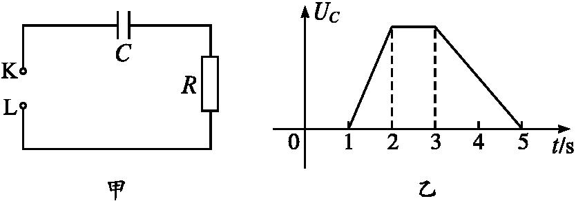

**17.** 图甲所示的电路中,K与L间接一智能电源,用以控制电容器*C*两端的电压*UC*。如果*UC*随时间*t*的变化如图乙所示,则下列描述电阻*R*两端电压*UR*随时间*t*变化的图像中,正确的是(　)

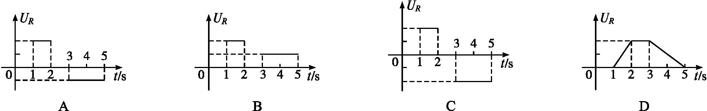

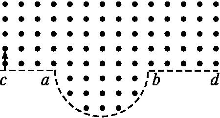

**18.** 一匀强磁场的磁感应强度大小为*B*,方向垂直于纸面向外,其边界如图中虚线所示,$\overset{⏜}{ab}$为半圆,*ac*、*bd*与直径*ab*共线,*ac*间的距离等于半圆的半径。一束质量为*m*、电荷量为*q(q\>*0)的粒子,在纸面内从*c*点垂直于*ac*射入磁场,这些粒子具有各种速率。不计粒子之间的相互作用。在磁场中运动时间最长的粒子,其运动时间为(　)

A.$\frac{7\pi m}{6qB}$ B.$\frac{5\pi m}{4qB}$
C.$\frac{4\pi m}{3qB}$ D.$\frac{3\pi m}{2qB}$

**19.** 下列核反应方程中,X1、X2、X3、X4代表α粒子的有(　)

A$._{1}^{2}H +_{1}^{2}H\text{→}_{0}^{1}$n+X1
B$._{1}^{2}H +_{1}^{3}H\text{→}_{0}^{1}$n+X2

C$._{92}^{235}U +_{0}^{1}n\text{→}_{56}^{144}$Ba$+_{36}^{89}$Kr+3X3
D$._{0}^{1}n +_{3}^{6}$Li$\text{→}_{1}^{3}$H+X4

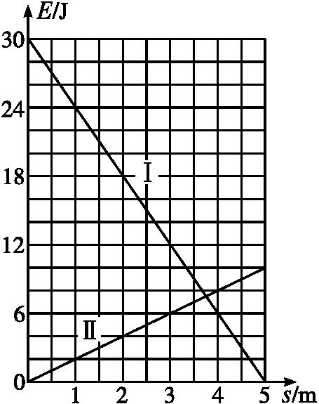

**20.** 一物块在高3.0 m、长5.0
m的斜面顶端从静止开始沿斜面下滑,其重力势能和动能随下滑距离*s*的变化如图中直线*Ⅰ*、*Ⅱ*所示,重力加速度取10
m/s2。则(　)

A.物块下滑过程中机械能不守恒

B.物块与斜面间的动摩擦因数为0.5

C.物块下滑时加速度的大小为6.0 m/s2

D.当物块下滑2.0 m时机械能损失了12 J

**21.** 如图所示,U形光滑金属框*abcd*置于水平绝缘平台上,*ab*和*dc*边平行,和*bc*边垂直。*ab*、*dc*足够长,整个金属框电阻可忽略。一根具有一定电阻的导体棒*MN*置于金属框上,用水平恒力*F*向右拉动金属框,运动过程中,装置始终处于竖直向下的匀强磁场中,*MN*与金属框保持良好接触,且与*bc*边保持平行。经过一段时间后(　)

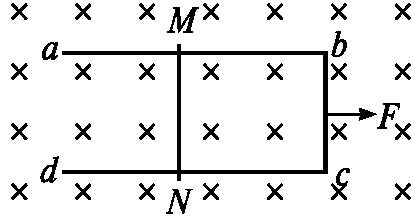

A.金属框的速度大小趋于恒定值

B.金属框的加速度大小趋于恒定值

C.导体棒所受安培力的大小趋于恒定值

D.导体棒到金属框*bc*边的距离趋于恒定值

三、非选择题:共**62**分。第**22***~***25**题为必考题,每个试题考生都必须作答。第**33***~***34**题为选考题,考生根据要求作答。

(一)必考题:共**47**分。

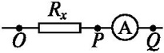

甲

**22.** (6分)某同学用伏安法测量一阻值为几十欧姆的电阻*Rx*,所用电压表的内阻为1
kΩ,电流表内阻为0.5
Ω。该同学采用两种测量方案,一种是将电压表跨接在图甲所示电路的*O*、*P*两点之间,另一种是跨接在*O*、*Q*两点之间。测量得到如图乙所示的两条*U-I*图线,其中*U*与*I*分别为电压表和电流表的示数。

回答下列问题:

(1)图乙中标记为*Ⅱ*的图线是采用电压表跨接在*<u>　　</u>*(选填“*O*、*P*”或“*O*、*Q*”)两点的方案测量得到的。 

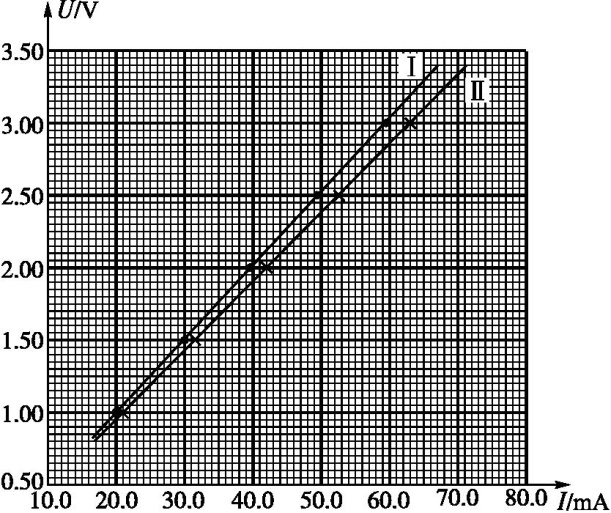

乙

(2)根据所用实验器材和图乙可判断,由图线*<u>　　</u>*(选填“*Ⅰ*”或“*Ⅱ*”)得到的结果更接近待测电阻的真实值,结果为*<u>　　</u>*
Ω(保留1位小数)。 

(3)考虑到实验中电表内阻的影响,需对(2)中得到的结果进行修正,修正后待测电阻的阻值为*<u>　　</u>*
Ω(保留1位小数)。 

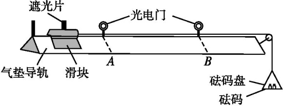

**23.** (9分)某同学用如图所示的实验装置验证动量定理,所用器材包括:气垫导轨、滑块(上方安装有宽度为*d*的遮光片)、两个与计算机相连接的光电门、砝码盘和砝码等。

实验步骤如下:

(1)开动气泵,调节气垫导轨,轻推滑块,当滑块上的遮光片经过两个光电门的遮光时间*<u>　　</u>*时,可认为气垫导轨水平; 

(2)用天平测砝码与砝码盘的总质量*m*1、滑块(含遮光片)的质量*m*2;

(3)用细线跨过轻质定滑轮将滑块与砝码盘连接,并让细线水平拉动滑块;

(4)令滑块在砝码和砝码盘的拉动下从左边开始运动,和计算机连接的光电门能测量出遮光片经过*A*、*B*两处的光电门的遮光时间Δ*t*1、Δ*t*2及遮光片从*A*运动到*B*所用的时间*t*12;

(5)在遮光片随滑块从*A*运动到*B*的过程中,如果将砝码和砝码盘所受重力视为滑块所受拉力,拉力冲量的大小*I=<u>　　</u>*,滑块动量改变量的大小Δ*p=<u>　　</u>*;(用题中给出的物理量及重力加速度*g*表示) 

(6)某次测量得到的一组数据为:*d=*1.000
cm,*m*1=1.50×10-2
kg,*m*2=0.400
kg,Δ*t*1=3.900×10-2
s,Δ*t*2=1.270×10-2
s,*t*12=1.50 s,*g*取9.80
m/s2。计算可得*I=<u>　　　</u>*
N·s,Δ*p=<u>　　</u>* kg·m/s;(结果均保留3位有效数字) 

(7)定义*δ=*$\left| \frac{I-\Delta p}{I} \right|$×100%,本次实验*δ=<u>　　</u>*%(保留1位有效数字)。 

**24.** (12分)我国自主研制了运-20重型运输机。飞机获得的升力大小*F*可用*F=kv*2描写,*k*为系数;*v*是飞机在平直跑道上的滑行速度,*F*与飞机所受重力相等时的*v*称为飞机的起飞离地速度。已知飞机质量为1.21×105
kg时,起飞离地速度为66 m/s;装载货物后质量为1.69×105
kg,装载货物前后起飞离地时的*k*值可视为不变。

(1)求飞机装载货物后的起飞离地速度。

(2)若该飞机装载货物后,从静止开始匀加速滑行1 521
m起飞离地,求飞机在滑行过程中加速度的大小和所用的时间。

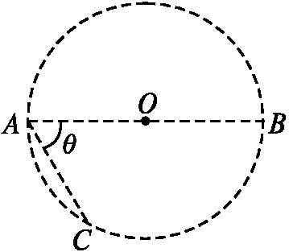

**25.** (20分)在一柱形区域内有匀强电场,柱的横截面是以*O*为圆心、半径为*R*的圆,*AB*为圆的直径,如图所示。质量为*m*、电荷量为*q(q\>*0)的带电粒子在纸面内自*A*点先后以不同的速度进入电场,速度方向与电场的方向垂直。已知刚进入电场时速度为零的粒子,自圆周上的*C*点以速率*v*0穿出电场,*AC*与*AB*的夹角*θ=*60°。运动中粒子仅受电场力作用。

(1)求电场强度的大小。

(2)为使粒子穿过电场后的动能增量最大,该粒子进入电场时的速度应为多大?

(3)为使粒子穿过电场前后动量变化量的大小为*mv*0,该粒子进入电场时的速度应为多大?

(二)选考题:共**15**分。请考生从**2**道物理题中任选一题作答。如果多做,则按所做的第一题计分。

**33.** \[物理——选修3-3\](15分)

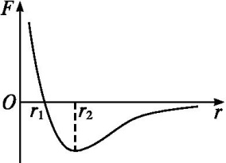

(1)(5分)分子间作用力*F*与分子间距*r*的关系如图所示,*r=r*1时,*F=*0。分子间势能由*r*决定,规定两分子相距无穷远时分子间的势能为零。若一分子固定于原点*O*,另一分子从距*O*点很远处向*O*点运动,在两分子间距减小到*r*2的过程中,势能*<u>　　</u>*(选填“减小”“不变”或“增大”);在间距由*r*2减小到*r*1的过程中,势能*<u>　　</u>*(选填“减小”“不变”或“增大”);在间距等于*r*1处,势能*<u>　　</u>*(选填“大于”“等于”或“小于”)零。 

(2)(10分)甲、乙两个储气罐储存有同种气体(可视为理想气体)。甲罐的容积为*V*,罐中气体的压强为*p*;乙罐的容积为2*V*,罐中气体的压强为$\frac{1}{2}$*p*。现通过连接两罐的细管把甲罐中的部分气体调配到乙罐中去,两罐中气体温度相同且在调配过程中保持不变,调配后两罐中气体的压强相等。求调配后

(*ⅰ*)两罐中气体的压强;

(*ⅱ*)甲罐中气体的质量与甲罐中原有气体的质量之比。

**34.** \[物理——选修3-4\](15分)

(1)(5分)在下列现象中,可以用多普勒效应解释的有*<u>　　</u>*。(填正确答案标号。选对1个得2分,选对2个得4分,选对3个得5分;每选错1个扣3分,最低得分为0分) 

A.雷雨天看到闪电后,稍过一会儿才能听到雷声

B.超声波被血管中的血流反射后,探测器接收到的超声波频率发生变化

C.观察者听到远去的列车发出的汽笛声,音调会变低

D.同一声源发出的声波,在空气和水中传播的速度不同

E.天文学上观察到双星(相距较近、均绕它们连线上某点做圆周运动的两颗恒星)光谱随时间的周期性变化

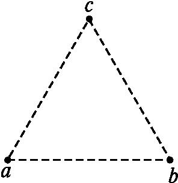

(2)(10分)一振动片以频率*f*做简谐振动时,固定在振动片上的两根细杆同步周期性地触动水面上*a*、*b*两点,两波源发出的波在水面上形成稳定的干涉图样,*c*是水面上的一点,*a*、*b*、*c*间的距离均为*l*,如图所示。已知除*c*点外,在*ac*连线上还有其他振幅极大的点,其中距*c*最近的点到*c*的距离为$\frac{3}{8}$*l*。求:

(*ⅰ*)波的波长;

(*ⅱ*)波的传播速度。

**答案与解析*

*2020**年物理(全国卷Ⅰ)

查缺补漏表

<table style="width:58%;">
<colgroup>
<col style="width: 2%" />
<col style="width: 2%" />
<col style="width: 19%" />
<col style="width: 16%" />
<col style="width: 5%" />
<col style="width: 6%" />
<col style="width: 4%" />
</colgroup>
<thead>
<tr>
<th>题号</th>
<th>分值</th>
<th>知识方法</th>
<th>能力要求</th>
<th>学科素养</th>
<th>教材出处</th>
<th>查缺补漏</th>
</tr>
</thead>
<tbody>
<tr>
<td>14</td>
<td>6</td>
<td>能量守恒、动量定理</td>
<td>理解能力、应用能力</td>
<td>物理观念</td>
<td>必修2、选修1</td>
<td></td>
</tr>
<tr>
<td>15</td>
<td>6</td>
<td>万有引力定律应用</td>
<td>理解能力、应用能力</td>
<td>
科学思维

物理观念
</td>
<td>必修2</td>
<td></td>
</tr>
<tr>
<td>16</td>
<td>6</td>
<td>牛顿第二定律、圆周运动</td>
<td>基本知识、基本方法的运用能力</td>
<td>
科学思维

物理观念
</td>
<td>必修1、必修2</td>
<td></td>
</tr>
<tr>
<td>17</td>
<td>6</td>
<td>电容器、电流</td>
<td>分析综合能力</td>
<td>
科学思维

物理观念
</td>
<td>必修3</td>
<td></td>
</tr>
<tr>
<td>18</td>
<td>6</td>
<td>带电粒子在磁场中运动</td>
<td>分析综合能力</td>
<td>
科学思维

物理观念
</td>
<td>选修2</td>
<td></td>
</tr>
<tr>
<td>19</td>
<td>6</td>
<td>核反应方程</td>
<td>理解能力</td>
<td>物理观念</td>
<td>选修3</td>
<td></td>
</tr>
<tr>
<td>20</td>
<td>6</td>
<td>牛顿运动定律、动能定理、机械能</td>
<td>理解能力、分析综合能力</td>
<td>
科学思维

物理观念
</td>
<td>必修1、必修2</td>
<td></td>
</tr>
<tr>
<td>21</td>
<td>6</td>
<td>电磁感应</td>
<td>分析综合能力</td>
<td>
科学思维

物理观念
</td>
<td>必修3、选修2</td>
<td></td>
</tr>
<tr>
<td>22</td>
<td>6</td>
<td>伏安法测电阻</td>
<td>实验探究能力</td>
<td>
科学探究

科学态度与责任
</td>
<td>必修3</td>
<td></td>
</tr>
<tr>
<td>23</td>
<td>9</td>
<td>验证动量定理</td>
<td>实验探究能力</td>
<td>
科学思维

科学探究

科学态度与责任
</td>
<td>选修1</td>
<td></td>
</tr>
<tr>
<td>24</td>
<td>12</td>
<td>匀变速直线运动规律、受力分析</td>
<td>考查考生灵活运用相关知识解决实际问题的能力</td>
<td>
科学思维

物理观念
</td>
<td>必修1</td>
<td></td>
</tr>
<tr>
<td>25</td>
<td>20</td>
<td>考查带电粒子在电场中的类平抛运动、动量</td>
<td>考查考生灵活运用相关知识解决问题的能力</td>
<td>
科学思维

物理观念
</td>
<td>必修3、选修1</td>
<td></td>
</tr>
<tr>
<td>33</td>
<td>15</td>
<td>考查分子力和分子势能、玻意耳定律</td>
<td>分析综合能力</td>
<td>
科学思维

物理观念
</td>
<td>选修3</td>
<td></td>
</tr>
<tr>
<td>34</td>
<td>15</td>
<td>考查多普勒效应、波的干涉、描述机械波的物理量的关系</td>
<td>
分析综合能力

理解能力
</td>
<td>
科学思维

物理观念
</td>
<td>选修1</td>
<td></td>
</tr>
</tbody>
</table>

【试题分析】2020年全国卷Ⅰ理综物理试题保持稳定,和2019年相比增加了对基本概念与原理考查的题目,考题科学、合理,灵活性较强,侧重基础及应用,整体难度有所下降,但对运算能力要求较高。在选择题、实验题、计算题三类题型中几乎没有拔高性的题目。试题以“力学”部分与“电磁学”部分为核心,突出对中学物理的主干知识和物理学科核心素养的考查。力学重基础,电磁学深挖掘。

从题型上来看,题目数量和2019年一样,实验题调整为“小力大电”的模式,考查比较基础。

整套试卷运算量比去年增加较多,重视数学几何知识在物理中的应用。

**14.** D　本题命题背景来源于生活实际,在充分考虑安全气囊的作用下,利用动量定理来解释。安全气囊延长了司机减速到零的时间,安全气囊弹出后增大了司机的受力面积,碰撞前后司机动量的变化量都为Δ*p=p'-p=*0*-p*,并没有改变;由动量定理可知,*Ft=*Δ*p,t*增加,司机受力变小,选项D正确,选项A、B错误。汽车最后速度为零,司机的动能不可能转化为汽车的动能,司机的动能转化为内能和气囊的弹性势能,选项C错误。

**15.** B　本题以物体为研究对象,利用万有引力定律分析求解。设地球质量为*m*地,地球半径为*r*地,则火星的质量为$\frac{m_{\text{地}}}{10}$,火星半径为$\frac{r_{\text{地}}}{2}$,物体质量为*m*。由万有引力定律可知,在火星表面*F*火万=$\frac{Gm_{\text{地}}m}{10\left( \frac{r_{\text{地}}}{2} \right)^{2}}$,在地球表面*F*地万=$\frac{Gm_{\text{地}}m}{{r_{\text{地}}}^{2}}$,所以同一物体在火星表面与在地球表面受到的引力的比值约为0.4,选项B正确。

**16.** B　本题以同学和秋千踏板整体为研究对象,在最低点根据牛顿第二定律求解。在最低点由2*F*T*-mg=*$\frac{mv^{2}}{l}$得,绳子的拉力*F*T=410
N,选项B正确。

**17.** A　本题由利用比值求电流的公式分析求得电路中的电流,再根据部分电路欧姆定律定量分析电阻*R*两端的电压即可。由*C=*$\frac{Q}{U_{C}} = \frac{\Delta Q}{\Delta U_{C}}$可得,Δ*Q=C*Δ*UC*,电容器不符合欧姆定律的适用条件,电流*i=*$\frac{\Delta Q}{\Delta t}$*=C*$\frac{\Delta U_{C}}{\Delta t}$;电阻*R*符合欧姆定律的适用条件,两端电压*UR=iR=CR*$\frac{\Delta U_{C}}{\Delta t}$;由图像可知,在0*~*1
s和2~3
s两段时间内,电压恒定,$\frac{\Delta U_{C}}{\Delta t}$=0,电阻R两端的电压必为零;1~2
s内,*R*两端电压*UR*1*=CR*$\frac{\Delta U_{C1}}{\Delta t_{1}} = \frac{CRU_{C}}{1s}$,3*~*5
s内,*R*两端电压*UR*2*=CR*$\frac{\Delta U_{C2}}{\Delta t_{2}} = \frac{-CRU_{C}}{2s}$,负号表示电流方向与原电流方向相反,所以1*~*2
s和3~5 s两段时间内,电阻*R*两端电压之比为2*∶*1,所以选项A正确。

**18.** C　本题带电粒子在半圆形磁场中运动的最长时间为六分之一周期。粒子在磁场中做匀速圆周运动*qBv=*$\frac{mv^{2}}{r}$,*T=*$\frac{2\pi r}{v}$,可得粒子在磁场中的周期*T=*$\frac{2\pi m}{qB}$,粒子在磁场中运动的时间*t=*$\frac{\theta}{2\pi}$·*T=*$\frac{\theta m}{qB}$,则粒子在磁场中运动的时间与速度无关,轨迹对应的圆心角越大,运动时间越长。采用放缩圆解决该问题,粒子垂直*ac*射入磁场,则轨迹圆心必在*ac*直线上,将粒子的轨迹半径由零逐渐增大。设$\overset{⏜}{ab}$所在半圆的半径为*R*,当半径*r*≤0.5*R*和*r*≥1.5*R*时,粒子分别从*ac*、*bd*区域射出,磁场中的轨迹为半圆,运动时间等于半个周期。

当0.5*R\<r\<*1.5*R*时,粒子从半圆边界射出,将轨迹半径从0.5*R*逐渐增大,粒子射出位置从半圆顶端向下移动,轨迹对应的圆心角从π逐渐增大,当轨迹半径为*R*时,轨迹对应的圆心角最大,然后再增大轨迹半径,轨迹对应的圆心角减小,因此当轨迹半径等于*R*时轨迹对应的圆心角最大,即轨迹对应的最大圆心角*θ=*π+$\frac{\pi}{3} = \frac{4}{3}$π,粒子运动最长时间为*t=*$\frac{\theta}{2\pi}$*T=*$\frac{\frac{4}{3}\pi}{2\pi} \times \frac{2\pi m}{qB} = \frac{4\pi m}{3qB}$,C正确。

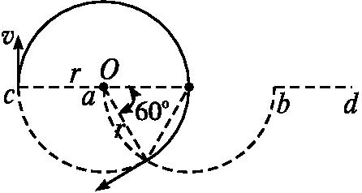

**19.** BD　本题可根据核反应方程质量数和电荷数守恒分析。根据核反应前后质量数和电荷数守恒分析可知,A项中的X1为$\ _{2}^{3}$He,B项中的X2为$\ _{2}^{4}$He,C项中的X3为$\ _{0}^{1}$n,D项中的X4为$\ _{2}^{4}$He。选项B、D正确。

**20.** AB　本题可根据图像分析出物块下滑过程中损失的机械能。由图像可知,物块在斜面顶端时重力势能为30
J,物块滑到斜面底端时动能为10 J,该过程损失了20
J的机械能,所以物块下滑过程中机械能不守恒,选项A正确;物块在斜面顶端时,*mgh=*30
J,在下滑全过程中由能量守恒得*μmg*cos *θ*·*s=*20 J,解得*m=*1
kg,*μ=*0.5,选项B正确;物块下滑时*mg*sin *θ-μmg*cos *θ=ma*,解得*a=*2.0
m/s2,选项C错误;物块下滑2.0 m时损失的机械能为*Q=μmg*cos
*θ*·*s=*0.5×10×0.8×2.0 J=8 J,选项D错误。

**21.** BC　由*bc*边切割磁感线产生电动势,形成电流,使得导体棒*MN*受到向右的安培力,做加速运动,*bc*边受到向左的安培力,向右做加速运动。当*MN*运动时,金属框的*bc*边和导体棒*MN*一起切割磁感线,设导体棒*MN*和金属框的速度分别为*v*1、*v*2,则电路中的电动势

*E=Bl(v*2*-v*1)

电路中的电流

*I=*$\frac{E}{R} = \frac{Bl(v_{2}-v_{1})}{R}$

金属框和导体棒*MN*受到的安培力分别为

*F*安框=$\frac{B^{2}l^{2}(v_{2}-v_{1})}{R}$,与运动方向相反

*F*安*MN*=$\frac{B^{2}l^{2}(v_{2}-v_{1})}{R}$,与运动方向相同

设导体棒*MN*和金属框的质量分别为*m*1、*m*2,则对导体棒*MN*有

$\frac{B^{2}l^{2}(v_{2}-v_{1})}{R}$*=m*1*a*1

对金属框有

*F-*$\frac{B^{2}l^{2}(v_{2}-v_{1})}{R}$*=m*2*a*2

初始速度均为零,则*a*1从零开始逐渐增加,*a*2从$\frac{F}{m_{2}}$开始逐渐减小。当*a*1*=a*2时,相对速度*v*2*-v*1=$\frac{FRm_{1}}{B^{2}l^{2}(m_{1} + m_{2})}$大小恒定。

整个运动过程用速度—时间图像描述如下。

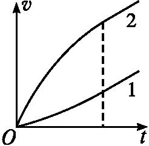

综上可得,金属框的加速度趋于恒定值,安培力也趋于恒定值,B、C正确;

金属框的速度会一直增大,导体棒到金属框*bc*边的距离也会一直增大,A、D错误。

**22.** 答案 (1)*O*、*P　*(2)*Ⅰ　*50.5　(3)50.0

解析
找清楚误差产生的原因,在电流相等的情况下,跨接在“*O*、*Q*”两点间的电压表的示数比跨接在“*O*、*P*”两点间的电压表的示数大。(1)在电流相等的情况下,跨接在“*O*、*P*”两点间的电压表的示数比跨接在“*O*、*Q*”两点间的电压表的示数小,所以题图乙中标记为*Ⅱ*的图线是采用电压表跨接在“*O*、*P*”两点间的方案测量得到的。(2)由*R=*$\frac{\Delta U}{\Delta I}$,根据图线*Ⅰ*,可知电阻阻值为50.5
Ω,该电阻为大电阻,电流表采取内接法得到的测量值更接近真实值。即由图线Ⅰ得到的结果更接近待测电阻的真实值。所以其结果为50.5
Ω。(3)因为测量值为待测电阻和电流表串联的阻值,修正后的待测电阻的值为50.5
Ω-0.5 Ω=50.0 Ω。

易错警示 注意有效数字的位数和图线上点的选取。

**23.** 答案
(1)大约相等　(5)*m*1*gt*12*　m*2$\left( \frac{d}{\Delta t_{2}}-\frac{d}{\Delta t_{1}} \right)$

(6)0.221　0.212　(7)4

解析
根据题目给出的物理量,利用冲量的定义式求冲量;利用极限思想求出滑块通过*A*、*B*两个光电门时的速度。

(1)气垫导轨水平时,滑块在导轨上做匀速直线运动,所以当滑块通过两个光电门的时间大约相等时,可认为气垫导轨水平。

(5)根据题干可知,拉力*F=m*1*g*,根据冲量的定义可得,拉力的冲量*I=m*1*gt*12;滑块通过光电门*A*的速度*vA=*$\frac{d}{\Delta t_{1}}$,通过光电门*B*的速度*vB=*$\frac{d}{\Delta t_{2}}$,所以滑块动量的改变量Δ*p=m*2$\left( \frac{d}{\Delta t_{2}}-\frac{d}{\Delta t_{1}} \right)$。

(6)把题干中的数据代入*I=m*1*gt*12,可知*I=*0.221
N·s;把题干中的数据代入Δ*p=m*2$\left( \frac{d}{\Delta t_{2}}-\frac{d}{\Delta t_{1}} \right)$,可得Δ*p=*0.212
kg·m/s。

(7)把(6)中的数据代入*δ=*$\left| \frac{I-\Delta p}{I} \right|$×100%可得*δ=*4%。

易错警示 注意有效数字的位数和单位间的换算。

**24.** 答案 (1)78 m/s　 (2)2.0 m/s2　39 s

解析
(1)设飞机装载货物前质量为*m*1,起飞离地速度为*v*1;装载货物后质量为*m*2,起飞离地速度为*v*2,重力加速度大小为*g*。飞机起飞离地应满足条件

*m*1*g=k*${v_{1}}^{2}$*①

m*2*g=k*${v_{2}}^{2}$*②*

由*①②*式及题给条件得*v*2=78 m/s。*③*

(2)设飞机滑行距离为*s*,滑行过程中加速度大小为*a*,所用时间为*t*。由匀变速直线运动公式有

${v_{2}}^{2}$=2*as④

v*2*=at⑤*

联立*③④⑤*式及题给条件得

*a=*2.0 m/s2*⑥

t=*39 s。*⑦*

**25.** 答案
(1)$\frac{m{v_{0}}^{2}}{2qR}$　(2)$\frac{\sqrt{2}}{4}$*v*0　(3)0或$\frac{\sqrt{3}}{2}$*v*0

解析
(1)粒子初速度为零,由*C*点射出电场,故电场方向与*AC*平行,由*A*指向*C*。由几何关系和电场强度的定义知

*lAC=R①

F=qE②*

由动能定理有*F*·*lAC=*$\frac{1}{2}m{v_{0}}^{2}$*③*

联立*①②③*式得*E=*$\frac{m{v_{0}}^{2}}{2qR}$。*④*

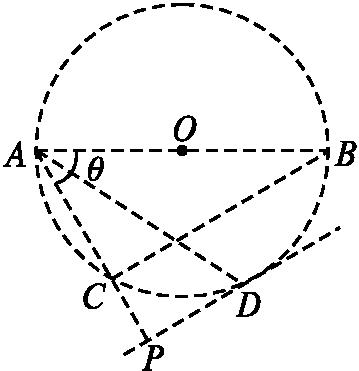

(2)如图所示,由几何关系知*AC*⊥*BC*,故电场中的等势线与*BC*平行。作与*BC*平行的直线与圆相切于*D*点,与*AC*的延长线交于*P*点,则自*D*点从圆周上穿出的粒子的动能增量最大。由几何关系知

∠*PAD=*30°,*lAP=*$\frac{3}{2}$*R,lDP=*$\frac{\sqrt{3}}{2}$*R⑤*

设粒子以速度*v*1进入电场时动能增量最大,在电场中运动的时间为*t*1。粒子在*AC*方向做加速度为*a*的匀加速运动,运动的距离等于*lAP*;在垂直于*AC*的方向上做匀速运动,运动的距离等于*lDP*。由牛顿第二定律和运动学公式有

*F=ma⑥

lAP=*$\frac{1}{2}a{t_{1}}^{2}$*⑦

lDP=v*1*t*1*⑧*

联立*②④⑤⑥⑦⑧*式得*v*1=$\frac{\sqrt{2}}{4}$*v*0。*⑨*

(3)设粒子以速度*v*进入电场时,在电场中运动的时间为*t*。以*A*为原点,粒子进入电场的方向为*x*轴正方向,电场方向为*y*轴正方向建立直角坐标系。由运动学公式有

*y=*$\frac{1}{2}$*at*2*⑩

x=vt*

粒子离开电场的位置在圆周上,有

$\left( x-\frac{\sqrt{3}}{2}R \right)^{2} + \left( y-\frac{1}{2}R \right)^{2}$*=R*2

粒子在电场中运动时,其*x*方向的动量不变,*y*方向的初始动量为零。设穿过电场前后动量变化量的大小为*mv*0的粒子,离开电场时其*y*方向的速度分量为*v*2,由题给条件及运动学公式有

*mv*2*=mv*0*=mat*

联立*②④⑥⑩*式得

*v=*0

或*v=*$\frac{\sqrt{3}}{2}$*v*0。

另解:由题意知,初速度为0时,动量增量的大小为*mv*0,此即问题的一个解。自*A*点以不同的速率垂直于电场方向射入电场的粒子,沿*y*方向位移相等时,所用时间都相同。因此,不同粒子运动到线段*CB*上时,动量变化都相同,自*B*点射出电场的粒子,其动量变化也为*mv*0。由几何关系及运动学规律可得,此时入射速率*v=*$\frac{\sqrt{3}}{2}$*v*0。

**33.** 答案
(1)减小　减小　小于　(2)(*ⅰ*)$\frac{2p}{3}$　(*ⅱ*)$\frac{2}{3}$

解析
(1)根据分子力做功和分子势能变化的关系分析。两分子相距无穷远时分子间的势能为零,在两分子间距减小到*r*1的过程中,分子力是引力,分子力做正功,分子势能一直减小,在间距等于*r*1时,分子势能小于零。

(2)以气体为研究对象,由于气体温度不变,由玻意耳定律分析。

(*ⅰ*)假设乙罐中的气体被压缩到压强为*p*,其体积变为*V*1,由玻意耳定律有

$\frac{1}{2}$*p*(2*V)=pV*1*①*

现两罐气体压强均为*p*,总体积为(*V+V*1)。设调配后两罐中气体的压强为*p'*,由玻意耳定律有

*p(V+V*1)*=p'(V+*2*V)②*

联立*①②*式可得

*p'=*$\frac{2}{3}$*p*。*③

(ⅱ*)若调配后甲罐中的气体再被压缩到原来的压强*p*时,体积为*V*2,由玻意耳定律

*p'V=pV*2*④*

设调配后甲罐中气体的质量与甲罐中原有气体的质量之比为*k*,由密度的定义有

*k=*$\frac{V_{2}}{V}$*⑤*

联立*③④⑤*式可得

*k=*$\frac{2}{3}$。*⑥*

**34.** 答案 (1)BCE　(2)(*ⅰ*)$\frac{l}{4}$　(*ⅱ*)$\frac{fl}{4}$

解析 (1)根据多普勒效应的概念或者利用排除法。
雷雨天看到闪电后过一会儿才能听到雷声,是因为在空气中光的传播速度比声音大,选项A不符合题意。机械波的传播速度是由介质决定的,同一声波在空气和水中传播的速度不同与多普勒效应无关,选项D不符合题意。选项B、C、E符合题意。

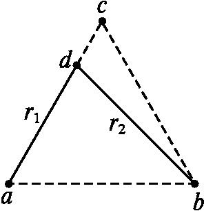

(2)根据几何关系找出距离差,振幅极大是振动加强点,利用振动加强点的条件分析。

(*ⅰ*)如图所示,设距*c*点最近的振幅极大的点为*d*点,*a*与*d*的距离为*r*1,*b*与*d*的距离为*r*2,*d*与*c*的距离为*s*,波长为*λ*。则

*r*2*-r*1*=λ①*

由几何关系有

*r*1*=l-s②*

${r_{2}}^{2}$=(*r*1sin
60°)2+(*l-r*1cos 60°)2*③*

联立*①②③*式并代入题给数据得

*λ=*$\frac{1}{4}$*l*。*④

(ⅱ*)波的频率为*f*,设波的传播速度为*v*,有

*v=fλ⑤*

联立*④⑤*式得

*v=*$\frac{fl}{4}$。*⑥*
