# 2021 年湖南卷 · 物理

> **卷别**：湖南自主命题　|　**含解析**：是　|　**来源**：物理备课大师（wl.eywedu.com）Word 版含解析
> **说明**：由官方 Word 版转换，公式为 LaTeX，图片见同目录 `images/`。

---

**2021**年普通高等学校招生全国统一考试(湖南卷)

物理

一、选择题:本题共6小题,每小题4分,共24分。在每小题给出的四个选项中,只有一项是符合题目要求的。

　　　　　　　　　

**1.** (2021·湖南,1,4分)核废料具有很强的放射性,需要妥善处理。下列说法正确的是(　)

A.放射性元素经过两个完整的半衰期后,将完全衰变殆尽

B.原子核衰变时电荷数守恒,质量数不守恒

C.改变压力、温度或浓度,将改变放射性元素的半衰期

D.过量放射性辐射对人体组织有破坏作用,但辐射强度在安全剂量内则没有伤害

解析
D　本题考查对半衰期概念的理解。半衰期是统计概念,指大量放射性元素的原子核衰变一半所用的时间,其表达式可写成*N=N*<sub>0</sub>$\left( \frac{1}{2} \right)^{\frac{t}{\tau}}$,由此可知选项A错误。原子核衰变时核电荷数守恒,质量数守恒,选项B错误。放射性元素的半衰期与压力、温度、浓度等外部条件无关,选项C错误。

**2.** (2021·湖南,2,4分)物体的运动状态可用位置*x*和动量*p*描述,称为相,对应*p-x*图像中的一个点。物体运动状态的变化可用*p-x*图像中的一条曲线来描述,称为相轨迹。假如一质点沿*x*轴正方向做初速度为零的匀加速直线运动,则对应的相轨迹可能是(　)

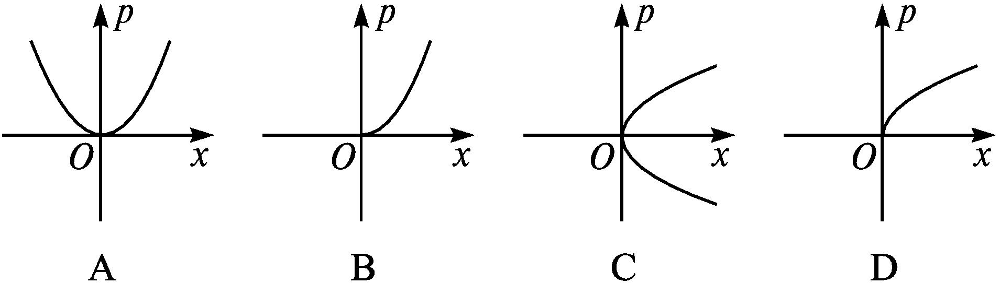

解析
D　本题考查对运动图像的理解和新概念的学习能力。动量*p=mv*,质点做初速度为零的匀加速直线运动,有*v*<sup>2</sup>=2*ax*,联立解得*p=m*$\sqrt{2ax}$,由此可知选项D正确,A、B、C错误。

**3.** (2021·湖南,3,4分)“复兴号”动车组用多节车厢提供动力,从而达到提速的目的。总质量为*m*的动车组在平直的轨道上行驶。该动车组有四节动力车厢,每节车厢发动机的额定功率均为*P*,若动车组所受的阻力与其速率成正比(*F*<sub>阻</sub>*=kv,k*为常量),动车组能达到的最大速度为*v*<sub>m</sub>。下列说法正确的是(　)

A.动车组在匀加速启动过程中,牵引力恒定不变

B.若四节动力车厢输出功率均为额定值,则动车组从静止开始做匀加速运动

C.若四节动力车厢输出的总功率为2.25*P*,则动车组匀速行驶的速度为$\frac{3}{4}$*v*<sub>m</sub>

D.若四节动力车厢输出功率均为额定值,动车组从静止启动,经过时间*t*达到最大速度*v*<sub>m</sub>,则这一过程中该动车组克服阻力做的功为$\frac{1}{2}m{v_{m}}^{2}$*-Pt*

解析
C　本题考查机车启动问题,考查分析综合能力。动车组匀加速启动过程中,根据牛顿第二定律,有*F-kv=ma*,因为加速度*a*不变,速度*v*改变,所以牵引力*F*改变,选项A错误。由四节动力车厢输出功率均为额定值,可得4*P=Fv,F-kv=ma'*,联立解得*a'=*$\frac{4P}{mv} - \frac{kv}{m}$,因为*v*改变,所以*a'*改变,选项B错误。由题干得4*P=F*<sub>阻</sub>*v*<sub>m</sub>*=k*${v_{m}}^{2}$,若输出总功率为2.25*P*,则有2.25*P=k*${v_{\text{匀}}}^{2}$,联立解得*v*<sub>匀</sub>=$\frac{3}{4}$*v*<sub>m</sub>,选项C正确。若四节动力车厢输出功率均为额定值,根据动能定理得,4*Pt-W*<sub>阻</sub>=$\frac{1}{2}m{v_{m}}^{2}$-0,解得*W*<sub>阻</sub>=4*Pt-*$\frac{1}{2}m{v_{m}}^{2}$,选项D错误。

**4.** (2021·湖南,4,4分)如图所示,在(*a*,0)位置放置电荷量为*q*的正点电荷,在(0,*a*)位置放置电荷量为*q*的负点电荷,在距*P(a,a*)为$\sqrt{2}$*a*的某点处放置正点电荷*Q*,使得*P*点的电场强度为零。则*Q*的位置及电荷量分别为(　)

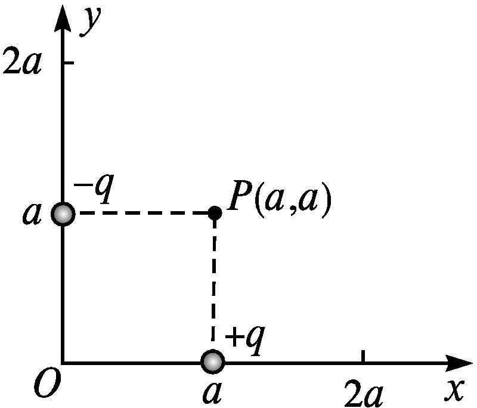

A.(0,2*a*),$\sqrt{2}$*q*

B.(0,2*a*),2$\sqrt{2}$*q*

C.(2*a*,0),$\sqrt{2}$*q*

D.(2*a*,0),2$\sqrt{2}$*q*

解析
B　本题考查电场强度的叠加,考查推理分析能力。如图所示,*-q*、*q*在*P*点的合电场强度为*E*<sub>1</sub>=$\sqrt{2}k\frac{q}{a^{2}}$,与水平方向夹角为45°。因为*P*点电场强度为零,所以*Q*必在*E*<sub>1</sub>的方向上,由几何关系得*Q*的坐标为(0,2*a*),在*P*点满足$\sqrt{2}k\frac{q}{a^{2}}$*=k*$\frac{Q}{(\sqrt{2}a)^{2}}$,解得*Q=*2$\sqrt{2}$*q*,选项B正确。

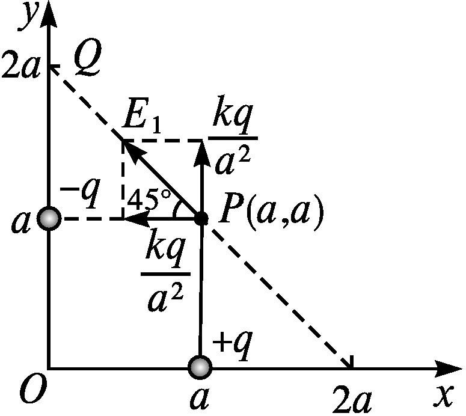

**5.** (2021·湖南,5,4分)质量为*m'*的凹槽静止在水平地面上,内壁为半圆柱面,截面如图所示,*A*为半圆的最低点,*B*为半圆水平直径的端点。凹槽恰好与竖直墙面接触,内有一质量为*m*的小滑块。用推力*F*推动小滑块由*A*点向*B*点缓慢移动,力*F*的方向始终沿圆弧的切线方向,在此过程中所有摩擦均可忽略,下列说法正确的是(　)

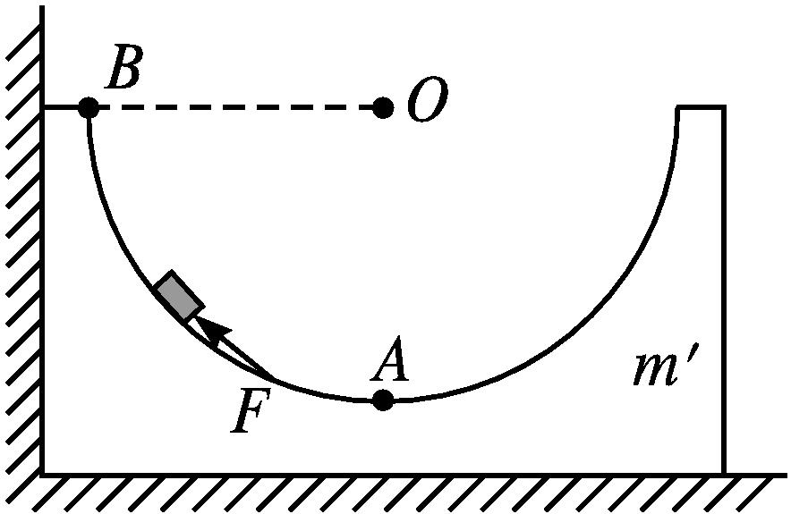

A.推力*F*先增大后减小

B.凹槽对滑块的支持力先减小后增大

C.墙面对凹槽的压力先增大后减小

D.水平地面对凹槽的支持力先减小后增大

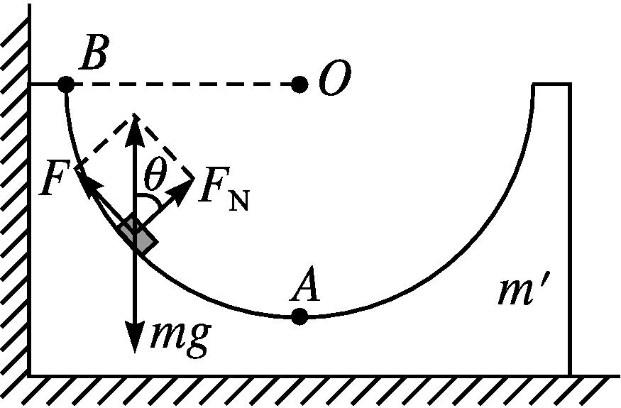

解析
C　本题考查动态平衡问题,考查推理分析能力。如图所示,在任意位置,对小滑块受力分析,设*F*<sub>N</sub>与竖直方向的夹角为*θ*,根据平衡条件有*F*<sub>N</sub>*=mg*cos
*θ*,推力*F=mg*sin
*θ*。由*A*向*B*移动过程中,*θ*角增大,所以推力*F*增大,*F*<sub>N</sub>减小,选项A、B错误。选小滑块和凹槽整体为研究对象,推力在水平方向的分力*F*<sub>水平</sub>*=F*cos
*θ=mg*sin *θ*cos
*θ=*$\frac{mgsin2\theta}{2}$,先增大后减小,所以墙面对凹槽的压力先增大后减小,选项C正确。推力在竖直方向的分力*F*<sub>竖</sub>*=F*sin
*θ=mg*sin<sup>2</sup>*θ*,增大,故水平地面对凹槽的支持力*F*<sub>支</sub>=(*m+m')g-F*<sub>竖</sub>减小,选项D错误。

**6.** (2021·湖南,6,4分)如图所示,理想变压器原、副线圈匝数比为*n*<sub>1</sub>*∶n*<sub>2</sub>,输入端*C*、*D*接入电压有效值恒定的交流电源,灯泡L<sub>1</sub>、L<sub>2</sub>的阻值始终与定值电阻*R*<sub>0</sub>的阻值相同。在滑动变阻器*R*的滑片从*a*端滑动到*b*端的过程中,两个灯泡始终发光且工作在额定电压以内,下列说法正确的是(　)

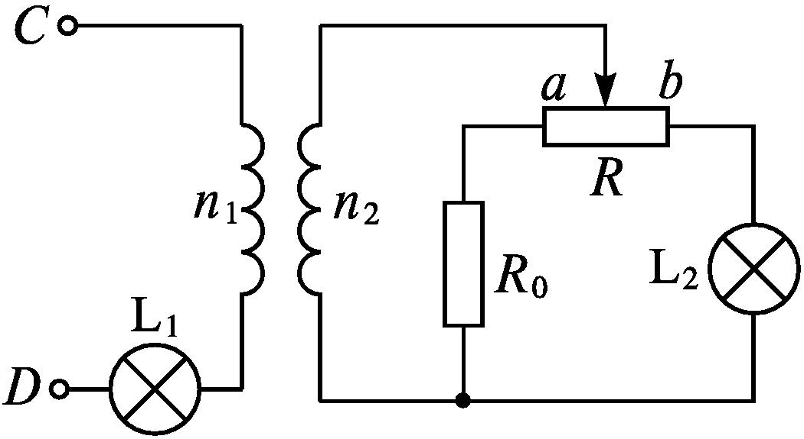

A.L<sub>1</sub>先变暗后变亮,L<sub>2</sub>一直变亮

B.L<sub>1</sub>先变亮后变暗,L<sub>2</sub>一直变亮

C.L<sub>1</sub>先变暗后变亮,L<sub>2</sub>先变亮后变暗

D.L<sub>1</sub>先变亮后变暗,L<sub>2</sub>先变亮后变暗

解析
A　本题考查变压器动态分析问题,考查分析推理能力。在滑片从*a*向*b*滑动过程中,根据串并联电路特点可知,变压器负载电阻先增大后减小,滑片在中间时,电阻最大;将变压器等效成用电器,等效电阻为*R'=*$\frac{{n_{1}}^{2}}{{n_{2}}^{2}}$*R*<sub>负</sub>,根据闭合电路欧姆定律可知,流过L<sub>1</sub>的电流*I*<sub>1</sub>先减小后增大,所以L<sub>1</sub>先变暗后变亮。滑片从*a*向*b*滑动过程中,滑到中点前,由于*I*<sub>1</sub>减小,L<sub>1</sub>两端电压减小,变压器原线圈两端电压*U*<sub>1</sub>增大,副线圈两端电压*U*<sub>2</sub>增大,对于L<sub>2</sub>所在支路,电阻减小,所以电流增大,L<sub>2</sub>变亮。滑片滑到中点后,由于*I*<sub>1</sub>增大,*U*<sub>1</sub>将减小,*U*<sub>2</sub>也减小,*R*<sub>0</sub>所在支路电阻在增大,电流减小,而由于*I*<sub>1</sub>增大,副线圈中电流也增大,所以流过L<sub>2</sub>的电流增大,因此L<sub>2</sub>一直变亮,选项A正确。

二、选择题:本题共4小题,每小题5分,共20分。在每小题给出的四个选项中,有多项符合题目要求。全部选对的得5分,选对但不全的得3分,有选错的得0分。

**7.** (2021·湖南,7,5分)2021年4月29日,中国空间站天和核心舱发射升空,准确进入预定轨道。根据任务安排,后续将发射问天实验舱和梦天实验舱,计划2022年完成空间站在轨建造。核心舱绕地球飞行的轨道可视为圆轨道,轨道离地面的高度约为地球半径的$\frac{1}{16}$。下列说法正确的是(　)

A.核心舱进入轨道后所受地球的万有引力大小约为它在地面时的$\left( \frac{16}{17} \right)^{2}$

B.核心舱在轨道上飞行的速度大于7.9 km/s

C.核心舱在轨道上飞行的周期小于24 h

D.后续加挂实验舱后,空间站由于质量增大,轨道半径将变小

解析
AC　本题考查万有引力定律的应用。根据*F=G*$\frac{m_{\text{地}}m}{R^{2}}$,在地面上时*F*<sub>1</sub>=$\frac{Gm_{\text{地}}m}{R^{2}}$,进入轨道后,*F*<sub>2</sub>*=G*$\frac{m_{\text{地}}m}{\left( R + \frac{1}{16}R \right)^{2}}$,则$\frac{F_{2}}{F_{1}} = \frac{R^{2}}{\left( \frac{17}{16} \right)^{2}R^{2}}$,即*F*<sub>2</sub>=$\left( \frac{16}{17} \right)^{2}$*F*<sub>1</sub>,选项A正确。根据$\frac{Gm_{\text{地}}m}{r^{2}} = \frac{mv^{2}}{r}$得,*v=*$\sqrt{\frac{Gm_{\text{地}}}{r}}$,因此核心舱在轨道上飞行的速度小于7.9
km/s,选项B错误。根据$\frac{Gm_{\text{地}}m}{r^{2}}$*=m*$\frac{4\pi^{2}}{T^{2}}$*r*可得*T=*2π$\sqrt{\frac{r^{3}}{Gm_{\text{地}}}}$,核心舱的高度小于地球同步卫星的高度,所以其飞行周期小于24
h,选项C正确。同速加挂,轨道半径不变,选项D错误。

**8.** (2021·湖南,8,5分)如图甲所示,质量分别为*m*<sub>A</sub>、*m*<sub>B</sub>的A、B两物体用轻弹簧连接构成一个系统,外力*F*作用在A上,系统静止在光滑水平面上(B靠墙面),此时弹簧形变量为*x*。撤去外力并开始计时,A、B两物体运动的*a-t*图像如图乙所示,*S*<sub>1</sub>表示0到*t*<sub>1</sub>时间内A的*a-t*图线与坐标轴所围面积大小,*S*<sub>2</sub>、*S*<sub>3</sub>分别表示*t*<sub>1</sub>到*t*<sub>2</sub>时间内A、B的*a-t*图线与坐标轴所围面积大小。A在*t*<sub>1</sub>时刻的速度为*v*<sub>0</sub>。下列说法正确的是(　)

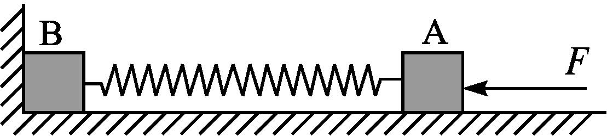

甲

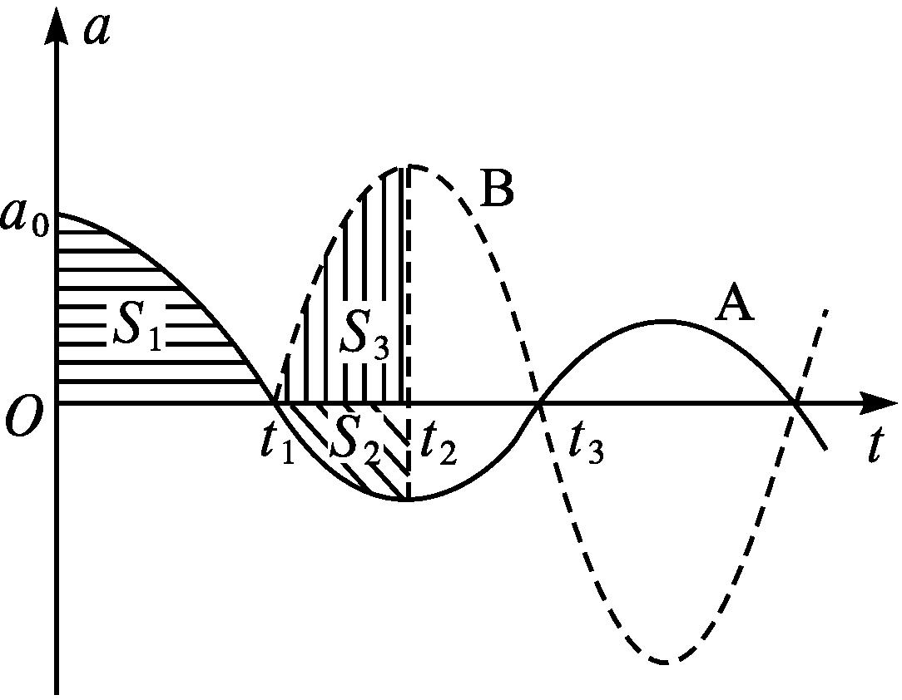

乙

A.0到*t*<sub>1</sub>时间内,墙对B的冲量等于*m*<sub>A</sub>*v*<sub>0</sub>

B.*m*<sub>A</sub>*\>m*<sub>B</sub>

C.B运动后,弹簧的最大形变量等于*x*

D.*S*<sub>1</sub>*-S*<sub>2</sub>*=S*<sub>3</sub>

解析
ABD　本题考查*a-t*图像、冲量、动量定理、机械能守恒定律等,考查分析综合能力。0到*t*<sub>1</sub>时间内,墙对B的冲量与弹簧对B的冲量大小相等,而弹簧对B的冲量与弹簧对A的冲量大小相等,根据动量定理,弹簧对A的冲量*I=m*<sub>A</sub>*v*<sub>0</sub>,所以选项A正确。分析运动过程可知,*t*<sub>1</sub>时刻弹簧恢复原长,之后A减速,B加速,当弹簧伸长量最大时二者速度相等,这时二者加速度均最大,即*t*<sub>2</sub>时刻,从图像可以看出,B的加速度大,所以质量小,即*m*<sub>B</sub>*\<m*<sub>A</sub>,选项B正确。初始时刻,系统机械能仅为弹性势能,弹簧形变量为*x*;去掉外力后,系统机械能守恒,当B运动后,A、B速度相等时,弹簧形变量最大,这时系统机械能包括动能和弹性势能,因此弹簧的最大形变量小于*x*,选项C错误。*a-t*图像中图线与*t*轴之间围的面积表示速度变化,设A、B在*t*<sub>2</sub>时刻速度为*v*<sub>1</sub>,则*v*<sub>0</sub>*=S*<sub>1</sub>,*v*<sub>1</sub>*=v*<sub>0</sub>*-S*<sub>2</sub>,*v*<sub>1</sub>*=S*<sub>3</sub>,解得*S*<sub>1</sub>*-S*<sub>2</sub>*=S*<sub>3</sub>,选项D正确。

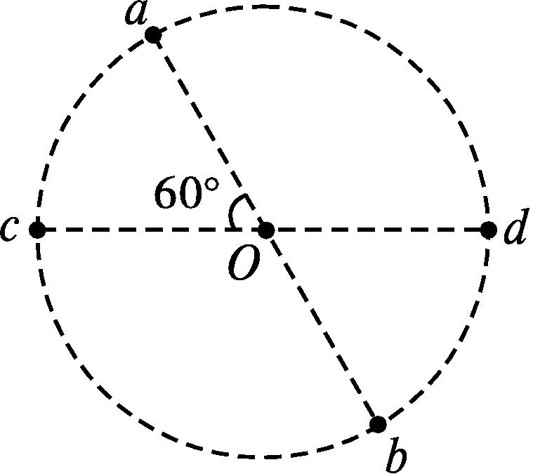

**9.** (2021·湖南,9,5分)如图所示,圆心为*O*的圆处于匀强电场中,电场方向与圆平面平行,*ab*和*cd*为该圆直径。将电荷量为*q(q\>*0)的粒子从*a*点移动到*b*点,电场力做功为2*W(W\>*0);若将该粒子从*c*点移动到*d*点,电场力做功为*W*。下列说法正确的是(　)

A.该匀强电场的电场强度方向与*ab*平行

B.将该粒子从*d*点移动到*b*点,电场力做功为0.5*W*

C.*a*点电势低于*c*点电势

D.若只受电场力,从*d*点射入圆形电场区域的所有带电粒子都做曲线运动

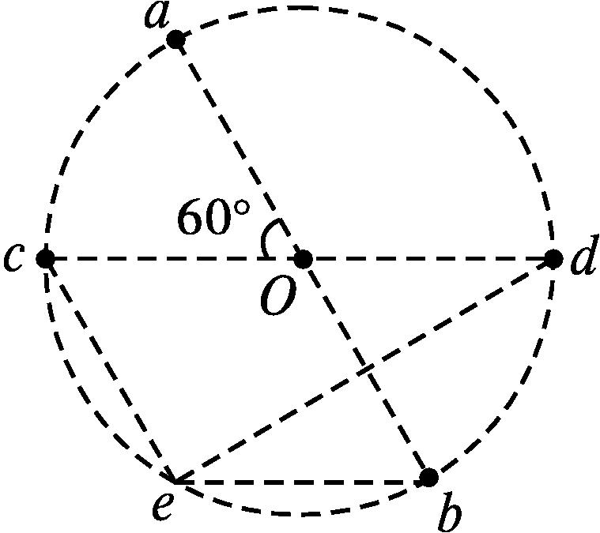

解析
AB　本题考查电势、电势差、电场力做功、匀强电场的特点等,考查分析综合能力。由题意可得*U<sub>ab</sub>=φ<sub>a</sub>-φ<sub>b</sub>=*$\frac{2W}{q}$,*U<sub>cd</sub>=φ<sub>c</sub>-φ<sub>d</sub>=*$\frac{W}{q}$,过*b*点作*cd*的平行线,交圆于*e*点,连接*ce*,由几何关系可得四边形*cObe*为平行四边形,故*φ<sub>c</sub>-φ<sub>e</sub>=φ<sub>O</sub>-φ<sub>b</sub>=*$\frac{W}{q}$,则*φ<sub>c</sub>-φ<sub>d</sub>=φ<sub>c</sub>-φ<sub>e</sub>,φ<sub>d</sub>=φ<sub>e</sub>*,电场线沿*ce*方向,即*ab*方向,选项A正确。*W<sub>db</sub>=*$\frac{U_{Ob}}{2}$·*q=*$\frac{1}{2}\frac{W}{q}$·*q=*$\frac{1}{2}$*W*,选项B正确。沿电场线方向电势降低,*φ<sub>a</sub>\>φ<sub>c</sub>*,选项C错误。从*d*点射入的粒子,有可能沿电场线反方向做直线运动,选项D错误。

**10.** (2021·湖南,10,5分)两个完全相同的正方形匀质金属框,边长为*l*,通过长为*l*的绝缘轻质杆相连,构成如图所示的组合体。距离组合体下底边*h*处有一方向水平、垂直于纸面向里的匀强磁场。磁场区域上下边界水平,高度为*l*,左右宽度足够大。把该组合体在垂直于磁场的平面内以初速度*v*<sub>0</sub>水平无旋转抛出,设置合适的磁感应强度大小*B*使其匀速通过磁场,不计空气阻力。下列说法正确的是(　)

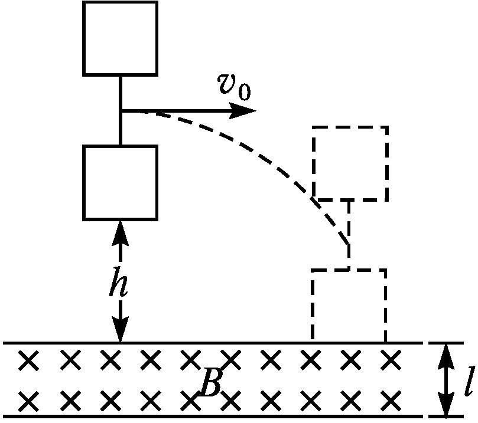

A.*B*与*v*<sub>0</sub>无关,与$\sqrt{h}$成反比

B.通过磁场的过程中,金属框中电流的大小和方向保持不变

C.通过磁场的过程中,组合体克服安培力做功的功率与重力做功的功率相等

D.调节*h*、*v*<sub>0</sub>和*B*,只要组合体仍能匀速通过磁场,则其通过磁场的过程中产生的热量不变

解析
CD　本题考查电磁感应的综合问题,考查分析综合能力。金属框匀速通过磁场时,重力与安培力相等,即*mg=BIl,I=*$\frac{Blv_{\bot}}{R},{v_{\bot}}^{2}$=2*gh*,联立可得*B*<sup>2</sup>=$\frac{mgR}{l^{2}\sqrt{2gh}}$,选项A错误。通过磁场过程中根据右手定则,金属框下边进入时电流为逆时针方向,金属框上边进入时电流为顺时针方向,选项B错误。因为金属框匀速通过磁场,重力做功与克服安培力做功相等,所以克服安培力做功的功率与重力做功的功率相等,选项C正确。因为通过磁场,重力做功不变,根据能量守恒定律得,产生的热量不变,选项D正确。

三、非选择题:共56分。第11*~*14题为必考题,每个试题考生都必须作答。第15、16题为选考题,考生根据要求作答。

(一)必考题:共43分。

**11.** (2021·湖南,11,6分)某实验小组利用图甲所示装置探究加速度与物体所受合外力的关系。主要实验步骤如下:

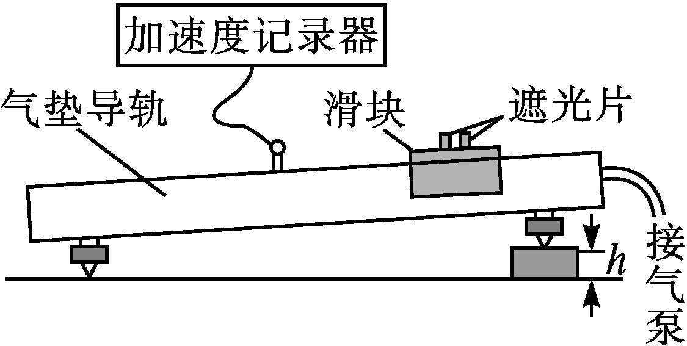

甲

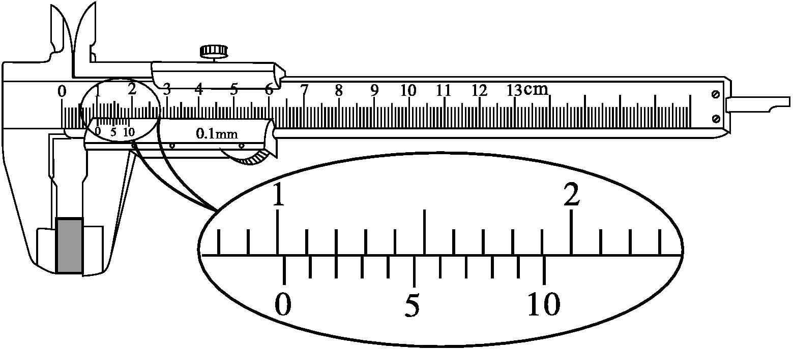

乙

(1)用游标卡尺测量垫块厚度*h*,示数如图乙所示,*h=<u>　　</u>* cm。 

(2)接通气泵,将滑块轻放在气垫导轨上,调节导轨至水平。

(3)在右支点下放一垫块,改变气垫导轨的倾斜角度。

(4)在气垫导轨合适位置释放滑块,记录垫块个数*n*和滑块对应的加速度*a*。

(5)在右支点下增加垫块个数(垫块完全相同),重复步骤(4),记录数据如下表:

| *n*                      | 1       | 2       | 3       | 4   | 5       | 6       |
|--------------------------|---------|---------|---------|-----|---------|---------|
| *a/*(m·s<sup>-2</sup>) | 0.087 | 0.180 | 0.260 |     | 0.425 | 0.519 |

根据表中数据在图丙上描点,绘制图线。

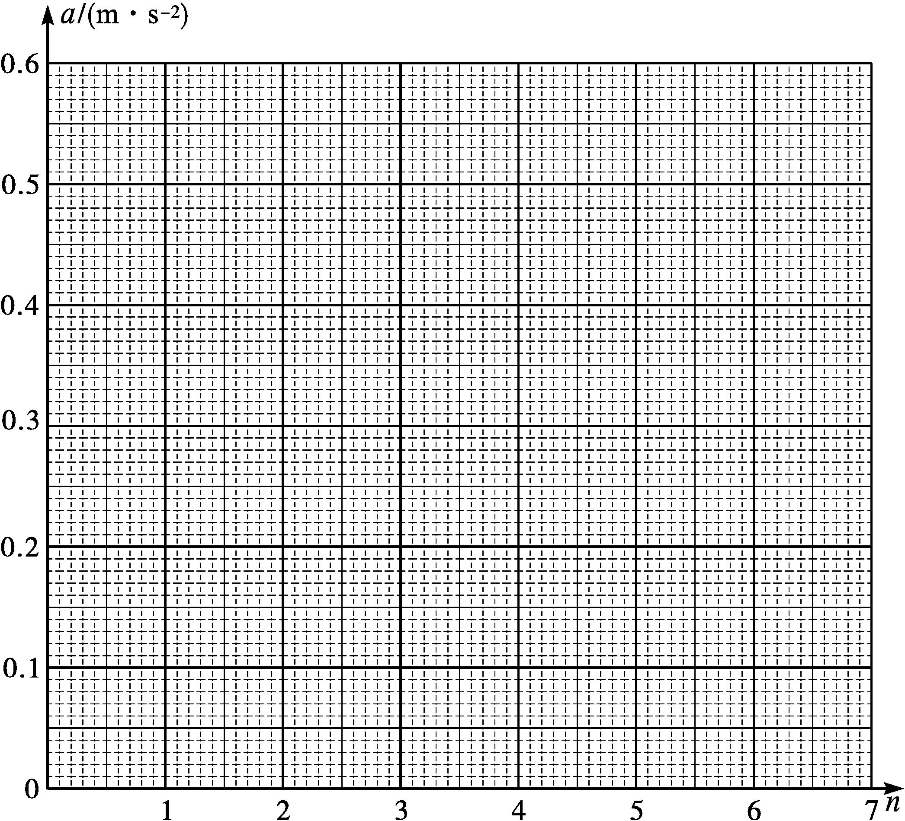

丙

如果表中缺少的第4组数据是正确的,其应该是*<u>　　</u>*
m/s<sup>2</sup>(保留三位有效数字)。 

答案 (1)1.02　(5)如图所示　0.346

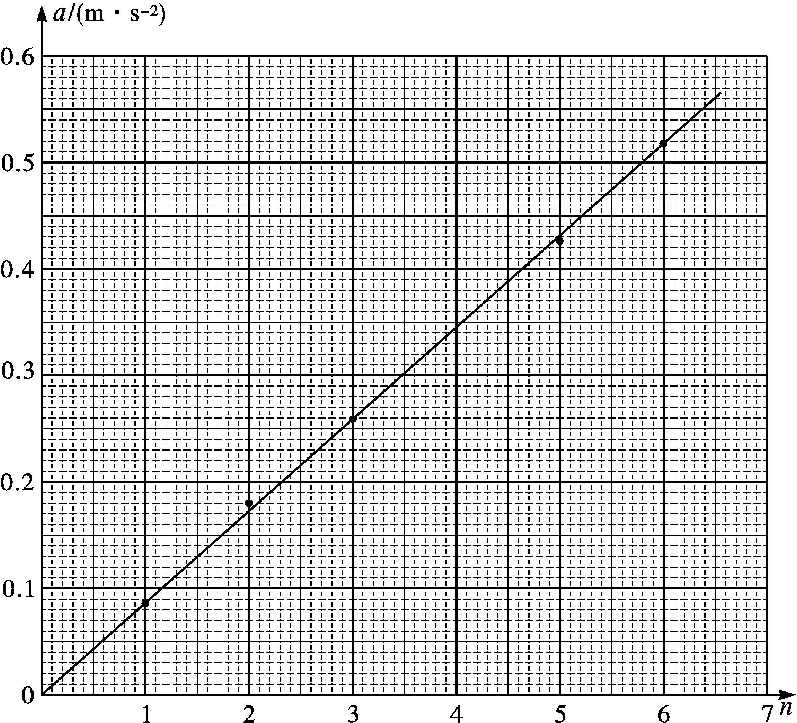

解析 (1)该游标卡尺分度值为0.1 mm,则*h=*10.2 mm=1.02 cm。

(5)绘图如答案图所示。

*mg*sin *θ=ma*,sin *θ=*$\frac{nh}{l}$

解得*a=*$\frac{gh}{l}$·*n*

由所绘图像可得斜率*k=*$\frac{0.519}{6}$ m/s<sup>2</sup>

故*a*<sub>4</sub>=4*k=*0.346 m/s<sup>2</sup>

也可直接由所绘图线读出第4组数据。

**12.** (2021·湖南,12,9分)某实验小组需测定电池的电动势和内阻,器材有:一节待测电池、一个单刀双掷开关、一个定值电阻(阻值为*R*<sub>0</sub>)、一个电流表(内阻为*R*<sub>A</sub>)、一根均匀电阻丝(电阻丝总阻值大于*R*<sub>0</sub>,并配有可在电阻丝上移动的金属夹)、导线若干。由于缺少刻度尺,无法测量电阻丝长度,但发现桌上有一个圆形时钟表盘。某同学提出将电阻丝绕在该表盘上,利用圆心角来表示接入电路的电阻丝长度。主要实验步骤如下:

(1)将器材如图甲连接。

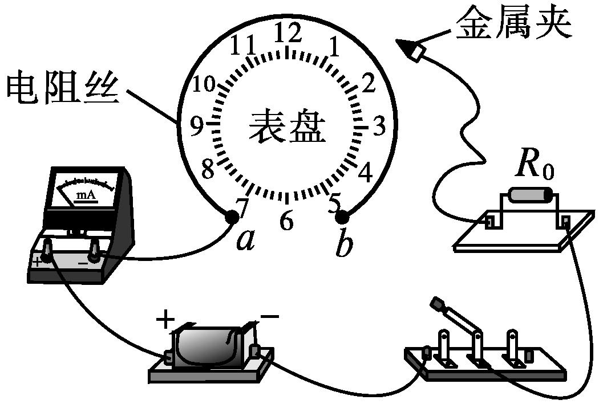

甲

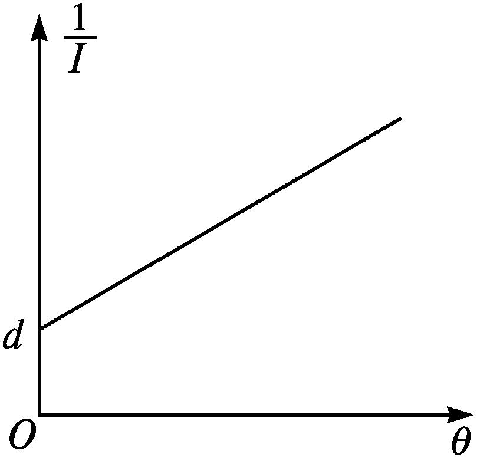

乙


丙

(2)开关闭合前,金属夹应夹在电阻丝的*<u>　　</u>*(选填“*a*”或“*b*”)端。 

(3)改变金属夹的位置,闭合开关,记录每次接入电路的电阻丝对应的圆心角*θ*和电流表示数*I*,得到多组数据。

(4)整理数据并在坐标纸上描点绘图,所得图像如图乙所示,图线斜率为*k*,与纵轴截距为*d*,设单位角度对应电阻丝的阻值为*r*<sub>0</sub>,该电池电动势和内阻可表示为*E=<u>　　</u>,r=<u>　　</u>*。(用*R*<sub>0</sub>、*R*<sub>A</sub>、*k*、*d*、*r*<sub>0</sub>表示) 

(5)为进一步确定结果,还需要测量单位角度对应电阻丝的阻值*r*<sub>0</sub>。利用现有器材设计实验,在图丙方框中画出实验电路图(电阻丝用滑动变阻器符号表示)。

(6)利用测出的*r*<sub>0</sub>,可得该电池的电动势和内阻。

答案 (2)*b*

(4)$\frac{r_{0}}{k}　\frac{r_{0}d}{k}$*-R*<sub>0</sub>*-R*<sub>A</sub>

(5)如图所示

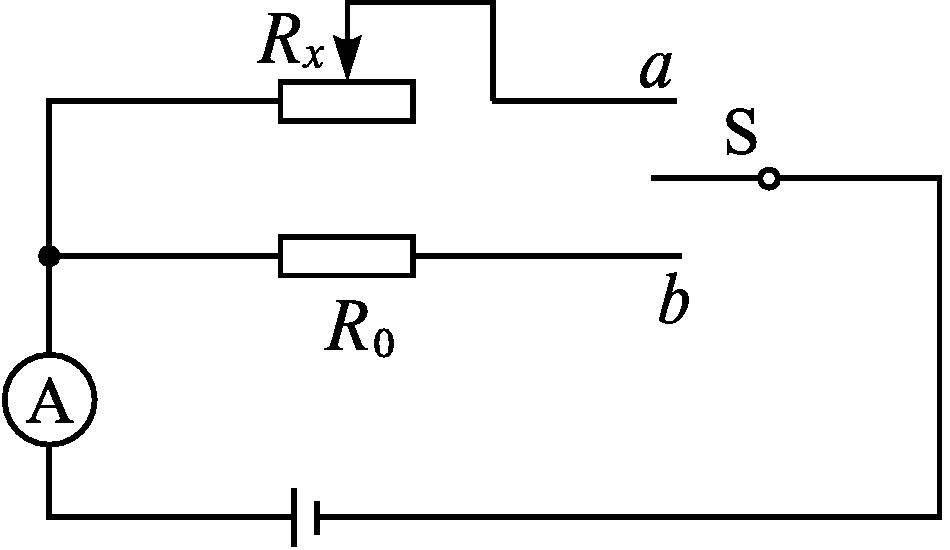

解析 (2)开始时接入线路电阻应最大,金属夹应夹在电阻丝的*b*端。

(4)根据闭合电路欧姆定律得

*E=I(R*<sub>0</sub>*+R<sub>x</sub>+R*<sub>A</sub>*+r)

R<sub>x</sub>=r*<sub>0</sub>*θ*

解得$\frac{1}{I} = \frac{1}{E}$*r*<sub>0</sub>*θ+*$\frac{R_{0} + R_{A} + r}{E}$

由题图乙得$\frac{r_{0}}{E}$*=k*,$\frac{R_{0} + R_{A} + r}{E}$*=d*

联立得*E=*$\frac{r_{0}}{k}$,*r=*$\frac{r_{0}d}{k}$*-R*<sub>0</sub>*-R*<sub>A</sub>。

(5)电路图如答案图所示。

S先打到*b*端,读出电流表读数*I*,再把S打到*a*端,移动*R<sub>x</sub>*上的金属夹,使电流表的读数也为*I*,此时*R<sub>x</sub>*的值与*R*<sub>0</sub>相等,记下偏转角度*θ*,则*r*<sub>0</sub>=$\frac{R_{0}}{\theta}$。

**13.** (2021·湖南,13,13分)带电粒子流的磁聚焦和磁控束是薄膜材料制备的关键技术之一。带电粒子流(每个粒子的质量为*m*、电荷量为*+q*)以初速度*v*垂直进入磁场,不计重力及带电粒子之间的相互作用。对处在*xOy*平面内的粒子,求解以下问题。

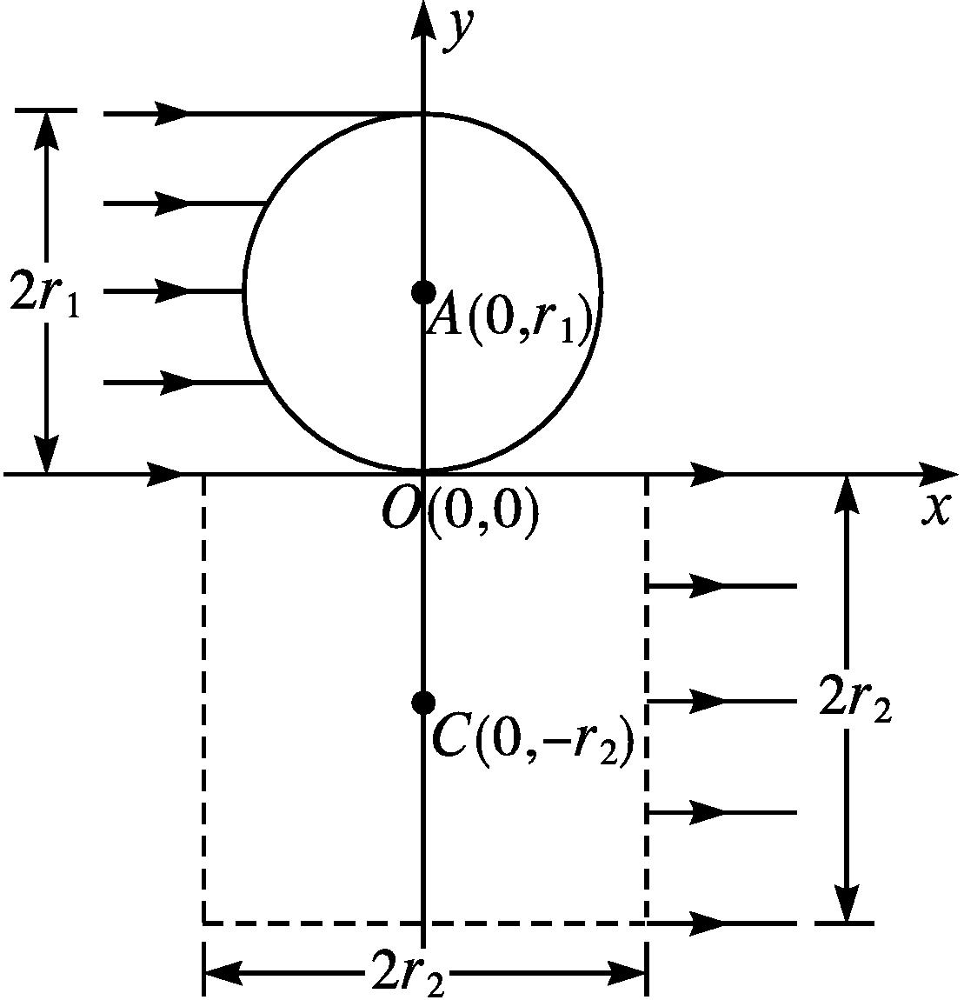

甲

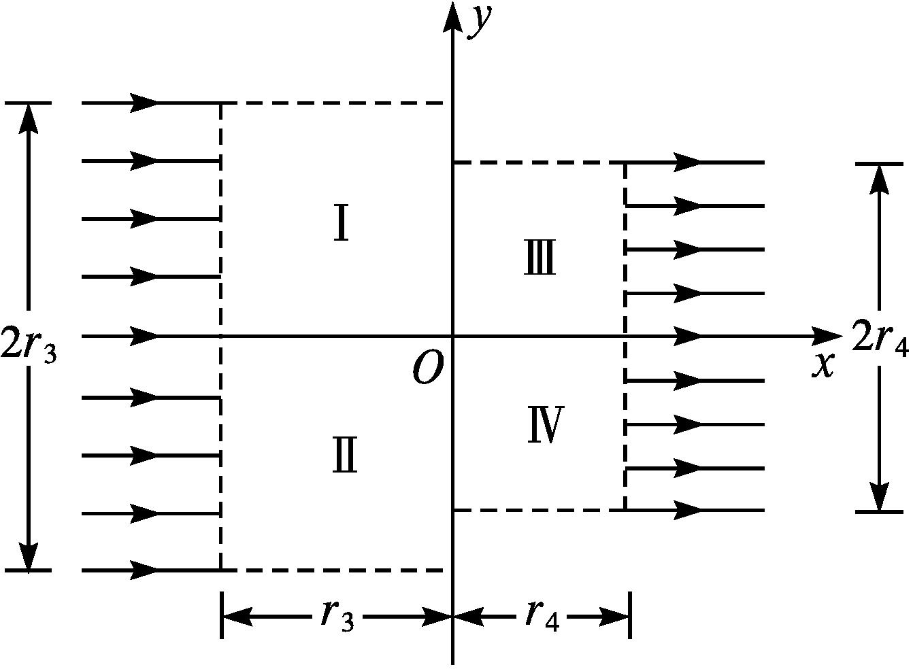

乙

(1)如图甲所示,宽度为2*r*<sub>1</sub>的带电粒子流沿*x*轴正方向射入圆心为*A*(0,*r*<sub>1</sub>)、半径为*r*<sub>1</sub>的圆形匀强磁场中,若带电粒子流经过磁场后都汇聚到坐标原点*O*,求该磁场磁感应强度*B*<sub>1</sub>的大小。

(2)如图甲所示,虚线框为边长等于2*r*<sub>2</sub>的正方形,其几何中心位于*C*(0,*-r*<sub>2</sub>)。在虚线框内设计一个区域面积最小的匀强磁场,使汇聚到*O*点的带电粒子流经过该区域后宽度变为2*r*<sub>2</sub>,并沿*x*轴正方向射出。求该磁场磁感应强度*B*<sub>2</sub>的大小和方向,以及该磁场区域的面积(无需写出面积最小的证明过程)。

(3)如图乙所示,虚线框*Ⅰ*和*Ⅱ*均为边长等于*r*<sub>3</sub>的正方形,虚线框*Ⅲ*和*Ⅳ*均为边长等于*r*<sub>4</sub>的正方形。在*Ⅰ*、*Ⅱ*、*Ⅲ*和*Ⅳ*中分别设计一个区域面积最小的匀强磁场,使宽度为2*r*<sub>3</sub>的带电粒子流沿*x*轴正方向射入*Ⅰ*和*Ⅱ*后汇聚到坐标原点*O*,再经过*Ⅲ*和*Ⅳ*后宽度变为2*r*<sub>4</sub>,并沿*x*轴正方向射出,从而实现带电粒子流的同轴控束。求*Ⅰ*和*Ⅲ*中磁场磁感应强度的大小,以及*Ⅱ*和*Ⅳ*中匀强磁场区域的面积(无需写出面积最小的证明过程)。

答案 (1)$\frac{mv}{qr_{1}}$

(2)图见解析　$\frac{mv}{qr_{2}}$,垂直纸面向里　π${r_{2}}^{2}$

(3)图见解析　$\frac{mv}{qr_{3}}　\frac{mv}{qr_{4}}　\frac{1}{2}\pi{r_{3}}^{2} - {r_{3}}^{2}$

``` math
\frac{1}{2}\pi{r_{4}}^{2} - {r_{4}}^{2}
```

解析 本题考查组合场问题。

(1)根据*qB*<sub>1</sub>*v=m*$\frac{v^{2}}{R_{1}}$

*R*<sub>1</sub>*=r*<sub>1</sub>

得*B*<sub>1</sub>=$\frac{mv}{qr_{1}}$。

(2)如图所示。

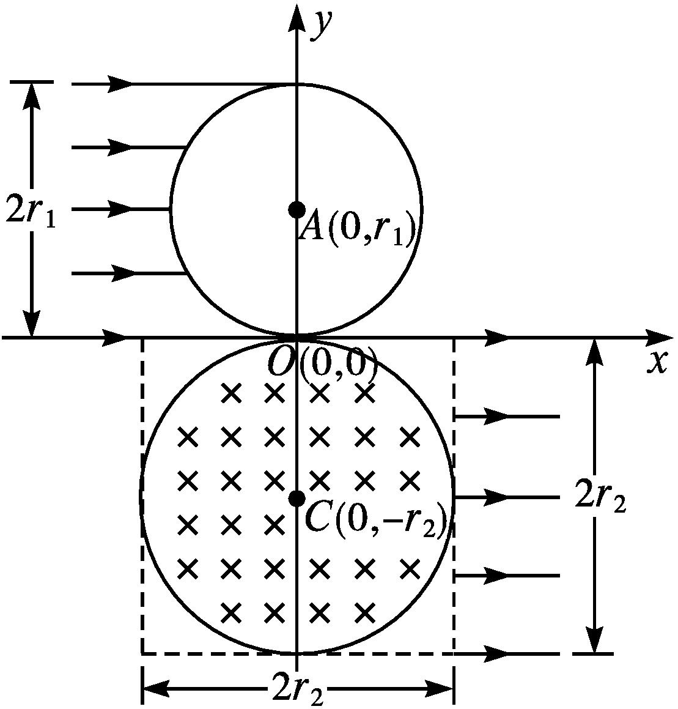

*qB*<sub>2</sub>*v=m*$\frac{v^{2}}{R_{2}}$

*R*<sub>2</sub>*=r*<sub>2</sub>

得*B*<sub>2</sub>=$\frac{mv}{qr_{2}}$,方向垂直纸面向里,面积*S=*π${r_{2}}^{2}$。

(3)如图所示。

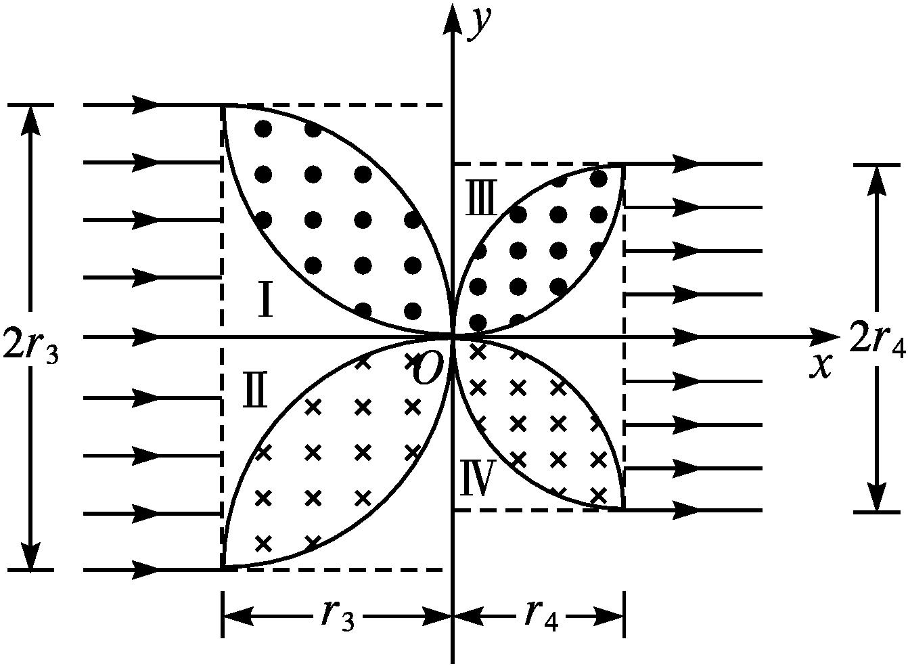

在区域*Ⅰ*中,有

*qB*<sub>3</sub>*v=m*$\frac{v^{2}}{R_{3}}$

*R*<sub>3</sub>*=r*<sub>3</sub>

得*B*<sub>3</sub>=$\frac{mv}{qr_{3}}$

在区域*Ⅲ*中,有*qB*<sub>4</sub>*v=m*$\frac{v^{2}}{R_{4}}$

*R*<sub>4</sub>*=r*<sub>4</sub>

得*B*<sub>4</sub>=$\frac{mv}{qr_{4}}$

区域*Ⅱ*中

*S<sub>Ⅱ</sub>=*$\frac{1}{2}\pi{r_{3}}^{2} - {r_{3}}^{2}$

区域*Ⅳ*中

*S<sub>Ⅳ</sub>=*$\frac{1}{2}\pi{r_{4}}^{2} - {r_{4}}^{2}$。

**14.** (2021·湖南,14,15分)如图所示,竖直平面内一足够长的光滑倾斜轨道与一长为*l*的水平轨道通过一小段光滑圆弧平滑连接,水平轨道右下方有一段弧形轨道*PQ*。质量为*m*的小物块A与水平轨道间的动摩擦因数为*μ*。以水平轨道末端*O*点为坐标原点建立平面直角坐标系*xOy,x*轴的正方向水平向右,*y*轴的正方向竖直向下,弧形轨道*P*端坐标为(2*μl,μl),Q*端在*y*轴上。重力加速度为*g*。

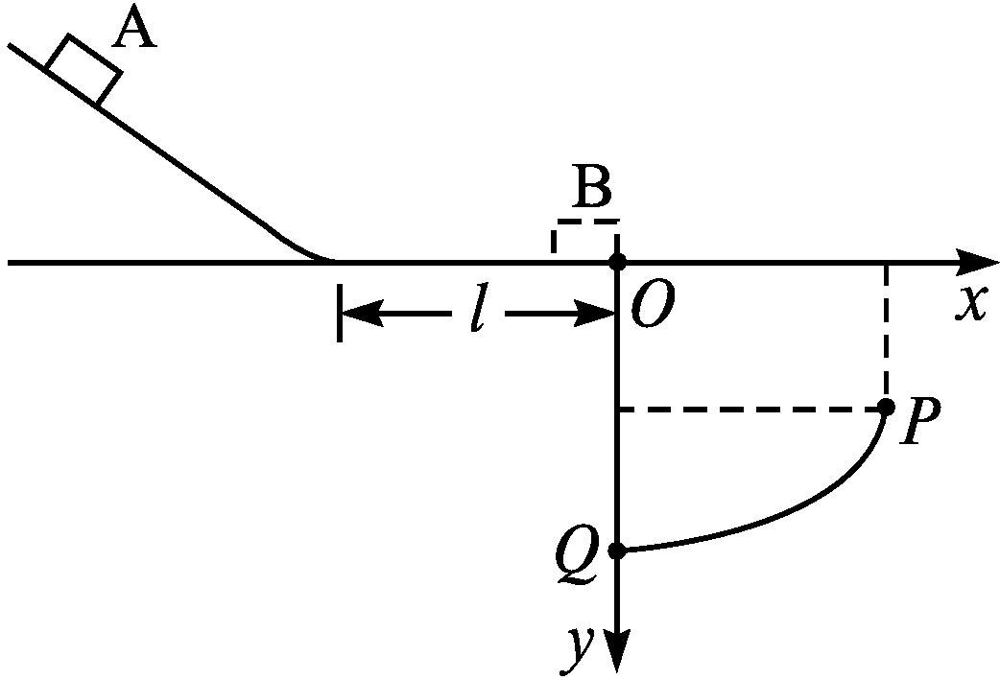

(1)若A从倾斜轨道上距*x*轴高度为2*μl*的位置由静止开始下滑,求A经过*O*点时的速度大小。

(2)若A从倾斜轨道上不同位置由静止开始下滑,经过*O*点落在弧形轨道*PQ*上的动能均相同,求*PQ*的曲线方程。

(3)将质量为*λm(λ*为常数且*λ*≥5)的小物块B置于*O*点,A沿倾斜轨道由静止开始下滑,与B发生弹性碰撞(碰撞时间极短),要使A和B均能落在弧形轨道上,且A落在B落点的右侧,求A下滑的初始位置距*x*轴高度的取值范围。

答案 (1)$\sqrt{2\mu gl}$

(2)*x*<sup>2</sup>+4*y*<sup>2</sup>-8*μly=*0(0*\<x*≤2*μl*)

(3)$\frac{3\lambda-1}{\lambda-3}$*μl\<h*≤$\frac{4(\lambda^{2} + \lambda + 1)}{(\lambda-1)^{2}}$*μl*

解析 本题考查动能定理、平抛、碰撞等。

(1)根据动能定理得

*mg*·2*μl-μmgl=*$\frac{1}{2}m{v_{0}}^{2}$-0*①*

解得*v*<sub>0</sub>=$\sqrt{2\mu gl}$。*②*

(2)当A落在*P*点时

*v*<sub>0</sub>*'t*<sub>1</sub>=2*μl③*

$\frac{1}{2}g{t_{1}}^{2}$*=μl④

E*<sub>k</sub>=$\frac{1}{2}$*mv*<sub>0</sub>*'*<sup>2</sup>*+mgμl⑤*

联立*③④⑤*得*E*<sub>k</sub>=2*μmgl⑥*

当A落在任一点(*x,y*)时:

*v*<sub>0</sub>*″t*<sub>2</sub>*=x⑦*

$\frac{1}{2}g{t_{2}}^{2}$*=y⑧

E*<sub>k</sub>=$\frac{1}{2}$*mv*<sub>0</sub>*″*<sup>2</sup>*+mgy⑨*

联立*⑥⑦⑧⑨*得*x*<sup>2</sup>+4*y*<sup>2</sup>-8*μly=*0(0*\<x*≤2*μl*)。*⑩*

(3)由动能定理得

*mgh-μmgl=*$\frac{1}{2}m{v_{1}}^{2}$-0

碰撞时有*mv*<sub>1</sub>*=-mv*<sub>2</sub>*+λmv*<sub>B</sub>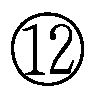

$\frac{1}{2}m{v_{1}}^{2} = \frac{1}{2}m{v_{2}}^{2} + \frac{1}{2}$*λm*${v_{B}}^{2}$

设A碰撞后又回到*O*点的速度为*v*<sub>3</sub>,有

*-μmg*·2*l=*$\frac{1}{2}m{v_{3}}^{2} - \frac{1}{2}m{v_{2}}^{2}$

A落到弧形轨道上,故*v*<sub>3</sub>≤*v*<sub>0</sub>*'*

A落到B落点右侧,有*v*<sub>3</sub>*\>v*<sub>B</sub>

联立解得

$\frac{3\lambda-1}{\lambda-3}$*μl\<h*≤$\frac{4(\lambda^{2} + \lambda + 1)}{(\lambda-1)^{2}}$*μl*。

(二)选考题:共13分。请考生从两道题中任选一题作答。如果多做,则按第一题计分。

**15.** (2021·湖南,15,13分)\[物理——选修3-3\]

(1)(5分)如图所示,两端开口、下端连通的导热汽缸,用两个轻质绝热活塞(截面积分别为*S*<sub>1</sub>和*S*<sub>2</sub>)封闭一定质量的理想气体,活塞与汽缸壁间无摩擦。在左端活塞上缓慢加细沙,活塞从*A*下降*h*高度到*B*位置时,活塞上细沙的总质量为*m*。在此过程中,用外力*F*作用在右端活塞上,使活塞位置始终不变。整个过程环境温度和大气压强*p*<sub>0</sub>保持不变,系统始终处于平衡状态,重力加速度为*g*。下列说法正确的是*<u>　　</u>*。(填正确答案标号。选对1个得2分,选对2个得4分,选对3个得5分。每选错1个扣3分,最低得分为0分) 

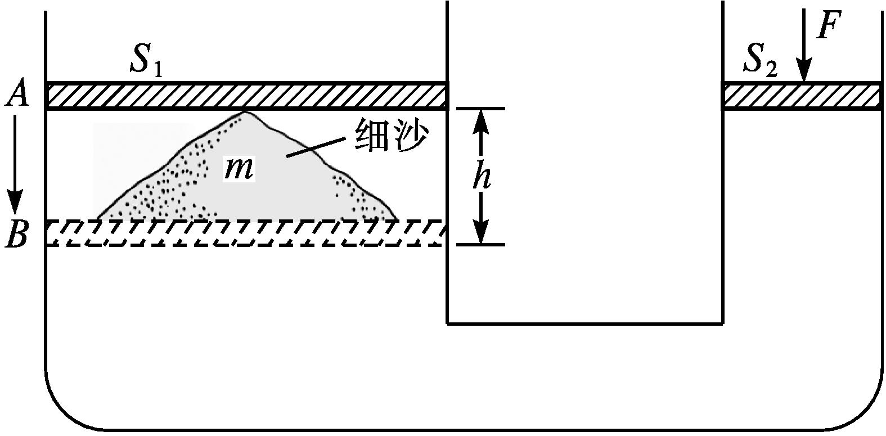

A.整个过程,外力*F*做功大于0,小于*mgh*

B.整个过程,理想气体的分子平均动能保持不变

C.整个过程,理想气体的内能增大

D.整个过程,理想气体向外界释放的热量小于(*p*<sub>0</sub>*S*<sub>1</sub>*h+mgh*)

E.左端活塞到达*B*位置时,外力*F*等于$\frac{mgS_{2}}{S_{1}}$

(2)(8分)小赞同学设计了一个用电子天平测量环境温度的实验装置,如图所示。导热汽缸开口向上并固定在桌面上,用质量*m*<sub>1</sub>=600
g、截面积*S=*20
cm<sup>2</sup>的活塞封闭一定质量的理想气体,活塞与汽缸壁间无摩擦。一轻质直杆中心置于固定支点*A*上,左端用不可伸长的细绳竖直悬挂活塞,右端用相同细绳竖直悬挂一个质量*m*<sub>2</sub>=1
200 g的铁块,并将铁块放置到电子天平上。当电子天平示数为600.0
g时,测得环境温度*T*<sub>1</sub>=300
K。设外界大气压强*p*<sub>0</sub>=1.0×10<sup>5</sup>
Pa,重力加速度*g*取10 m/s<sup>2</sup>。

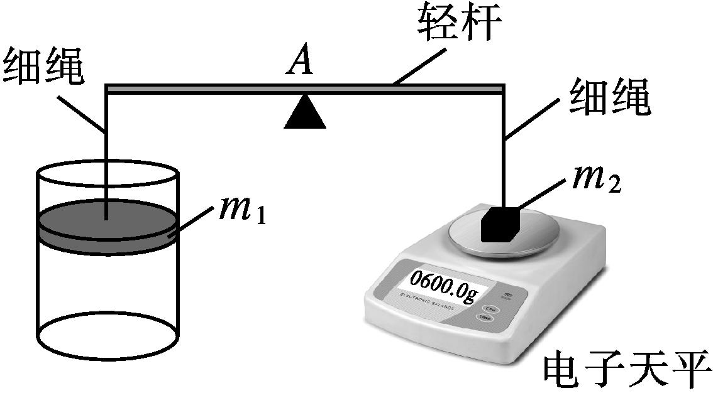

(*ⅰ*)当电子天平示数为400.0 g时,环境温度*T*<sub>2</sub>为多少?

(*ⅱ*)该装置可测量的最高环境温度*T*<sub>max</sub>为多少?

答案 (1)BDE　(2)(*ⅰ*)297 K　(*ⅱ*)309 K

解析
(1)活塞*S*<sub>2</sub>没有移动,所以外力*F*做功为零,选项A错误。由于环境温度不变,汽缸导热,汽缸内理想气体温度不变,分子平均动能不变,所以理想气体内能不变,选项B正确,C错误。整个过程中,因为*m*是不断增加的,压力做功小于*p*<sub>0</sub>*S*<sub>1</sub>*h+mgh*,根据热力学第一定律可知,选项D正确。选右侧活塞为研究对象,根据平衡条件有*F+p*<sub>0</sub>*S*<sub>2</sub>*=pS*<sub>2</sub>;选左侧活塞为研究对象,根据平衡条件有*mg+p*<sub>0</sub>*S*<sub>1</sub>*=pS*<sub>1</sub>,联立解得*F=*$\frac{mgS_{2}}{S_{1}}$,选项E正确。

(2)(*ⅰ*)对铁块受力分析,根据平衡条件有

*F*<sub>T</sub>*=m*<sub>2</sub>*g-m*<sub>0</sub>*g,m*<sub>0</sub>为天平示数

左侧理想气体初状态:*p*<sub>1</sub>*=p*<sub>0</sub>+$\frac{m_{1}g-F_{T1}}{S}$,*T*<sub>1</sub>=300
K

末状态:*p*<sub>2</sub>*=p*<sub>0</sub>+$\frac{m_{1}g-F_{T2}}{S}$,*T*<sub>2</sub>待求。

根据等容变化,得

``` math
\frac{p_{1}}{T_{1}} = \frac{p_{2}}{T_{2}}
```

联立解得*T*<sub>2</sub>=297 K。

(*ⅱ*)当环境温度为*T*<sub>max</sub>时,天平读数为1 200
g,此时*F*<sub>T</sub>=0

*p*<sub>3</sub>*=p*<sub>0</sub>+$\frac{m_{1}g}{S}$

根据等容变化,得

``` math
\frac{p_{1}}{T_{1}} = \frac{p_{3}}{T_{\max}}
```

联立解得*T*<sub>max</sub>=309 K。

**16.** (2021·湖南,16,13分)\[物理——选修3-4\]

(1)(5分)均匀介质中,波源位于*O*点的简谐横波在*xOy*水平面内传播,波面为圆。*t=*0时刻,波面分布如图甲所示,其中实线表示波峰,虚线表示相邻的波谷。*A*处质点的振动图像如图乙所示,*z*轴正方向竖直向上。下列说法正确的是*<u>　　</u>*。(填正确答案标号。选对1个得2分,选对2个得4分,选对3个得5分。每选错1个扣3分,最低得分为0分) 

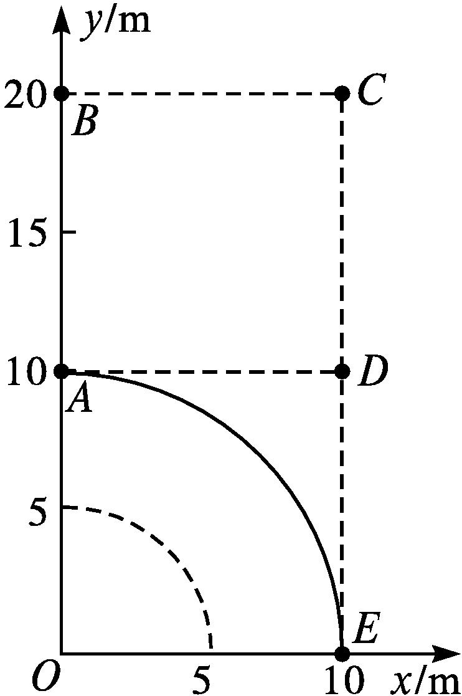

甲

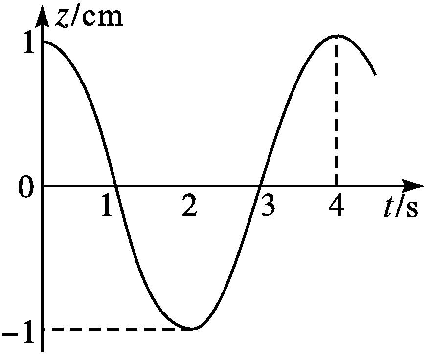

乙

A.该波从*A*点传播到*B*点,所需时间为4 s

B.*t=*6 s时,*B*处质点位于波峰

C.*t=*8 s时,*C*处质点振动速度方向竖直向上

D.*t=*10 s时,*D*处质点所受回复力方向竖直向上

E*.E*处质点起振后,12 s内经过的路程为12 cm

(2)(8分)我国古代著作《墨经》中记载了小孔成倒像的实验,认识到光沿直线传播。身高1.6
m的人站在水平地面上,其正前方0.6
m处的竖直木板墙上有一个圆柱形孔洞,直径为1.0 cm、深度为1.4
cm,孔洞距水平地面的高度是人身高的一半。此时,由于孔洞深度过大,使得成像不完整,如图所示。现在孔洞中填充厚度等于洞深的某种均匀透明介质,不考虑光在透明介质中的反射。

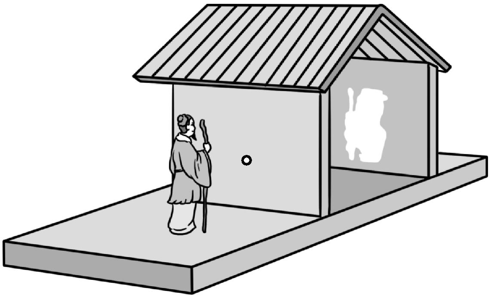

(*ⅰ*)若该人通过小孔能成完整的像,透明介质的折射率最小为多少?

(*ⅱ*)若让掠射进入孔洞的光能成功出射,透明介质的折射率最小为多少?

答案 (1)ACE　(2)(*ⅰ*)1.38　(*ⅱ*)1.72

解析 (1)由题图知,*T=*4 s,*λ=*10 m,所以*v=*$\frac{\lambda}{T}$=2.5
m/s,*t<sub>AB</sub>=*$\frac{10m}{2.5\text{ }m\text{/}s}$=4
s,选项A正确。4 s到6 s,*B*处质点从波峰运动到波谷,因此*t=*6
s时,*B*处质点位于波谷,选项B错误。8
s时,*C*处质点位于平衡位置往上很小一段距离处,向波峰运动,选项C正确。10
s时,*D*处质点在波峰与平衡位置之间,回复力方向向下,选项D错误。*E*处质点起振后,12
s内,经过3个周期,经过的路程为4 cm×3=12 cm,选项E正确。

(2)(*ⅰ*)当恰好成完整的像时,光路如图所示。

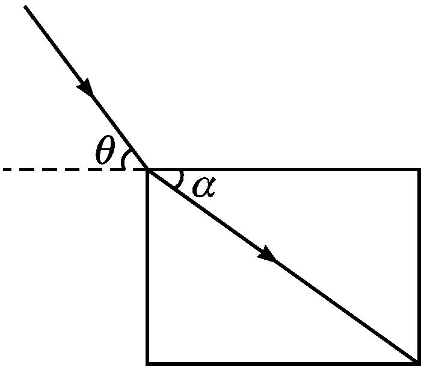

tan *θ=*$\frac{0.8}{0.6} = \frac{4}{3}$,sin
*θ=*$\frac{4}{5}$

tan *α=*$\frac{0.01}{0.014} = \frac{5}{7}$,sin
*α=*$\frac{1}{\sqrt{2.96}}$

*n=*$\frac{\sin\theta}{\sin\alpha}$=1.38。

(*ⅱ*)当掠射进入孔洞的光恰好出射时,光路如图所示。

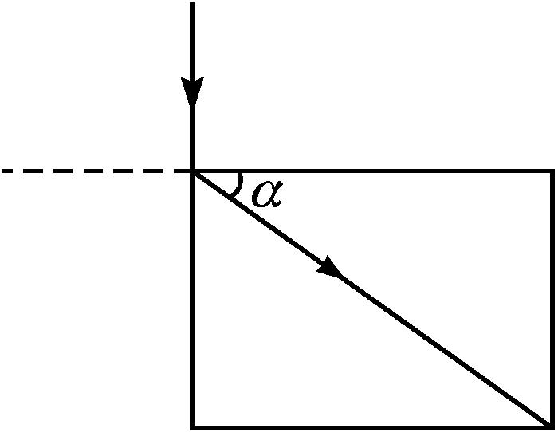

*n'=*$\frac{sin90^\circ }{\sin\alpha} = \sqrt{2.96}$=1.72。
