# 2022 年湖南卷 · 物理

> **卷别**：湖南自主命题　|　**含解析**：是　|　**来源**：物理备课大师（wl.eywedu.com）Word 版含解析
> **说明**：由官方 Word 版转换，公式为 LaTeX，图片见同目录 `images/`。

---

湖南省**2022**年普通高中学业水平选择性考试

物理

注意事项:

1. 答卷前,考生务必将自己的姓名、准考证号填写在本试卷和答题卡上。

2. 回答选择题时,选出每小题答案后,用铅笔把答题卡上对应题目的答案标号涂黑。如需改动,用橡皮擦干净后,再选涂其他答案标号。回答非选择题时,将答案写在答题卡上。写在本试卷上无效。

3. 考试结束后,将本试卷和答题卡一并交回。

一、选择题:本题共6小题,每小题4分,共24分。在每小题给出的四个选项中,只有一项是符合题目要求的。

**1.** (2022·湖南,1,4分)关于原子结构和微观粒子波粒二象性,下列说法正确的是(
C　)

A.卢瑟福的核式结构模型解释了原子光谱的分立特征

B.玻尔的原子理论完全揭示了微观粒子运动的规律

C.光电效应揭示了光的粒子性

D.电子束穿过铝箔后的衍射图样揭示了电子的粒子性

解析
卢瑟福的核式结构模型解释了α粒子散射实验,故A错误;玻尔的原子理论解释了氢原子光谱,故B错误;光电效应揭示了光的粒子性,故C正确;电子的衍射揭示了电子的波动性,故D错误。

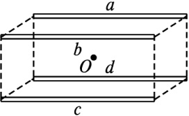

**2.** (2022·湖南,2,4分)如图所示,四根完全相同的均匀带正电绝缘长棒对称放置在长方体的四条长边*a*、*b*、*c*、*d*上。移去*a*处的绝缘棒,假定另外三根绝缘棒电荷分布不变。关于长方体几何中心*O*点处电场强度方向和电势的变化,下列说法正确的是(
A　)

A.电场强度方向垂直指向*a*,电势减小

B.电场强度方向垂直指向*c*,电势减小

C.电场强度方向垂直指向*a*,电势增大

D.电场强度方向垂直指向*c*,电势增大

解析
由电场叠加知,四根绝缘棒都存在时,*O*点的电场强度为0。移去*a*处绝缘棒后,*b*、*d*处绝缘棒在*O*处产生的电场强度为0,*c*处绝缘棒在*O*处产生的电场强度不为0,方向垂直指向*a*。根据电场叠加知,去掉*a*处绝缘棒后,*O*点的电场强度不为0,方向垂直指向*a*,故B、D错误。选无穷远处电势为0,假设有一正试探电荷放在*O*处,移去*a*处的绝缘棒后,*O*点处的正试探电荷具有的电势能减少,根据电势的定义知,*O*处的电势减小,故A正确,C错误。

**3.** (2022·湖南,3,4分)如图甲所示,直导线*MN*被两等长且平行的绝缘轻绳悬挂于水平轴*OO'*上,其所在区域存在方向垂直指向*OO'*的磁场,与*OO'*距离相等位置的磁感应强度大小相等且不随时间变化,其截面图如图乙所示。导线通以电流*I*,静止后,悬线偏离竖直方向的夹角为*θ*。下列说法正确的是(
D　)

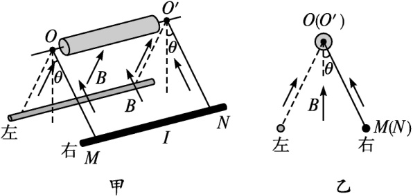

A.当导线静止在图甲右侧位置时,导线中电流方向由*N*指向*M*

B.电流*I*增大,静止后,导线对悬线的拉力不变

C.tan *θ*与电流*I*成正比

D.sin *θ*与电流*I*成正比

解析 当

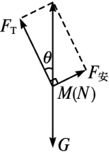

导线静止在题图甲右侧位置时,对直导线*MN*进行受力分析,如图所示,由左手定则知,导线中电流方向由*M*指向*N*,故A错误;由于与*OO'*距离相等位置的磁感应强度大小相等且不随时间变化,因此*F*安*=G*sin
*θ,F*T*=G*cos *θ,F*安*=BIl*,可得sin
*θ*与*I*成正比,当*I*增大时,*θ*增大,cos
*θ*减小,静止后,导线对悬线的拉力*F*T减小,故B、C错误,D正确。

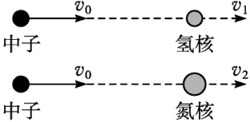

**4.** (2022·湖南,4,4分)1932年,查德威克用未知射线轰击氢核,发现这种射线是由质量与质子质量大致相等的中性粒子(即中子)组成。如图所示,中子以速度*v*0分别碰撞静止的氢核和氮核,碰撞后氢核和氮核的速度分别为*v*1和*v*2。设碰撞为弹性正碰,不考虑相对论效应,下列说法正确的是(
B　)

A.碰撞后氮核的动量比氢核的小

B.碰撞后氮核的动能比氢核的小

C.*v*2大于*v*1

D.*v*2大于*v*0

解析
由题知,*m*中子*=m*氢,*m*中子*\<m*氮。在中子与氢核碰撞时,设碰撞后中子的速度为*v*3,由动量守恒定律和能量守恒定律得*m*中子*v*0*=m*中子*v*3*+m*氢*v*1,$\frac{1}{2}$*m*中子${v_{0}}^{2} = \frac{1}{2}$*m*中子${v_{3}}^{2} + \frac{1}{2}$*m*氢${v_{1}}^{2}$,解得*v*1*=v*0。在中子与氮核碰撞中,设碰撞后中子的速度为*v*4,由动量守恒定律和能量守恒定律得*m*中子*v*0*=m*中子*v*4*+m*氮*v*2,$\frac{1}{2}$*m*中子${v_{0}}^{2} = \frac{1}{2}$*m*中子${v_{4}}^{2} + \frac{1}{2}$*m*氮${v_{2}}^{2}$,解得*v*2=$\frac{2m_{\text{中子}}}{m_{\text{氮}} + m_{\text{中子}}}$*v*0,可得*v*1*=v*0*\>v*2,故C、D错误。碰撞后氢核的动量为*p*氢*=m*氢*v*1*=m*中子*v*0,碰撞后氮核的动量为*p*氮*=m*氮*v*2=$\frac{2m_{\text{氮}}m_{\text{中子}}}{m_{\text{氮}} + m_{\text{中子}}}$*v*0,得*p*氢*\<p*氮,故A错误。碰撞后氢核的动能为*E*k氢=$\frac{1}{2}$*m*氢${v_{1}}^{2} = \frac{1}{2}$*m*中子${v_{0}}^{2}$,碰撞后氮核的动能为*E*k氮=$\frac{1}{2}$*m*氮${v_{2}}^{2} = \frac{1}{2}\frac{4m_{\text{氮}}{m_{\text{中子}}}^{2}}{(m_{\text{氮}} + m_{\text{中子}})^{2}}{v_{0}}^{2}$,得*E*k氢*\>E*k氮,故B正确。

**5.** (2022·湖南,5,4分)2022年北京冬奥会跳台滑雪空中技巧比赛场地边,有一根系有飘带的风力指示杆,教练员根据飘带的形态提示运动员现场风力的情况。若飘带可视为粗细一致的匀质长绳,其所处范围内风速水平向右、大小恒定且不随高度改变。当飘带稳定时,飘带实际形态最接近的是(
A　)

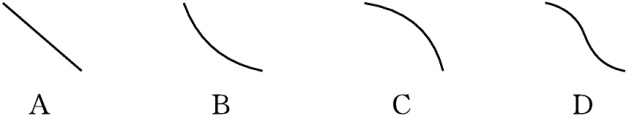

解析
任意选取飘带上一小段*P*,以*P*为研究对象,因为飘带可视为粗细一致的匀质长绳,且风速水平向右、大小恒定且不随高度改变,所以该小段重力和风力的合力方向不变,故选A。

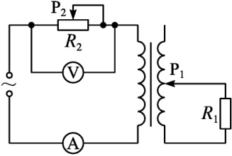

**6.** (2022·湖南,6,4分)如图所示,理想变压器原、副线圈总匝数相同,滑动触头P1初始位置在副线圈正中间,输入端接入电压有效值恒定的交流电源。定值电阻*R*1的阻值为*R*,滑动变阻器*R*2的最大阻值为9*R*,滑片P2初始位置在最右端。理想电压表V的示数为*U*,理想电流表A的示数为*I*。下列说法正确的是(
B　)

A.保持P1位置不变,P2向左缓慢滑动的过程中,*I*减小,*U*不变

B.保持P1位置不变,P2向左缓慢滑动的过程中,*R*1消耗的功率增大

C.保持P2位置不变,P1向下缓慢滑动的过程中,*I*减小,*U*增大

D.保持P2位置不变,P1向下缓慢滑动的过程中,*R*1消耗的功率减小

解析
保持P1位置不变,由题意可知,变压器接入电路中原、副线圈的匝数比为2,若原线圈的电流为*I*,则副线圈的电流为2*I*,根据欧姆定律可得副线圈两端的电压有效值为*U*2=2*IR*1,则变压器原线圈两端的电压有效值为*U*1=2*U*2=4*IR*1,设输入电压有效值为*U*0,则*U*0=4*IR*1*+IR*2,可得*I=*$\frac{U_{0}}{4R_{1} + R_{2}}$。P2向左缓慢滑动的过程中,*R*2减小,*I*变大,而*U*1=4*IR*1,可知变压器原线圈两端的电压有效值变大,输入电压有效值不变,则*R*2两端的电压不断变小,即电压表示数*U*变小,原线圈两端的电压、输入的电流都变大,则变压器输入功率变大,根据原、副线圈的功率相等,可知*R*1消耗的功率增大,故B正确,A错误。保持P2位置不变,设原、副线圈的匝数比为*n*,同理可得*U*1*=n*2*IR*1,则*U*0*=n*2*IR*1*+IR*2,整理可得*I=*$\frac{U_{0}}{n^{2}R_{1} + R_{2}}$,P1向下缓慢滑动的过程中,*n*不断变大,则*I*变小,对*R*2由欧姆定律可知*U=IR*2,可知*U*不断变小,根据原、副线圈的功率相等可知*R*1消耗的功率*P*1*=IU*1=$\frac{U_{0}}{n^{2}R_{1} + R_{2}}$·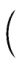*U*0-$\frac{U_{0}R_{2}}{n^{2}R_{1} + R_{2}}$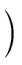,整理可得*P*1=$\frac{{U_{0}}^{2}}{(n + \frac{9}{n})\ ^{2}R}$,可知*n=*3时,*R*1消耗的功率有最大值,可知*R*1消耗的功率先增大,后减小,故C、D错误。

二、选择题:本题共4小题,每小题5分,共20分。在每小题给出的四个选项中,有多项符合题目要求。全部选对的得5分,选对但不全的得3分,有选错的得0分。

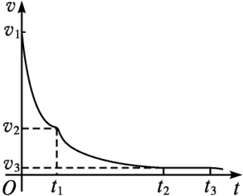

**7.** (2022·湖南,7,5分)神舟十三号返回舱进入大气层一段时间后,逐一打开引导伞、减速伞、主伞,最后启动反冲装置,实现软着陆。某兴趣小组研究了减速伞打开后返回舱的运动情况,将其运动简化为竖直方向的直线运动,其*v-t*图像如图所示。设该过程中,重力加速度不变,返回舱质量不变,下列说法正确的是(
AC　)

A.在0*~t*1时间内,返回舱重力的功率随时间减小

B.在0*~t*1时间内,返回舱的加速度不变

C.在*t*1*~t*2时间内,返回舱的动量随时间减小

D.在*t*2*~t*3时间内,返回舱的机械能不变

解析
由*v-t*图像可知,0*~t*1时间内,返回舱的速度减小,加速度减小,返回舱重力的瞬时功率*P=mg*·*v*变小,故A正确,B错误;*t*1*~t*2时间内,返回舱的速度继续减小,返回舱的质量不变,则返回舱的动量*p=mv*减小,故C正确;*t*2*~t*3时间内,返回舱的速度不变,动能不变,高度下降,重力势能减小,返回舱的机械能减小,故D错误。

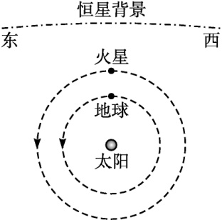

**8.** (2022·湖南,8,5分)如图所示,火星与地球近似在同一平面内,绕太阳沿同一方向做匀速圆周运动,火星的轨道半径大约是地球的1.5倍。地球上的观测者在大多数的时间内观测到火星相对于恒星背景由西向东运动,称为顺行;有时观测到火星由东向西运动,称为逆行。当火星、地球、太阳三者在同一直线上,且太阳和火星位于地球两侧时,称为火星冲日。忽略地球自转,只考虑太阳对行星的引力,下列说法正确的是(
CD　)

A.火星的公转周期大约是地球的$\sqrt{\frac{8}{27}}$倍

B.在冲日处,地球上的观测者观测到火星的运动为顺行

C.在冲日处,地球上的观测者观测到火星的运动为逆行

D.在冲日处,火星相对于地球的速度最小

解析
由开普勒第三定律得,$\frac{{r_{\text{火}}}^{3}}{{T_{\text{火}}}^{2}} = \frac{{r_{\text{地}}}^{3}}{{T_{\text{地}}}^{2}}$,*r*火=$\frac{3}{2}$*r*地,则*T*火=$\sqrt{\frac{27}{8}}$*T*地,故A错误;由$\frac{Gm_{\text{太}}m}{r^{2}}$*=mω*2*r*得*ω=*$\sqrt{\frac{Gm_{\text{太}}}{r^{3}}}$,轨道半径越大,角速度越小,由于火星轨道半径大于地球轨道半径,因此火星运动的角速度小于地球运动的角速度,在冲日处,以地球为参考系,火星运动为逆行,故C正确,B错误;由于火星和地球运动的线速度大小不变,在冲日处火星与地球线速度的方向相同,所以此时火星与地球的相对速度最小,故D正确。

**9.** (2022·湖南,9,5分)球形飞行器安装了可提供任意方向推力的矢量发动机,总质量为*m*。飞行器飞行时受到的空气阻力大小与其速率二次方成正比(即*F*阻*=kv*2,*k*为常量)。当发动机关闭时,飞行器竖直下落,经过一段时间后,其匀速下落的速率为10
m/s;当发动机以最大推力推动飞行器竖直向上运动,经过一段时间后,飞行器匀速向上的速率为5
m/s。重力加速度大小为*g*,不考虑空气相对于地面的流动及飞行器质量的变化,下列说法正确的是(
BC　)

A.发动机的最大推力为1.5*mg*

B.当飞行器以5
m/s匀速水平飞行时,发动机推力的大小为$\frac{\sqrt{17}}{4}$*mg*

C.发动机以最大推力推动飞行器匀速水平飞行时,飞行器速率为5$\sqrt{3}$ m/s

D.当飞行器以5 m/s的速率飞行时,其加速度大小可以达到3*g*

解析 关

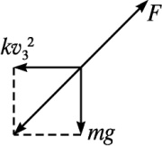

闭发动机飞行器匀速下落时,有*k*${v_{1}}^{2}$*=mg*,当发动机以最大推力推动飞行器竖直向上运动时,有*F*max*=mg+k*${v_{2}}^{2}$,解得*F*max=1.25*mg*,故A错误。当飞行器以5
m/s匀速水平飞行时,假设飞行器向右飞,对飞行器进行受力分析如图所示,由受力分析得*F=*$\sqrt{(mg)^{2} + (k{v_{3}}^{2})^{2}} = \frac{\sqrt{17}}{4}$*mg*,故B正确。当发动机以最大推力推动飞行器匀速水平飞行时,设飞行器速度为*v*4,*k*${v_{4}}^{2} = \sqrt{{F_{\max}}^{2}\text{-(}mg)^{2}}$,又*k*${v_{1}}^{2}$*=mg*,得*v*4=5$\sqrt{3}$
m/s,故C正确。当发动机的最大推力向下,飞行器以*v*5=5
m/s的速率向上减速飞行时,其加速度达到最大值,由牛顿第二定律得*F*max*+mg+k*${v_{5}}^{2}$*=ma*,解得*a=*2.5*g*,故D错误。

**10.** (2022·湖南,10,5分)如图所示,间距*l=*1
m的U形金属导轨,一端接有0.1 Ω的定值电阻*R*,固定在高*h=*0.8
m的绝缘水平桌面上。质量均为0.1
kg的匀质导体棒a和b静止在导轨上,两导体棒与导轨接触良好且始终与导轨垂直,接入电路的阻值均为0.1
Ω,与导轨间的动摩擦因数均为0.1(设最大静摩擦力等于滑动摩擦力),导体棒a距离导轨最右端1.74
m。整个空间存在竖直向下的匀强磁场(图中未画出),磁感应强度大小为0.1
T。用*F=*0.5
N沿导轨水平向右的恒力拉导体棒a,当导体棒a运动到导轨最右端时,导体棒b刚要滑动,撤去*F*,导体棒a离开导轨后落到水平地面上。重力加速度取10
m/s2,不计空气阻力,不计其他电阻,下列说法正确的是( BD　)

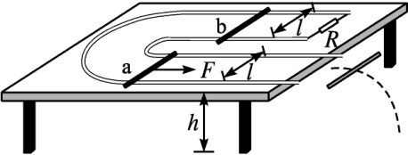

A.导体棒a离开导轨至落地过程中,水平位移为0.6 m

B.导体棒a离开导轨至落地前,其感应电动势不变

C.导体棒a在导轨上运动的过程中,导体棒b有向右运动的趋势

D.导体棒a在导轨上运动的过程中,通过电阻*R*的电荷量为0.58 C

解析
当导体棒b刚要滑动时,有*F*安*=μmg,F*安*=BI*b*l*,设此时导体棒a的速度为*v,E=Blv,I*总=$\frac{E}{R_{\text{总}}}$,*I*总*=I*b*+IR=*2*I*b,*R*总*=R*a+$\frac{R_{b}R}{R_{b} + R}$,解得*v=*3
m/s,导体棒a离开轨道做平抛运动,由*h=*$\frac{1}{2}$*gt*2,*x=vt*知,*x=*1.2
m,故A错误;导体棒a离开轨道做平抛运动过程中与磁场垂直,水平速度*v*不变,由*E=Blv*知,其感应电动势不变,故B正确;导体棒a在导轨上运动的过程中,由右手定则判断出电路中电流方向,又由左手定则知导体棒b受到的安培力的方向向左,导体棒b有向左运动的趋势,故C错误;导体棒a在导轨上运动的过程中,通过电路的电荷量*q=*$\overline{I}$Δ*t=*$\frac{Bl\cdot \Delta x}{R_{\text{总}}}$=1.16
C,导体棒b与电阻*R*并联,*I*b*=IR*,则通过电阻*R*的电荷量*q'=*$\frac{q}{2}$=0.58
C,故D正确。

三、非选择题:共56分。第11*~*14题为必考题,每个试题考生都必须作答。第15、16题为选考题,考生根据要求作答。

(一)必考题:共43分。

**11.** (2022·湖南,11,6分)小圆同学用橡皮筋、同种一元硬币、刻度尺、塑料袋、支架等,设计了如图甲所示的实验装置,测量冰墩墩玩具的质量。主要实验步骤如下:

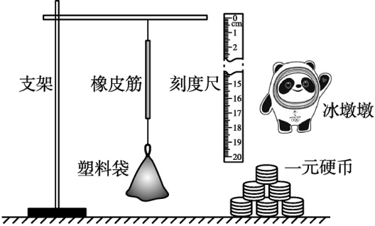

甲

(1)查找资料,得知每枚硬币的质量为6.05 g。

(2)将硬币以5枚为一组逐次加入塑料袋,测量每次稳定后橡皮筋的长度*l*,记录数据如下表:

| 序号             | 1       | 2       | 3       | 4       | 5       |
|------------------|---------|---------|---------|---------|---------|
| 硬币数量*n/*枚   | 5       | 10      | 15      | 20      | 25      |
| 橡皮筋长度*l/*cm | 10.51 | 12.02 | 13.54 | 15.05 | 16.56 |

(3)根据表中数据在图乙上描点,绘制图线:

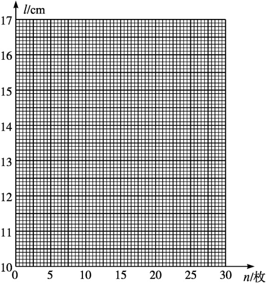

乙

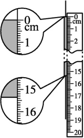

丙

(4)取出全部硬币,把冰墩墩玩具放入塑料袋中,稳定后橡皮筋长度的示数如图丙所示,此时橡皮筋的长度为*<u>　　</u>*
cm。 

(5)由上述数据计算得冰墩墩玩具的质量为*<u>　　</u>*
g(计算结果保留3位有效数字)。 

答案 (3)如图所示

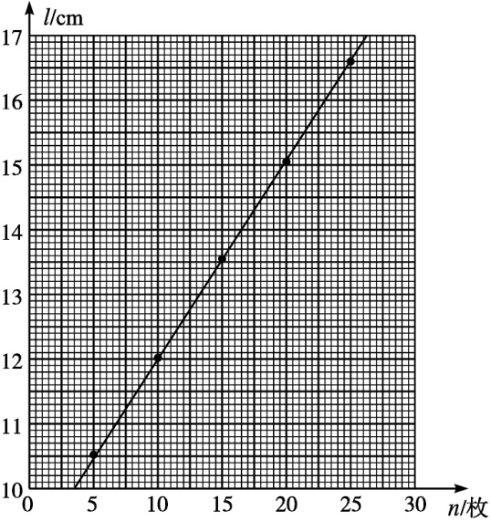

(4)15.35　(5)127

解析 (4)由题图丙可知,刻度尺的分度值为1 mm,读数为15 cm+3.5
mm=153.5 mm=15.35 cm。

(5)设橡皮筋的劲度系数为*k*,原长为*x*0,则

*n*1*mg=k(x*1*-x*0)

*n*5*mg=k(x*5*-x*0)

设冰墩墩质量为*m*1,则有*m*1*g=k(l-x*0)

联立各式代入数据解得*m*1=127 g。

**12.** (2022·湖南,12,9分)小梦同学自制了一个两挡位(“×1”“×10”)的欧姆表,其内部结构如图所示,*R*0为调零电阻(最大阻值为*R*0m),*Rs*、*Rm*、*Rn*为定值电阻(*Rs+R*0m*\<Rm\<Rn*),电流表G的内阻为*R*G(*Rs*≪*R*G)。用此欧姆表测量一待测电阻的阻值,回答下列问题:

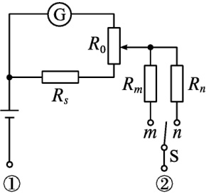

(1)短接*①②*,将单刀双掷开关S与*m*接通,电流表G示数为*Im*;保持电阻*R*0滑片位置不变,将单刀双掷开关S与*n*接通,电流表G示数变为*In*,则*Im<u>　　</u>*(选填“大于”或“小于”)*In*。 

(2)将单刀双掷开关S与*n*接通,此时欧姆表的挡位为*<u>　　</u>*(选填“×1”或“×10”)。 

(3)若从“×1”挡位换成“×10”挡位,调整欧姆零点(欧姆零点在电流表G满偏刻度处)时,调零电阻*R*0的滑片应该*<u>　　</u>*(选填“向上”或“向下”)调节。 

(4)在“×10”挡位调整欧姆零点后,在*①②*间接入阻值为100
Ω的定值电阻*R*1,稳定后电流表G的指针偏转到满偏刻度的$\frac{2}{3}$;取走*R*1,在*①②*间接入待测电阻*Rx*,稳定后电流表G的指针偏转到满偏刻度的$\frac{1}{3}$,则*Rx=<u>　　</u>*
Ω。 

答案 (1)大于　(2)×10　(3)向上　(4)400

解析
(1)由*Rm\<Rn*得开关拨向*m*时电路的总电阻小于开关拨向*n*时电路的总电阻,电源电动势不变,根据*I=*$\frac{E}{R}$知,*Im\>In*。

(2)S与*n*接通时,欧姆表内阻大,欧姆表的挡位倍率大,即为“×10”挡。

(3)从“×1”挡位换为“×10”挡位,即开关S从*m*拨向*n*,电路总电阻增大,干路电流减小,*①②*短接时,为了使电流表满偏,则需要增大通过电流表所在支路的电流,所以需要将*R*0的滑片向上调节。

(4)设“×10”挡位时欧姆表内阻为*R*内,电流表满偏电流为*I*g,电路简化结构如图

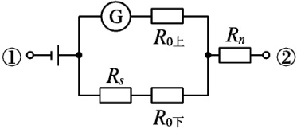

则$\frac{(R_{0\text{上}} + R_{G})I_{g}}{R_{0\text{下}} + R_{s}}$*+I*g=$\frac{E}{R_{\text{内}}}$

$\frac{\frac{2}{3}I_{g}(R_{0\text{上}} + R_{G})}{R_{0\text{下}} + R_{s}} + \frac{2}{3}$*I*g=$\frac{E}{R_{\text{内}} + 100\Omega}$

$\frac{\frac{1}{3}I_{g}(R_{0\text{上}} + R_{G})}{R_{0\text{下}} + R_{s}} + \frac{1}{3}$*I*g=$\frac{E}{R_{\text{内}} + R_{x}}$

解得*Rx=*400 Ω。

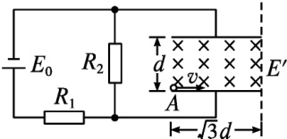

**13.** (2022·湖南,13,13分)如图所示,两个定值电阻的阻值分别为*R*1和*R*2,直流电源的内阻不计,平行板电容器两极板水平放置,板间距离为*d*,板长为$\sqrt{3}$*d*,极板间存在方向水平向里的匀强磁场。质量为*m*、电荷量为*+q*的小球以初速度*v*沿水平方向从电容器下板左侧边缘*A*点进入电容器,做匀速圆周运动,恰从电容器上板右侧边缘离开电容器。此过程中,小球未与极板发生碰撞,重力加速度大小为*g*,忽略空气阻力。

(1)求直流电源的电动势*E*0。

(2)求两极板间磁场的磁感应强度*B*。

(3)在图中虚线的右侧设计一匀强电场,使小球离开电容器后沿直线运动,求电场强度的最小值*E'*。

答案
(1)$\frac{mgd(R_{1} + R_{2})}{qR_{2}}$　(2)$\frac{mv}{2qd}$　(3)$\frac{mg}{2q}$

解析
(1)小球在电磁场中做匀速圆周运动,小球受的静电力大小与重力大小相等,即*mg=q*$\frac{U}{d}$

又由于*U=*$\frac{E_{0}}{R_{1} + R_{2}}$·*R*2

得*E*0=$\frac{mgd(R_{1} + R_{2})}{qR_{2}}$。

(2)如图所示

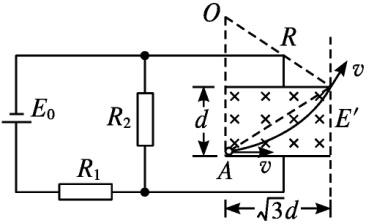

设粒子在电磁场中做圆周运动的半径为*R*,根据几何关系得

(*R-d*)2+($\sqrt{3}$*d*)2*=R*2

解得*R=*2*d*

由*qvB=*$\frac{mv^{2}}{R}$

得*B=*$\frac{mv}{2qd}$。

(3)小球离开电磁场时速度方向与竖直方向夹角为30°,要使小球做直线运动,需使小球所受静电力在垂直于小球速度方向的分力与重力在垂直于小球速度方向的分力相等。当静电力在平行于小球速度方向的分力为零时,静电力最小,电场强度最小,可得*qE'=mg*sin
30°

解得*E'=*$\frac{mg}{2q}$。

**14.** (2022·湖南,14,15分)如图甲所示,质量为*m*的篮球从离地*H*高度处由静止下落,与地面发生一次非弹性碰撞后反弹至离地*h*的最高处。设篮球在运动过程中所受空气阻力的大小是篮球所受重力的*λ*倍*λ*为常数且0*\<λ\<*$\frac{H-h}{H + h}$,且篮球每次与地面碰撞的碰后速率与碰前速率之比相同,重力加速度大小为*g*。

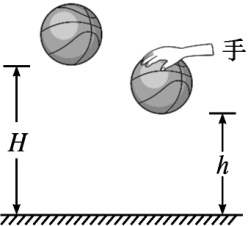

甲

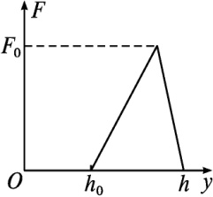

乙

(1)求篮球与地面碰撞的碰后速率与碰前速率之比。

(2)若篮球反弹至最高处*h*时,运动员对篮球施加一个向下的压力*F*,使得篮球与地面碰撞一次后恰好反弹至*h*的高度处,力*F*随高度*y*的变化如图乙所示,其中*h*0已知,求*F*0的大小。

(3)篮球从*H*高度处由静止下落后,每次反弹至最高点时,运动员拍击一次篮球(拍击时间极短),瞬间给其一个竖直向下、大小相等的冲量*I*,经过*N*次拍击后篮球恰好反弹至*H*高度处,求冲量*I*的大小。

答案
(1)$\sqrt{\frac{(1 + \lambda)h}{(1-\lambda)H}}$　(2)$\frac{2(1-\lambda\text{)(}H-h)mg}{h-h_{0}}$　(3)*m*$\sqrt{\frac{2g(1-\lambda\text{)(}H-h\text{)(}H^{N + 1}-h^{N + 1})}{h(H^{N}-h^{N})}}$

解析
(1)设篮球第一次与地面碰前速率为*v*下,碰后速率为*v*上

由动能定理得(*mg-λmg)H=*$\frac{1}{2}m{v_{\text{下}}}^{2}$-0

-(*mg+λmg*)·*h=*0-$\frac{1}{2}m{v_{\text{上}}}^{2}$

解得*k=*$\frac{v_{\text{上}}}{v_{\text{下}}} = \sqrt{\frac{(1 + \lambda)h}{(1-\lambda)H}}$。

(2)根据能量守恒定律得,*F*做的功等于全过程克服阻力做的功和篮球与地面碰撞损失的动能,即*F*0·$\frac{h-h_{0}}{2}$*=λmg*·2*h+*$\frac{1}{2}m{v_{\text{下}}}^{2} - \frac{1}{2}m{v_{\text{上}}}^{2}$

解得*F*0=$\frac{2(1-\lambda\text{)(}H-h)mg}{h-h_{0}}$。

(3)由(1)问可知篮球上升和下降过程中的加速度分别为

*a*下=(1*-λ)g*(方向向下)

*a*上=(1*+λ)g*(方向向下)

由题知运动员拍击一次篮球(拍击时间极短),瞬间给其一个竖直向下、大小相等的冲量*I*,由于拍击时间极短,则重力的冲量可忽略不计,则根据动量定理有*I=mv*

即每拍击一次篮球将给它一个速度*v*。

拍击第1次下降过程有

${v_{1}}^{2}$*-v*2=2(1*-λ)gh*0

上升过程有

(*kv*1)2=2(1*+λ)gh*1

代入*k*后,上升过程有*h*${v_{1}}^{2}$=2(1*-λ)gHh*1

联立有*h*1=$\frac{h}{H}\left\lbrack h_{0} + \frac{v^{2}}{2g(1-\lambda)} \right\rbrack = \left( \frac{h}{H} \right)^{1}$·*h*0+$\left( \frac{h}{H} \right)^{1} \cdot \frac{v^{2}}{2g(1-\lambda)}$

拍击第2次,同理代入*k*后,下降过程有

${v_{2}}^{2}$*-v*2=2(1*-λ)gh*1

上升过程有*h*${v_{2}}^{2}$= 2(1*-λ)gHh*2

联立有*h*2=$\frac{h}{H}\left\lbrack h_{1} + \frac{v^{2}}{2g(1-\lambda)} \right\rbrack$

再将*h*1代入*h*2有*h*2=$\left( \frac{h}{H} \right)^{2}$·*h*0+$\left( \frac{h}{H} \right)^{2} \cdot \frac{v^{2}}{2g(1-\lambda)} + \left( \frac{h}{H} \right)^{1} \cdot \frac{v^{2}}{2g(1-\lambda)}$

拍击第3次,同理代入*k*后,下降过程有

${v_{3}}^{2}$*-v*2= 2(1*-λ)gh*2

上升过程有*h*${v_{3}}^{2}$=2(1*-λ)gHh*3

联立有*h*3=$\frac{h}{H}\left\lbrack h_{2} + \frac{v^{2}}{2g(1-\lambda)} \right\rbrack$

再将*h*2代入*h*3有

*h*3=$\left( \frac{h}{H} \right)^{3}$·*h*0+$\left( \frac{h}{H} \right)^{3} \cdot \frac{v^{2}}{2g(1-\lambda)} + \left( \frac{h}{H} \right)^{2} \cdot \frac{v^{2}}{2g(1-\lambda)} + \left( \frac{h}{H} \right)^{1} \cdot \frac{v^{2}}{2g(1-\lambda)}$

直到拍击第*N*次,同理代入*k*后,下降过程有

${v_{N}}^{2}$*-v*2=2(1*-λ)ghN-*1

上升过程有*h*${v_{N}}^{2}$=2(1*-λ)gHhN*

联立有*hN=*$\frac{h}{H}\left\lbrack h_{N-1} + \frac{v^{2}}{2g(1-\lambda)} \right\rbrack$

将*hN-*1代入*hN*有*hN=*$\left( \frac{h}{H} \right)^{N}$·*h*0+$\left( \frac{h}{H} \right)^{N} \cdot \frac{v^{2}}{2g(1-\lambda)} + \left( \frac{h}{H} \right)^{N-1} \cdot \frac{v^{2}}{2g(1-\lambda)}$+…+$\left( \frac{h}{H} \right)^{1} \cdot \frac{v^{2}}{2g(1-\lambda)}$

其中*hN=H,h*0*=h*

则有*H=*$\left( \frac{h}{H} \right)^{N}$·*h+*$\left\lbrack \frac{\left( \frac{h}{H} \right)^{N + 1}-\frac{h}{H}}{\frac{h}{H}-1} \right\rbrack\frac{v^{2}}{2g(1-\lambda)}$

则*I=mv=m*$\sqrt{\frac{2g(1-\lambda\text{)(}H-h\text{)(}H^{N + 1}-h^{N + 1})}{h(H^{N}-h^{N})}}$。

(二)选考题:共13分。请考生从两道题中任选一题作答。如果多做,则按第一题计分。

**15.** (2022·湖南,15,13分)\[物理——选修3-3\]

(1)(5分)利用“涡流效应”可实现冷热气体的分离。如图所示,一冷热气体分离装置由喷嘴、涡流室、环形管、分离挡板和冷热两端管等构成。高压氮气由喷嘴切向流入涡流室中,然后以螺旋方式在环形管中向右旋转前进,分子热运动速率较小的气体分子将聚集到环形管中心部位,而分子热运动速率较大的气体分子将聚集到环形管边缘部位。气流到达分离挡板处时,中心部位气流与分离挡板碰撞后反向,从*A*端流出,边缘部位气流从*B*端流出。下列说法正确的是*<u>　　</u>*(选对1个得2分,选对2个得4分,选对3个得5分。每选错1个扣3分,最低得分为0分)。 

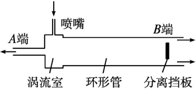

A.*A*端为冷端,*B*端为热端

B.*A*端流出的气体分子热运动平均速率一定小于*B*端流出的

C.*A*端流出的气体内能一定大于*B*端流出的

D.该装置气体进出的过程满足能量守恒定律,但违背了热力学第二定律

E.该装置气体进出的过程既满足能量守恒定律,也满足热力学第二定律

(2)(8分)如图所示,小赞同学设计了一个液体拉力测量仪。一个容积*V*0=9.9
L的导热汽缸下接一圆管,用质量*m*1=90 g、横截面积*S=*10
cm2的活塞封闭一定质量的理想气体,活塞与圆管壁间摩擦不计。活塞下端用轻质细绳悬挂一质量*m*2=10
g的U形金属丝,活塞刚好处于*A*位置。将金属丝部分浸入待测液体中,缓慢升起汽缸,使金属丝从液体中拉出,活塞在圆管中的最低位置为*B*。已知*A*、*B*间距离*h=*10
cm,外界大气压强*p*0=1.01×105
Pa,重力加速度*g*取10 m/s2,环境温度保持不变。求

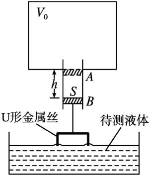

(*ⅰ*)活塞处于*A*位置时,汽缸中的气体压强*p*1;

(*ⅱ*)活塞处于*B*位置时,液体对金属丝拉力*F*的大小。

答案 (1)ABE　(2)(*ⅰ*)1.0×105 Pa　(*ⅱ*)1 N

解析
(1)由题意得,分子热运动速率较小的气体从*A*端流出,分子热运动速率较大的气体从*B*端流出,又同种气体中平均分子速率较大的部分温度较高,故*A*端为冷端,*B*端为热端,故A、B正确;内能的多少除了与温度有关还与分子数有关,故不能得出从*A*端流出的气体内能一定大于从*B*端流出的气体内能,故C错误;该装置将冷热气体进行分离,喷嘴处有高压,并非是自发进行的,没有违背热力学第二定律,任何过程都满足能量守恒定律,故D错误,E正确。

(2)(*ⅰ*)当活塞处于*A*位置时,对活塞与金属丝整体受力分析得

*p*0*S=p*1*S+(m*1*+m*2)*g*

代入数据解得*p*1=1.0×105 Pa。

(*ⅱ*)当活塞处于*B*位置时,设汽缸内气体的压强为*p*2,则有*p*1*V*0*=p*2(*V*0*+Sh*)

代入数据解得*p*2=9.9×104 Pa

对活塞与金属丝整体受力分析得

*p*0*S=p*2*S+(m*1*+m*2)*g+F*

解得*F=*1 N。

**16.** (2022·湖南,16,13分)\[物理——选修3-4\]

(1)(5分)下端附着重物的粗细均匀木棒,竖直浮在河面,在重力和浮力作用下,沿竖直方向做频率为1
Hz的简谐运动;与此同时,木棒在水平方向上随河水做匀速直线运动,如图甲所示。以木棒所受浮力*F*为纵轴,木棒水平位移*x*为横轴建立直角坐标系,浮力*F*随水平位移*x*的变化如图乙所示。已知河水密度为*ρ*,木棒横截面积为*S*,重力加速度大小为*g*。下列说法正确的是*<u>　　</u>*(选对1个得2分,选对2个得4分,选对3个得5分。每选错1个扣3分,最低得分为0分)。 

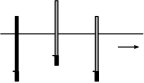

甲

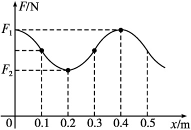

乙

A.*x*从0.05 m到0.15 m的过程中,木棒的动能先增大后减小

B.*x*从0.21 m到0.25 m的过程中,木棒加速度方向竖直向下,大小逐渐变小

C.*x=*0.35 m和*x=*0.45 m时,木棒的速度大小相等,方向相反

D.木棒在竖直方向做简谐运动的振幅为$\frac{F_{1}-F_{2}}{2\rho Sg}$

E.木棒的运动为向*x*轴正方向传播的机械横波,波速为0.4 m/s

(2)(8分)如图所示,某种防窥屏由透明介质和对光完全吸收的屏障构成,其中屏障垂直于屏幕平行排列,可实现对像素单元可视角度*θ*的控制(可视角度*θ*定义为某像素单元发出的光在图示平面内折射到空气后最大折射角的2倍)。透明介质的折射率*n=*2,屏障间隙*l=*0.8
mm。发光像素单元紧贴屏下,位于相邻两屏障的正中间。不考虑光的衍射。

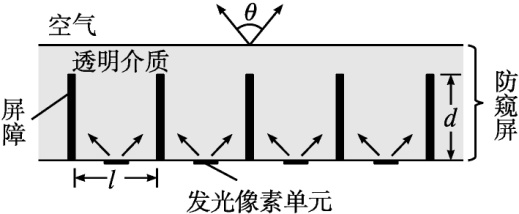

(*ⅰ*)若把发光像素单元视为点光源,要求可视角度*θ*控制为60°,求屏障的高度*d*。

(*ⅱ*)若屏障高度*d'=*1.0
mm,且发光像素单元的宽度不能忽略,求像素单元宽度*x*最小为多少时,其可视角度*θ*刚好被扩为180°(只要看到像素单元的任意一点,即视为能看到该像素单元)。

答案 (1)ABD

(2)(*ⅰ*)$\frac{2\sqrt{15}}{5}$
mm　(*ⅱ*)$\frac{10\sqrt{3}-12}{15}$ mm

解析 (1)由题图乙知,*x*从0.05 m到0.15
m过程中浮力变小,木棒从深处向上运动,越过平衡位置继续向上运动,木棒的动能先增大后减小,故A正确;*x*从0.21
m到0.25
m过程浮力变大,未过平衡位置,*F*合向下变小,加速度变小,故B正确;木棒同时参与了竖直方向和水平方向两个运动,*x=*0.35
m和*x=*0.45
m处只是竖直方向速度等大反向,故C错误;设木棒在竖直方向处于平衡位置时在水中部分的长度为*h*,振幅为*A*,则$\frac{F_{1} + F_{2}}{2}$*=ρgSh,F*1*=ρgS(A+h*),联立两式得$\frac{F_{1}-F_{2}}{2}$*=ρgSA*,得*A=*$\frac{F_{1}-F_{2}}{2\rho gS}$,故D正确;木棒上各质点相对静止随木棒一起运动,不能看成向*x*轴正方向传播的机械波,故E错误。

(2)(*ⅰ*)

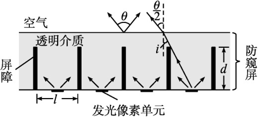

当*θ=*60°时,根据$\frac{\sin\text{ }\frac{\theta}{2}}{\sin i}$=2可得sin
*i=*$\frac{1}{4}$

根据数学知识可知tan *i=*$\frac{1}{\sqrt{15}}$

由几何知识可知tan *i=*$\frac{\frac{l}{2}}{d}$

解得*d=*$\frac{2\sqrt{15}}{5}$ mm。

(*ⅱ*)当*θ'=*180°时,根据$\frac{\sin\frac{\theta'}{2}}{\sin i\overset{}{'}}$=2可得sin
*i'=*$\frac{1}{2}$

根据数学知识可知tan *i'=*$\frac{1}{\sqrt{3}}$

由几何知识可知tan *i'=*$\frac{x'}{d'}$

解得*x'=*$\frac{\sqrt{3}}{3}$ mm

则*x=*2*x'-*$\frac{l}{2}$=$\frac{10\sqrt{3}-12}{15}$
mm。
