# 2023 年湖南卷 · 物理

> **卷别**：湖南自主命题　|　**含解析**：是　|　**来源**：物理备课大师（wl.eywedu.com）Word 版含解析
> **说明**：由官方 Word 版转换，公式为 LaTeX，图片见同目录 `images/`。

---

2023年普通高等学校招生全国统一考试

物理(湖南卷)

一、选择题:本题共6小题,每小题4分,共24分。在每小题给出的四个选项中,只有一项符合题目要求。

**1.** 2023年4月13日,中国“人造太阳”反应堆中科院环流器装置(EAST)创下新纪录,实现403秒稳态长脉冲高约束模等离子体运行,为可控核聚变的最终实现又向前迈出了重要的一步,下列关于核反应的说法正确的是(　A　)

　　　　　　　　

A.相同质量的核燃料,轻核聚变比重核裂变释放的核能更多

B.氘氚核聚变的核反应方程为$\ _{1}^{2}H +_{1}^{3}H\text{→}_{2}^{4}$He$+_{-1}^{　0}$e

C.核聚变的核反应燃料主要是铀235

D.核聚变反应过程中没有质量亏损

解析核聚变是轻核的聚变,相同质量的核燃料,轻核聚变比重核裂变释放的核能更多,A正确,C错误;氘氚核聚变反应遵守电荷数守恒和质量数守恒,B错误;核聚变反应有质量亏损,D错误。

**2.** 如图甲所示,我国某些农村地区人们用手抛撒谷粒进行水稻播种。某次抛出的谷粒中有两颗的运动轨迹如图乙所示,其轨迹在同一竖直平面内,抛出点均为*O*,且轨迹交于*P*点,抛出时谷粒1和谷粒2的初速度分别为*v*1和*v*2,其中*v*1方向水平,*v*2方向斜向上。忽略空气阻力,关于两谷粒在空中的运动,下列说法正确的是(　B　)

甲

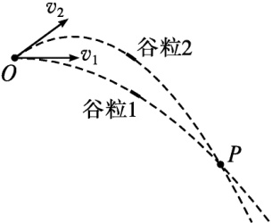

乙

A.谷粒1的加速度小于谷粒2的加速度

B.谷粒2在最高点的速度小于*v*1

C.两谷粒从*O*到*P*的运动时间相等

D.两谷粒从*O*到*P*的平均速度相等

解析由题知,两谷粒在空中运动时只受重力,加速度均为重力加速度,A错误;谷粒1做平抛运动,谷粒2做斜上抛运动,因都过*P*点,说明从开始抛出到过*P*点,两谷粒竖直位移相同,根据位移公式*y*1=$\frac{1}{2}g{t_{1}}^{2}$,*y*2*=-v*2*y**t*2+$\frac{1}{2}g{t_{2}}^{2}$,由此可知,谷粒2从*O*到*P*的运动时间长,平均速度小,C、D错误;从*O*到*P*,谷粒2运动时间长,但水平位移与谷粒1相等且谷粒2在最高点的速度为其初速度的水平分量,故谷粒2在最高点的速度小于*v*1,B正确。

**3.** 如图甲所示,在均匀介质中有*A*、*B*、*C*和*D*四点,其中*A*、*B*、*C*三点位于同一直线上,*AC=BC=*4
m,*DC=*3
m,*DC*垂直*AB*。*t=*0时,位于*A*、*B*、*C*处的三个完全相同的横波波源同时开始振动,振动图像均如图乙所示,振动方向与平面*ABD*垂直,已知波长为4
m。下列说法正确的是(　C　)

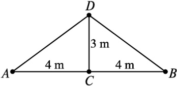

甲

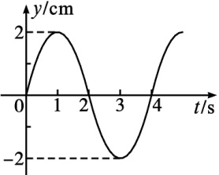

乙

A.这三列波的波速均为2 m/s

B.*t=*2 s时,*D*处的质点开始振动

C.*t=*4.5 s时,*D*处的质点向*y*轴负方向运动

D.*t=*6 s时,*D*处的质点与平衡位置的距离是6 cm

解析由题图乙可知,波的周期为4
s,波速为*v=*$\frac{\lambda}{T} = \frac{4m}{4s}$=1 m/s,A错误;*t=*2
s时,这三列波都还没有传到*D*点,*D*处的质点没有振动,B错误;*t=*4.5
s时,*A*、*B*处的振动没有传到*D*点,*C*处的振动传到*D*点后,又振动了1.5
s,根据题图乙可知,*D*处的质点正向*y*轴负方向运动,C正确;*t=*6
s时,*A*、*B*处的振动传到*D*点时,都使*D*处的质点向*y*轴正方向振动了1
s,而*C*处的振动传到*D*时,使*D*处的质点处在平衡位置且向*y*轴负方向振动,根据波的叠加原理知,此时,*D*处的质点与平衡位置的距离是4
cm,D错误。

**4.** 根据宇宙大爆炸理论,密度较大区域的物质在万有引力作用下,不断聚集可能形成恒星。恒星最终的归宿与其质量有关,如果质量为太阳质量的1*~*8倍将坍缩成白矮星,质量为太阳质量的10*~*20倍将坍缩成中子星,质量更大的恒星将坍缩成黑洞。设恒星坍缩前后可看成质量均匀分布的球体,质量不变,体积缩小,自转变快。不考虑恒星与其它物体的相互作用。已知逃逸速度为第一宇宙速度的$\sqrt{2}$倍,中子星的密度大于白矮星的密度。根据万有引力理论,下列说法正确的是(　B　)

A.同一恒星表面任意位置的重力加速度相同

B.恒星坍缩后表面两极处的重力加速度比坍缩前的大

C.恒星坍缩前后的第一宇宙速度不变

D.中子星的逃逸速度小于白矮星的逃逸速度

解析恒星自转,类比地球表面,可知同一恒星表面的重力加速度不都相同,A错误;由于恒星坍缩后质量不变,半径减小,根据万有引力定律得*G*$\frac{Mm}{R^{2}}$*=mg,g=*$\frac{GM}{R^{2}}$,可知恒星坍缩后表面两极处的重力加速度比坍缩前的大,B正确;根据*G*$\frac{Mm}{R^{2}}$*=m*$\frac{v^{2}}{R}$得*v=*$\sqrt{\frac{GM}{R}}$,可知恒星坍缩后的第一宇宙速度比坍缩前的大,C错误;由*M=ρ*·$\frac{4}{3}$π*R*3,*v=*$\sqrt{\frac{GM}{R}}$,*v*逃=$\sqrt{2}$*v*得*v*逃=$\sqrt{\frac{2GM\frac{\sqrt[3]{4\rho\pi}}{　}}{\sqrt[3]{3M}}}$,又由于中子星的密度大于白矮星的密度,因此中子星的逃逸速度大于白矮星的逃逸速度,D错误。

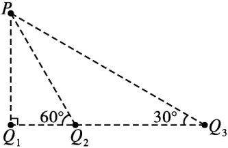

**5.** 如图所示,真空中有三个点电荷固定在同一直线上,电荷量分别为*Q*1、*Q*2和*Q*3,*P*点和三个点电荷的连线与点电荷所在直线的夹角分别为90°、60°和30°。若*P*点处的电场强度为零,*q\>*0,则三个点电荷的电荷量可能为(　D　)

A.*Q*1*=q,Q*2=$\sqrt{2}$*q,Q*3*=q*

B.*Q*1*=-q,Q*2=-$\frac{4\sqrt{3}}{3}$*q,Q*3=-4*q*

C.*Q*1*=-q,Q*2=$\sqrt{2}$*q,Q*3*=-q*

D.*Q*1*=q,Q*2=-$\frac{4\sqrt{3}}{3}$*q,Q*3=4*q*

解析根据电场强度的矢量性可知,要使*P*点的电场强度为零,三个点电荷不可能是同种电性,故A、B错误;根据矢量叠加特点和几何关系知,*Q*1、*Q*3在*P*点的电场强度应大小相等,故C错误,D正确。

**6.** 如图所示,真空中有区域*Ⅰ*和*Ⅱ*,区域*Ⅰ*中存在匀强电场和匀强磁场,电场方向竖直向下(与纸面平行),磁场方向垂直于纸面向里,等腰直角三角形*CGF*区域(区域*Ⅱ*)内存在匀强磁场,磁场方向垂直于纸面向外。图中*A*、*C*、*O*三点在同一直线上,*AO*与*GF*垂直,且与电场和磁场方向均垂直。*A*点处的粒子源持续将比荷一定但速率不同的粒子射入区域*Ⅰ*中,只有沿直线*AC*运动的粒子才能进入区域*Ⅱ*。若区域*Ⅰ*中电场强度大小为*E*、磁感应强度大小为*B*1,区域*Ⅱ*中磁感应强度大小为*B*2,则粒子从*CF*的中点射出,它们在区域*Ⅱ*中运动的时间为*t*0。若改变电场或磁场强弱,能进入区域*Ⅱ*中的粒子在区域*Ⅱ*中运动的时间为*t*,不计粒子的重力及粒子之间的相互作用,下列说法正确的是(　D　)

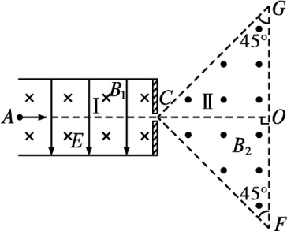

A.若仅将区域*Ⅰ*中磁感应强度大小变为2*B*1,则*t\>t*0

B.若仅将区域*Ⅰ*中电场强度大小变为2*E*,则*t\>t*0

C.若仅将区域*Ⅱ*中磁感应强度大小变为$\frac{\sqrt{3}}{4}$*B*2,则*t=*$\frac{t_{0}}{2}$

D.若仅将区域*Ⅱ*中磁感应强度大小变为$\frac{\sqrt{2}}{4}$*B*2,则*t=*$\sqrt{2}$*t*0

解析在区域*Ⅰ*中,由*qvB*1*=qE*得,粒子速度*v=*$\frac{E}{B_{1}}$,粒子进入区域*Ⅱ*中后,当粒子从*CF*中点射出时,在区域*Ⅱ*中运动半径为*r=*$\frac{\sqrt{2}}{4}$*a(a*为*CF*长度),又由*qvB*2*=m*$\frac{v^{2}}{r}$得*r=*$\frac{mv}{B_{2}q}$,*t*0=$\frac{1}{4}$*T=*$\frac{\pi m}{2B_{2}q}$,运动轨迹如图甲所示。当区域*Ⅰ*中的磁感应强度大小变为2*B*1时,*v*1=$\frac{E}{2B_{1}} = \frac{v}{2}$,这时粒子进入区域*Ⅱ*后,*r*1=$\frac{mv_{1}}{B_{2}q} = \frac{mv}{2B_{2}q}$*\<r*,粒子还是从*CF*射出,如图乙所示,在区域*Ⅱ*中的运动时间不变,A错误;当区域*Ⅰ*中电场强度大小变为2*E*时,*v*2=$\frac{2E}{B_{1}}$=2*v*,这时粒子进入区域*Ⅱ*后,*r*2=$\frac{2mv}{B_{2}q}$=2*r=*$\frac{\sqrt{2}}{2}$*a*,根据几何关系知,粒子恰好从*F*点射出,如图丙所示,在区域*Ⅱ*中的运动时间不变,B错误;当区域*Ⅱ*中磁感应强度大小变为$\frac{\sqrt{3}}{4}$*B*2时,*r*3=$\frac{mv}{\frac{\sqrt{3}}{4}B_{2}q} = \frac{4}{\sqrt{3}}$*r=*$\sqrt{\frac{2}{3}}$*a*,如图丁所示,这时粒子从*FG*边界射出,轨迹对应的圆心角的正弦值sin
*θ=*$\frac{\frac{\sqrt{2}}{2}a}{\sqrt{\frac{2}{3}}a} = \frac{\sqrt{3}}{2}$,*θ=*$\frac{\pi}{3}$,*t*3=$\frac{\frac{\pi}{3}}{2\pi}$*×T*3=$\frac{1}{6} \times \frac{2\pi m}{\frac{\sqrt{3}}{4}B_{2}q} = \frac{8\sqrt{3}}{9}$*t*0,C错误;当区域*Ⅱ*中磁感应强度大小变为$\frac{\sqrt{2}}{4}$*B*2时,*r*4=$\frac{mv}{\frac{\sqrt{2}}{4}B_{2}q} = \frac{4}{\sqrt{2}}$*r=a*,这时粒子从*FG*边界射出,如图戊所示,轨迹对应的圆心角的正弦值sin
*θ'=*$\frac{\frac{\sqrt{2}}{2}a}{a} = \frac{\sqrt{2}}{2}$,*θ'=*$\frac{\pi}{4}$,*t*4=$\frac{\frac{\pi}{4}}{2\pi}$*×T*4=$\frac{1}{8} \times \frac{2\pi m}{\frac{\sqrt{2}}{4}B_{2}q} = \sqrt{2}$*t*0,D正确。

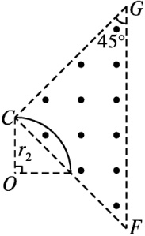

甲

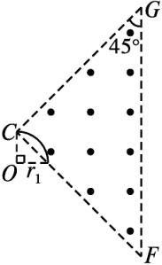

乙

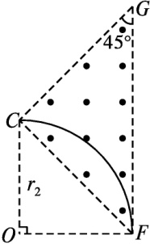

丙

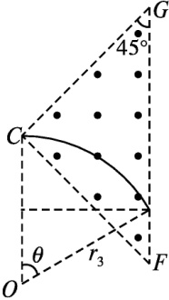

丁

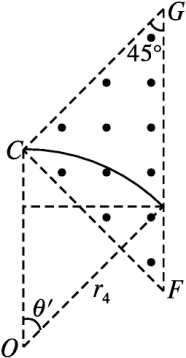

戊

二、选择题:本题共4小题,每小题5分,共20分。在每小题给出的四个选项中,有多项符合题目要求。全部选对的得5分,选对但不全的得3分,有选错的得0分。

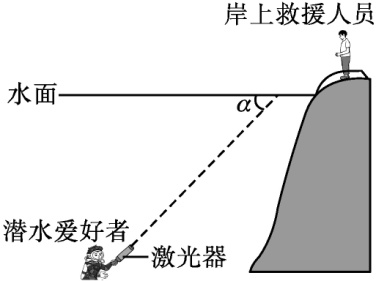

**7.** 一位潜水爱好者在水下活动时,利用激光器向岸上救援人员发射激光信号,设激光光束与水面的夹角为*α*,如图所示。他发现只有当*α*大于41°时,岸上救援人员才能收到他发出的激光光束,下列说法正确的是(　BC　)

A.水的折射率为$\frac{1}{sin41^\circ }$

B.水的折射率为$\frac{1}{sin49^\circ }$

C.当他以*α=*60°向水面发射激光时,岸上救援人员接收激光光束的方向与水面夹角小于60°

D.当他以*α=*60°向水面发射激光时,岸上救援人员接收激光光束的方向与水面夹角大于60°

解析如图甲所示,其临界角*C=*90°*-α,n=*$\frac{1}{\sin C} = \frac{1}{sin49^\circ }$,A错误,B正确;当*α=*60°时,入射角*i=*30°,如图乙所示,根据折射定律,光从光密介质到光疏介质(空气),折射角大于入射角,所以救援人员接收激光光束与水面夹角小于60°,C正确,D错误。

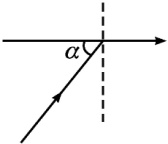

甲

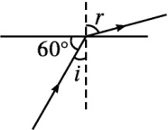

乙

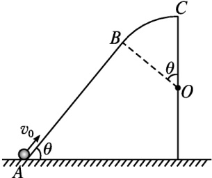

**8.** 如图所示,固定在竖直面内的光滑轨道*ABC*由直线段*AB*和圆弧段*BC*组成,两段相切于*B*点,*AB*段与水平面夹角为*θ,BC*段圆心为*O*,最高点为*C,A*与*C*的高度差等于圆弧轨道的直径2*R*。小球从*A*点以初速度*v*0冲上轨道,能沿轨道运动恰好到达*C*点,下列说法正确的是(　AD　)

A.小球从*B*到*C*的过程中,对轨道的压力逐渐增大

B.小球从*A*到*C*的过程中,重力的功率始终保持不变

C.小球的初速度*v*0=$\sqrt{2gR}$

D.若小球初速度*v*0增大,小球有可能从*B*点脱离轨道

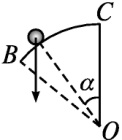

解析小球能沿轨道运动恰好到*C*点,说明*vC=*0,对小球从*A*到*C*运动的过程,根据机械能守恒定律有$\frac{1}{2}m{v_{0}}^{2}$*=mg*·2*R*,得*v*0=$\sqrt{4gR}$,C错误;从*A*到*C*的过程小球竖直方向的速度不断减小,重力的功率不断减小,B错误;设*α*为小球球心与*O*点连线与竖直方向的夹角,从*B*到*C*的过程中*mg*cos
*α-F*N*=m*$\frac{v^{2}}{R}$,*F*N*=mg*cos
*α-m*$\frac{v^{2}}{R}$,*α*减小,cos
*α*增大,*v*减小,所以*F*N增大,A正确;在*B*点,当*mg*cos
*θ*≤*m*$\frac{v^{2}}{R}$时,小球会从*B*点脱离轨道,D正确。

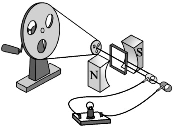

**9.** 某同学自制了一个手摇交流发电机,如图所示。大轮与小轮通过皮带传动(皮带不打滑),半径之比为4*∶*1,小轮与线圈固定在同一转轴上。线圈是由漆包线绕制而成的边长为*L*的正方形,共*n*匝,总阻值为*R*。磁体间磁场可视为磁感应强度大小为*B*的匀强磁场。大轮以角速度*ω*匀速转动,带动小轮及线圈绕转轴转动,转轴与磁场方向垂直。线圈通过导线、滑环和电刷连接一个阻值恒为*R*的灯泡。假设发电时灯泡能发光且工作在额定电压以内,下列说法正确的是(　AC　)

A.线圈转动的角速度为4*ω*

B.灯泡两端电压有效值为3$\sqrt{2}$*nBL*2*ω*

C.若用总长为原来两倍的相同漆包线重新绕制成边长仍为*L*的多匝正方形线圈,则灯泡两端电压有效值为$\frac{4\sqrt{2}nBL^{2}\omega}{3}$

D.若仅将小轮半径变为原来的两倍,则灯泡变得更亮

解析当大轮以角速度*ω*匀速转动时,因为两轮线速度大小相等,所以小轮的角速度为4*ω*,即线圈转动的角速度为4*ω*,A正确;*E*m=4*nBL*2*ω*,其有效值为*E=*$\frac{E_{m}}{\sqrt{2}}$=2$\sqrt{2}$*nBL*2*ω*,灯泡两端电压的有效值为*U=*$\frac{1}{2}$*E=*$\sqrt{2}$*nBL*2*ω*,B错误;若漆包线的长度变为原来的两倍,则漆包线的电阻变为原来的两倍,线圈匝数变为原来的两倍,线圈产生的电动势变为原来的两倍,灯泡两端电压有效值*U'=*$\frac{1}{3}$*E'=*$\frac{4\sqrt{2}nBL^{2}\omega}{3}$,C正确;若将小轮半径变为原来的两倍,则小轮转动的角速度减小,线圈产生的电动势减小,灯泡变暗,D错误。

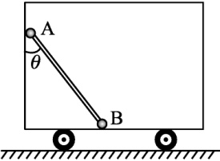

**10.** 如图所示,光滑水平地面上有一质量为2*m*的小车在水平推力*F*的作用下加速运动。车厢内有质量均为*m*的A、B两小球,两球用轻杆相连,A球靠在光滑左壁上,B球处在车厢水平底面上,且与底面的动摩擦因数为*μ*,杆与竖直方向的夹角为*θ*,杆与车厢始终保持相对静止。假设最大静摩擦力等于滑动摩擦力。下列说法正确的是(　CD　)

A.若B球受到的摩擦力为零,则*F=*2*mg*tan *θ*

B.若推力*F*向左,且tan *θ*≤*μ*,则*F*的最大值为2*mg*tan *θ*

C.若推力*F*向左,且*μ\<*tan *θ*≤2*μ*,则*F*的最大值为4*mg*(2*μ-*tan *θ*)

D.若推力*F*向右,且tan *θ\>*2*μ*,则*F*的范围为4*mg*(tan
*θ-*2*μ*)≤*F*≤4*mg*(tan *θ+*2*μ*)

解析设杆的弹力为*F*T,对A球,一定有*F*Tcos
*θ=mg*。若B球受到的摩擦力为0,则对B球,在水平方向有*F*Tsin
*θ=ma*,解得*a=g*tan *θ*,对整体有*F=*4*ma=*4*mg*tan
*θ*,A错误;若推力*F*向左,当A有最大加速度时侧壁对A的弹力为0,此时*a=g*tan
*θ*,当B有最大加速度*a'*时,对B有*μ*·2*mg-F*Tsin *θ=ma'*,且tan
*θ*≤*μ*,解得*a'\>a*,故最大加速度仍为*a*,对整体有*F=*4*ma=*4*mg*tan
*θ*,B错误;若推力*F*向左,且*μ\<*tan
*θ*≤2*μ*,则*a'\<a*,对整体有*F=*4*ma'=*4*mg*(2*μ-*tan
*θ*),C正确;若推力*F*向右,且tan
*θ\>*2*μ*,则B向右的最小加速度为*a*1,对B有*F*T*sin
θ-μ*·2*mg=ma*1,对整体有*F*min=4*ma*1=4*mg*(tan
*θ-*2*μ*),B向右的最大加速度为*a*2,对B有*F*Tsin
*θ+μ*·2*mg=ma*2,对整体有*F*max=4*ma*2=4*mg*(tan
*θ+*2*μ*),故4*mg*(tan *θ-*2*μ*)≤*F*≤4*mg*(tan *θ+*2*μ*),D正确。

三、非选择题:本题共5小题,共56分。

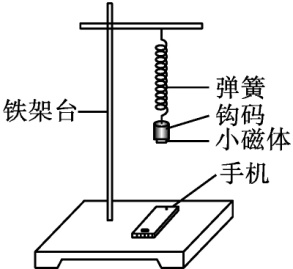

甲

**11.** (7分)某同学探究弹簧振子振动周期与质量的关系,实验装置如图甲所示,轻质弹簧上端悬挂在铁架台上,下端挂有钩码,钩码下表面吸附一个小磁体,其正下方放置智能手机,手机中的磁传感器可以采集磁感应强度实时变化的数据并输出图像,实验步骤如下:

(1)测出钩码和小磁体的总质量*m*。

(2)在弹簧下端挂上该钩码和小磁体,使弹簧振子在竖直方向做简谐运动,打开手机的磁传感器软件,此时磁传感器记录的磁感应强度变化周期等于弹簧振子振动周期。

(3)某次采集到的磁感应强度*B*的大小随时间*t*变化的图像如图乙所示,从图中可以算出弹簧振子振动周期*T=<u>　　</u>*(用“*t*0”表示)。 

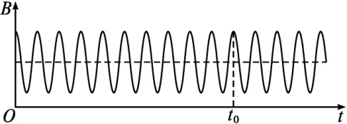

乙

(4)改变钩码质量,重复上述步骤。

(5)实验测得数据如下表所示,分析数据可知,弹簧振子振动周期的二次方与质量的关系是*<u>　　　</u>*(选填“线性的”或“非线性的”)。 

| *m/*kg  | 10*T/*s | *T/*s   | *T*2*/*s2 |
|---------|---------|---------|---------------------------------|
| 0.015 | 2.43  | 0.243 | 0.059                         |
| 0.025 | 3.14  | 0.314 | 0.099                         |
| 0.035 | 3.72  | 0.372 | 0.138                         |
| 0.045 | 4.22  | 0.422 | 0.178                         |
| 0.055 | 4.66  | 0.466 | 0.217                         |

(6)设弹簧的劲度系数为*k*,根据实验结果并结合物理量的单位关系,弹簧振子振动周期的表达式可能是*<u>　　</u>*(填正确答案标号)。 

A.2π$\sqrt{\frac{m}{k}}$ B.2π$\sqrt{\frac{k}{m}}$

C.2π$\sqrt{mk}$ D.2π*k*$\sqrt{m}$

(7)除偶然误差外,写出一条本实验中可能产生误差的原因:*<u> </u>

<u>　</u>*。 

答案(3)$\frac{t_{0}}{10}$　(5)线性的　(6)A　(7)*①*弹簧非轻质弹簧,其质量不可忽略*　②*手机内部有磁体、导体的存在,使得电磁阻尼不可避免(任选一条,其他答案合理也可)

解析
(3)由题图乙知,0*~t*0内有10个完整波形,即*t*0=10*T,T=*$\frac{t_{0}}{10}$。

(5)由表格数据可知,*T*2∝*m*。

(6)由第(5)问知,*T*∝$\sqrt{m}$,选项B错误。已知*T*的单位为s,*m*的单位为kg,*k*的单位为N/m,将各物理量单位代入A、C、D表达式中可得选项A正确,C、D错误。

**12.** (9分)某探究小组利用半导体薄膜压力传感器等元件设计了一个测量微小压力的装置,其电路如图甲所示,*R*1、*R*2、*R*3为电阻箱,*R*F为半导体薄膜压力传感器,*C*、*D*间连接电压传感器(内阻无穷大)。

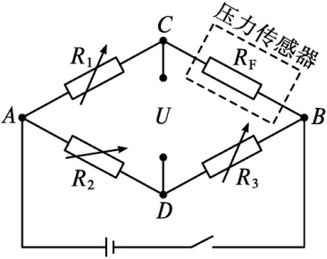

甲

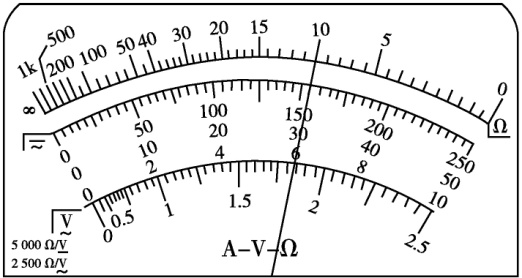

乙

(1)先用欧姆表“×100”挡粗测*R*F的阻值,示数如图乙所示,对应的读数是*<u>　　</u>*
Ω。 

(2)适当调节*R*1、*R*2、*R*3,使电压传感器示数为0,此时,*R*F的阻值为*<u>　　</u>*(用*R*1、*R*2、*R*3表示)。 

(3)依次将0.5
g的标准砝码加载到压力传感器上(压力传感器上所受压力大小等于砝码重力大小),读出电压传感器示数*U*,所测数据如下表所示:

| 次数          | 1     | 2     | 3     | 4     | 5     | 6     |
|---------------|-------|-------|-------|-------|-------|-------|
| 砝码质量*m/*g | 0.0 | 0.5 | 1.0 | 1.5 | 2.0 | 2.5 |
| 电压*U/*mV    | 0     | 57    | 115   | 168   | 220   | 280   |

根据表中数据在图丙上描点,绘制*U-m*关系图线。

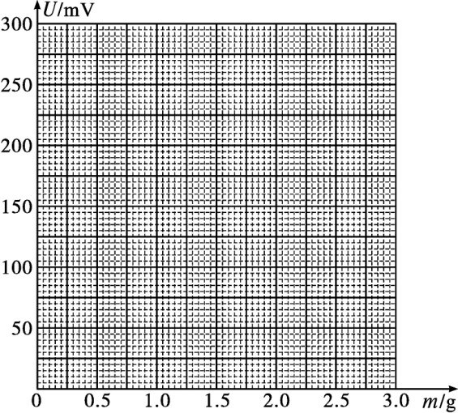

丙

(4)完成前面三步的实验工作后,该测量微小压力的装置即可投入使用。在半导体薄膜压力传感器上施加微小压力*F*0,电压传感器示数为200
mV,则*F*0大小是*<u>　　</u>* N(重力加速度取9.8
m/s2,保留3位有效数字)。 

(5)若在步骤(4)中换用非理想毫伏表测量*C*、*D*间电压,在半导体薄膜压力传感器上施加微小压力*F*1,此时非理想毫伏表读数为200
mV,则*F*1*<u>　　</u>*(选填“*\>*”“=”或“*\<*”)*F*0。 

答案(1)1
000　(2)$\frac{R_{1}R_{3}}{R_{2}}$　(3)如图所示　(4)1.75×10-2　(5)*\>*

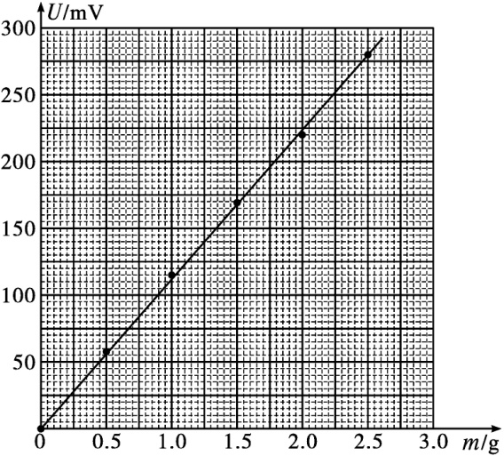

解析 (1)由题图乙知,欧姆表表盘示数为10
Ω,所选挡位为“×100”挡,则对应的读数是10 Ω×100=1 000 Ω。

(2)当电压传感器示数为0时,*C*、*D*点的电势相等,根据串联电路中电压分配规律得$\frac{R_{1}}{R_{F}} = \frac{R_{2}}{R_{3}}$,*R*F=$\frac{R_{1}R_{3}}{R_{2}}$。

(3)根据表格中的数据,描点作图,图线为一条过原点的直线。

(4)由第(3)问图知,*U=*112*m(U*的单位为mV,*m*的单位为g),当*U*0=200
mV时,*m*0=$\frac{200}{112}$
g,则*F*0*=m*0*g=*$\frac{200}{112}$×10-3×9.8
N=1.75×10-2 N。

(5)当*C*、*D*间连接电压传感器(内阻无穷大)时,有

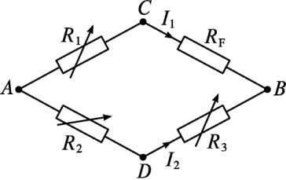

*UCD=I*1*R*F*-I*2*R*3

当*C*、*D*间接非理想毫伏表时,有

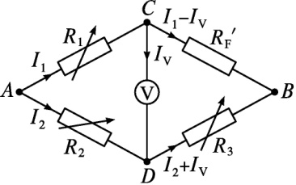

*UCD=(I*1*-I*V)*R*F*'-(I*2*+I*V)*R*3

由以上两式得

*I*1*R*F-(*I*1*-I*V)*R*F*'=I*2*R*3-(*I*2*+I*V)*R*3*\<*0

所以*R*F*\<R*F*'*,则*F*1*\>F*0。

**13.** (10分)汽车刹车助力装置能有效为驾驶员踩刹车省力。如图所示,刹车助力装置可简化为助力气室和抽气气室等部分构成,连杆*AB*与助力活塞固定为一体,驾驶员踩刹车时,在连杆*AB*上施加水平力推动液压泵实现刹车。助力气室与抽气气室用细管连接,通过抽气降低助力气室压强,利用大气压与助力气室的压强差实现刹车助力。每次抽气时,K1打开,K2闭合,抽气活塞在外力作用下从抽气气室最下端向上运动,助力气室中的气体充满抽气气室,达到两气室压强相等;然后,K1闭合,K2打开,抽气活塞向下运动,抽气气室中的全部气体从K2排出,完成一次抽气过程。已知助力气室容积为*V*0,初始压强等于外部大气压强*p*0,助力活塞横截面积为*S*,抽气气室的容积为*V*1。假设抽气过程中,助力活塞保持不动,气体可视为理想气体,温度保持不变。

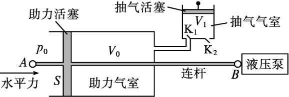

(1)求第1次抽气之后助力气室内的压强*p*1。

(2)第*n*次抽气后,求该刹车助力装置为驾驶员省力的大小Δ*F*。

答案(1)$\frac{V_{0}}{V_{0} + V_{1}}$*p*0　(2)$\left\lbrack 1-\left( \frac{V_{0}}{V_{0} + V_{1}} \right)^{n} \right\rbrack$*p*0*S*

解析
(1)以原助力气室中封闭的气体为研究对象,其经历等温膨胀过程,由玻意耳定律得

*p*0*V*0*=p*1(*V*0*+V*1)

解得*p*1=$\frac{V_{0}}{V_{0} + V_{1}}$*p*0。

(2)完成一次抽气后,助力气室中封闭气体的压强变为之前的$\frac{V_{0}}{V_{0} + V_{1}}$,所以第*n*次抽气后,助力气室中封闭气体的压强为

*pn=*$\left( \frac{V_{0}}{V_{0} + V_{1}} \right)^{n}$*p*0

对助力活塞与连杆*AB*构成的系统受力分析得

Δ*F=(p*0*-pn)S=*$\left\lbrack 1-\left( \frac{V_{0}}{V_{0} + V_{1}} \right)^{n} \right\rbrack$*p*0*S*。

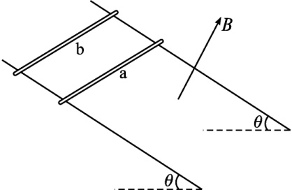

**14.** (14分)如图所示,两根足够长的光滑金属直导轨平行放置,导轨间距为*L*,两导轨及其所构成的平面均与水平面成*θ*角,整个装置处于垂直于导轨平面斜向上的匀强磁场中,磁感应强度大小为*B*。现将质量均为*m*的金属棒a、b垂直导轨放置,每根金属棒接入导轨之间的电阻均为*R*。运动过程中金属棒与导轨始终垂直且接触良好,金属棒始终未滑出导轨,导轨电阻忽略不计,重力加速度为*g*。

(1)先保持棒b静止,将棒a由静止释放,求棒a匀速运动时的速度大小*v*0。

(2)在(1)问中,当棒a匀速运动时,再将棒b由静止释放,求释放瞬间棒b的加速度大小*a*0。

(3)在(2)问中,从棒b释放瞬间开始计时,经过时间*t*0,两棒恰好达到相同的速度*v*,求速度*v*的大小,以及时间*t*0内棒a相对于棒b运动的距离Δ*x*。

答案(1)$\frac{2mgR\sin\theta}{B^{2}L^{2}}$　(2)2*g*sin
*θ　*(3)*gt*0sin
*θ+*$\frac{mgR\sin\theta}{B^{2}L^{2}}　\frac{2m^{2}R^{2}g\sin\theta}{B^{4}L^{4}}$

解析 (1)a与b构成闭合导体回路,b静止,a切割磁感线,a相当于电源。

a匀速运动时,对a有*E=BLv*0

*I=*$\frac{E}{2R}$

*mg*sin *θ=BIL*

解得*v*0=$\frac{2mgR\sin\theta}{B^{2}L^{2}}$。

(2)释放b棒瞬间,b所受的安培力沿轨道向下,且大小为*BIL=mg*sin *θ*

对b受力分析得*mg*sin *θ+BIL=ma*0

解得*a*0=2*g*sin *θ*。

(3)b棒释放之后,对a、b组成的系统,由动量定理得

2*mgt*0sin *θ=*2*mv-mv*0

解得*v=gt*0sin *θ+*$\frac{mgR\sin\theta}{B^{2}L^{2}}$

对b棒由动量定理得*mgt*0sin *θ+IF=mv

IF=*∑*BLi*Δ*t=BLq

q=*$\frac{\Delta\Phi}{2R} = \frac{BL\Delta x}{2R}$

解得Δ*x=*$\frac{2m^{2}R^{2}g\sin\theta}{B^{4}L^{4}}$。

**15.** (16分)如图所示,质量为*m*0的匀质凹槽放在光滑水平地面上,凹槽内有一个半椭圆形的光滑轨道,椭圆的半长轴和半短轴分别为*a*
和*b*,长轴水平,短轴竖直。质量为*m*的小球,初始时刻从椭圆轨道长轴的右端点由静止开始下滑。以初始时刻椭圆中心的位置为坐标原点,在竖直平面内建立固定于地面的直角坐标系*xOy*,椭圆长轴位于*x*轴上。整个过程凹槽不翻转,重力加速度为*g*。

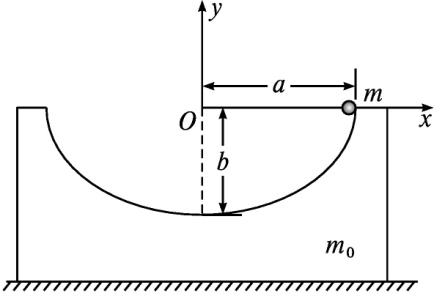

(1)小球第一次运动到轨道最低点时,求凹槽的速度大小以及凹槽相对于初始时刻运动的距离。

(2)在平面直角坐标系*xOy*中,求出小球运动的轨迹方程。

(3)若$\frac{m_{0}}{m} = \frac{b}{a-b}$,求小球下降*h=*$\frac{b}{2}$高度时
,小球相对于地面的速度大小(结果用*a*、*b*及*g*表示)。

答案(1)$\sqrt{\frac{2m^{2}gb}{m_{0}(m_{0} + m)}}　\frac{ma}{m_{0} + m}$

(2)$\frac{\left( x-\frac{m}{m_{0} + m}a \right)^{2}}{\left( \frac{am_{0}}{m_{0} + m} \right)^{2}} + \frac{y^{2}}{b^{2}}$=1(*y*≤0)

(3)$\sqrt{\frac{4gb^{2}}{a + 3b}}$

解析 (1)小球与凹槽组成的系统机械能守恒,则

*mgb=*$\frac{1}{2}$*m*0${v_{1}}^{2} + \frac{1}{2}m{v_{2}}^{2}$(凹槽相对地面向右的速度为*v*1,小球相对地面向左的速度为*v*2)*①*

小球与凹槽组成的系统在水平方向上动量守恒,则*m*0*v*1*=mv*2*②*

联立*①②*得*v*1=$\sqrt{\frac{2m^{2}gb}{m_{0}(m_{0} + m)}}$

由*②*式得*m*0*x*1*=mx*2(*x*1、*x*2均为相对地面位移的大小)*③

x*1*+x*2*=a④*

联立*③④*得*x*1=$\frac{ma}{m_{0} + m}$。

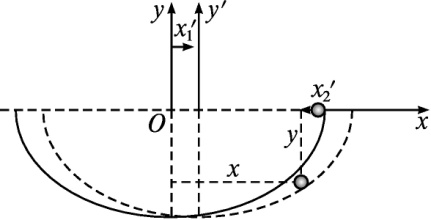

(2)小球与凹槽组成的系统,在水平方向上动量守恒,则

*m*0*x*1*'=mx*2*'

x+x*2*'=a*

且满足$\frac{(x-x_{1}')^{2}}{a^{2}} + \frac{y^{2}}{b^{2}}$=1

联立以上各式得

$\frac{\left( x-\frac{m}{m_{0} + m}a \right)^{2}}{\left( \frac{am_{0}}{m_{0} + m} \right)^{2}} + \frac{y^{2}}{b^{2}}$=1(*y*≤0)。

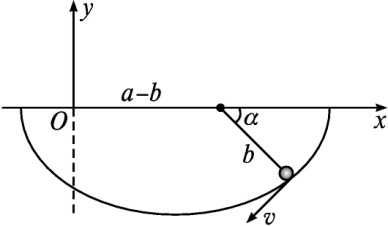

(3)当$\frac{m_{0}}{m} = \frac{b}{a-b}$时,轨迹方程为$\frac{\text{[}x\text{-(}a-b)\text{]}^{2}}{b^{2}} + \frac{y^{2}}{b^{2}}$=1,即小球的轨迹为圆的一部分,圆心为(*a-b*,0),半径为*b*

根据几何关系可得图中*α=*30°

在水平方向上,根据动量守恒定律得

*mv*cos 60°*=m*0*v'*

根据机械能守恒定律得

*mg*$\frac{b}{2} = \frac{1}{2}$*m*0*v'*2+$\frac{1}{2}$*mv*2

联立解得*v=*$\sqrt{\frac{4gb^{2}}{a + 3b}}$。
