# 2024 年湖南卷 · 物理

> **卷别**：湖南自主命题　|　**含解析**：是　|　**来源**：物理备课大师（wl.eywedu.com）Word 版含解析
> **说明**：由官方 Word 版转换，公式为 LaTeX，图片见同目录 `images/`。

---

**2024年普通高等学校招生全国统一考试*

*物理**(湖南卷)

一、选择题:本题共6小题,每小题4分,共24分。在每小题给出的四个选项中,只有一项符合题目要求。

**1.**量子技术是当前物理学应用研究的热点,下列关于量子论的说法正确的是(　B　)

A.普朗克认为黑体辐射的能量是连续的

B.光电效应实验中,红光照射可以让电子从某金属表面逸出,若改用紫光照射也可以让电子从该金属表面逸出

C.康普顿研究石墨对X射线散射时,发现散射后仅有波长小于原波长的射线成分

D.德布罗意认为质子具有波动性,而电子不具有波动性

解析普朗克认为黑体辐射的能量是量子化的,故A错误;入射光的频率大于或等于金属的截止频率能产生光电效应,紫光的频率大于红光的频率,红光能让金属产生光电效应,则紫光也能让金属产生光电效应,故B正确;石墨对X射线的散射过程遵循动量守恒,光子和电子碰撞后,电子获得一定的动量,光子动量变小,根据*λ=*$\frac{h}{p}$可知波长变长,故C错误;德布罗意认为物质都具有波动性,故D错误。

**2.**如图所示,健身者在公园以每分钟60次的频率上下抖动长绳的一端,长绳自右向左呈现波浪状起伏,可近似为单向传播的简谐横波。长绳上*A*、*B*两点平衡位置相距6
m,*t*0时刻*A*点位于波谷,*B*点位于波峰,两者之间还有一个波谷。下列说法正确的是(　D　)

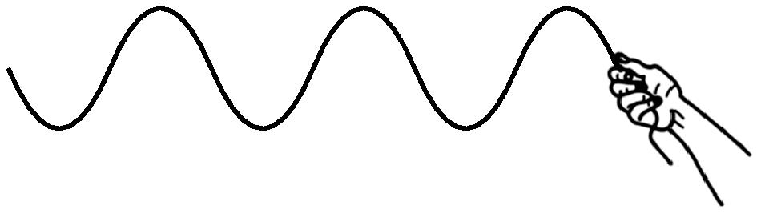

A.波长为3 m

B.波速为12 m/s

C.*t*0+0.25 s时刻,*B*点速度为0

D.*t*0+0.50 s时刻,*A*点速度为0

解析本题考查波长、频率和波速的关系,波的图像理解。由图可知*xAB=*$\frac{3}{2}$*λ=*6
m,得*λ=*4 m,故A错误;波源的振动频率为*f=*$\frac{60}{60}$ Hz=1
Hz,所以波速为*v=λf=*4 m/s,故B错误;振动周期为*T=*1 s,0.25
s=$\frac{T}{4}$,故*B*点在*t*0+0.25
s时运动到平衡位置,位移为0,速度最大,故C错误;0.5
s=$\frac{T}{2}$,故*A*点在*t*0+0.5
s时运动到波峰,位移最大,速度为0,故D正确。

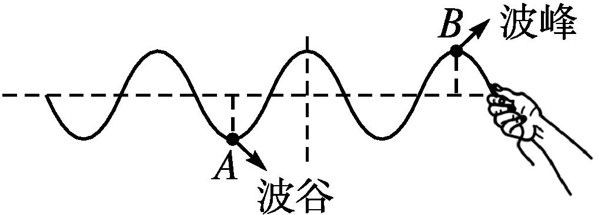

**3.**如图所示,质量分别为4*m*、3*m*、2*m*、*m*的四个小球*A*、*B*、*C*、*D*,通过细线或轻弹簧互相连接,悬挂于*O*点,处于静止状态,重力加速度为*g*。若将*B*、*C*间的细线剪断,则剪断瞬间*B*和*C*的加速度大小分别为(　A　)

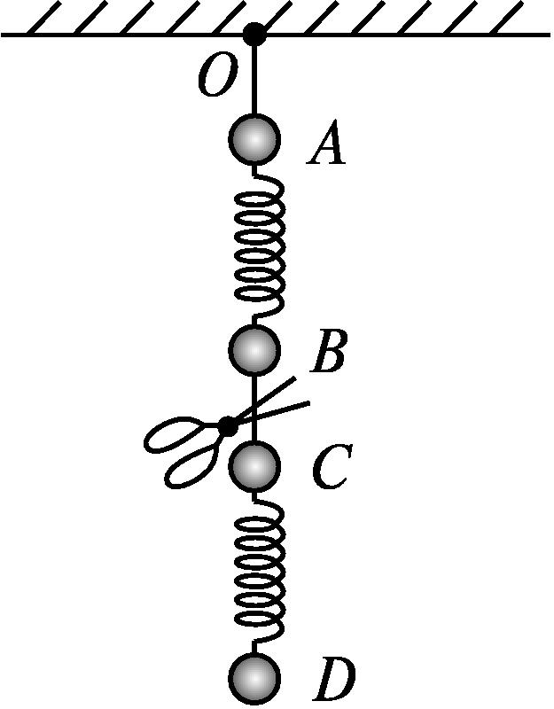

A.*g*,1.5*g* B.2*g*,1.5*g*

C.2*g*,0.5*g* D*.g*,0.5*g*

解析本题考查牛顿第二定律的瞬时性问题。剪断前,对*B*、*C*、*D*整体分析得*FAB=*(3*m+*2*m+m)g*,对*D*有*FCD=mg*;剪断后,对*B*有*FAB-*3*mg=*3*maB*,解得*aB=g*,方向竖直向上;对*C*有*FCD+*2*mg=*2*maC*,解得*aC=*1.5*g*,方向竖直向下。故选项A正确。

**4.**如图所示,有一硬质导线*Oabc*,其中$\overset{⏜}{abc}$是半径为*R*的半圆弧,*b*为圆弧的中点,直线段*Oa*长为*R*且垂直于直径*ac*。该导线在纸面内绕*O*点逆时针转动,导线始终在垂直纸面向里的匀强磁场中。则*O*、*a*、*b*、*c*各点电势关系为(　C　)

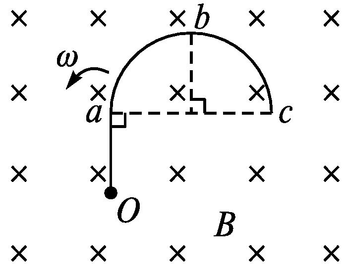

A.*φO\>φa\>φb\>φc*

B.*φO\<φa\<φb\<φc*

C.*φO\>φa\>φb=φc*

D.*φO\<φa\<φb=φc*

解析本题考查导体切割磁感线产生感应电动势。如图所示,该导线在纸面内绕*O*点逆时针转动,相当于*Oa*、*Ob*、*Oc*导体棒转动切割磁感线,根据右手定则可知*O*点电势最高;根据*E=Blv=*$\frac{1}{2}$*Bωl*2,又*lOb=lOc=*$\sqrt{5}$*R\>lOa*,所以0*\<UOa\<UOb=UOc*,得*φO\>φa\>φb=φc*,故选项C正确。

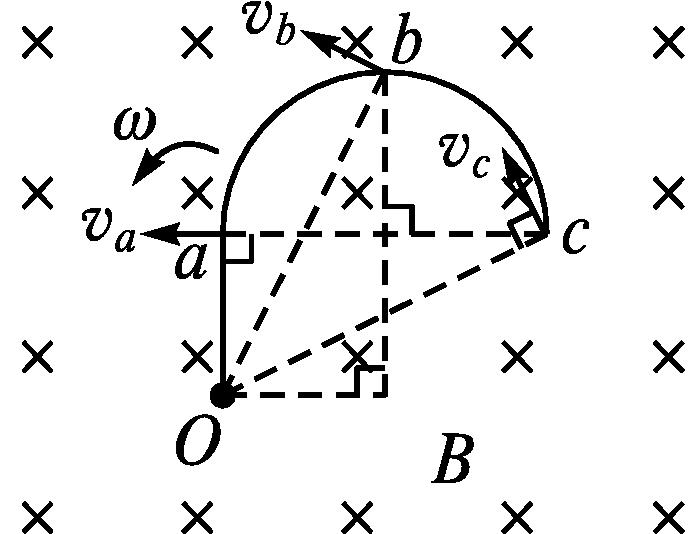

**5.**真空中有电荷量为+4*q*和*-q*的两个点电荷,分别固定在*x*轴上-1和0处。设无限远处电势为0,*x*正半轴上各点电势*φ*随*x*变化的图像正确的是(　D　)

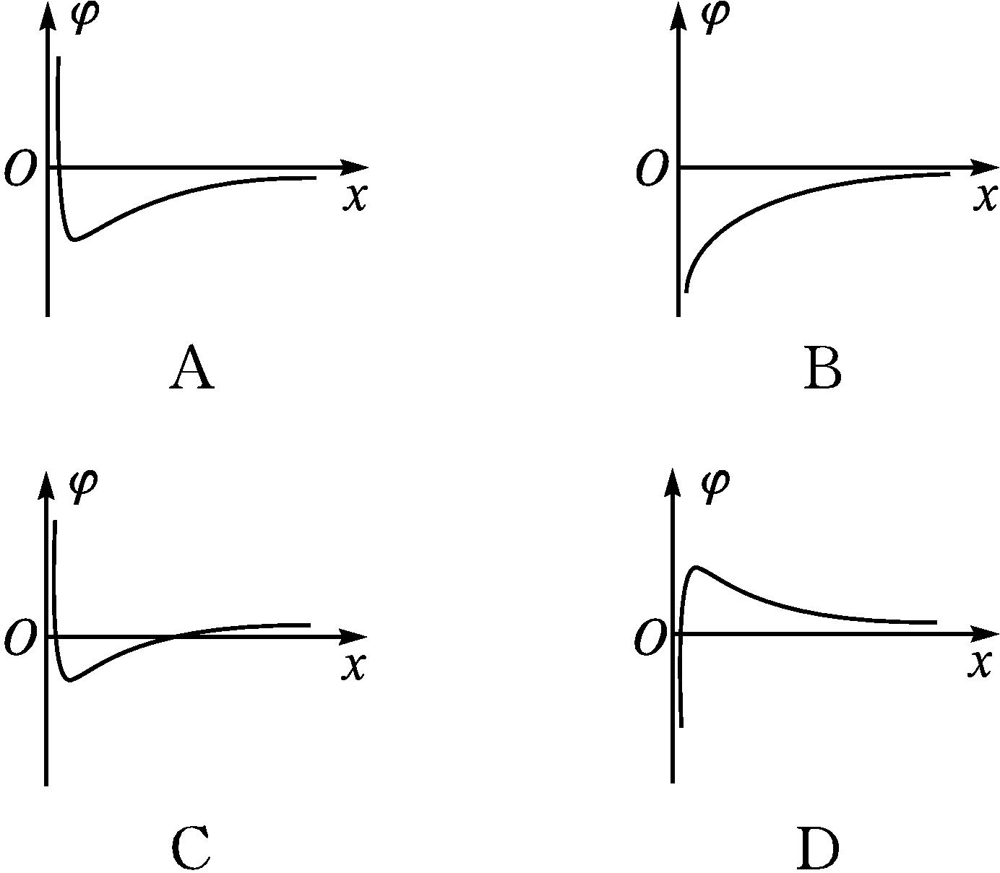

解析解法一　根据异种点电荷的电场分布情况,可知两个点电荷的连线上,在两电荷中间及电荷量小的点电荷外侧,均有电势为零的点,所以*x*正半轴上各点电势*φ*应先负后正,由此可判断选项D正确。

解法二

根据点电荷周围的电势公式*φ=k*$\frac{Q}{r}$(该公式教材中没有),设*x'*处(*x'\>*0)的电势为0,得*k*$\frac{4q}{1 + x'}$*+k*$\frac{-q}{x'}$=0,解得*x'=*$\frac{1}{3}$,故可知当0*\<x\<*$\frac{1}{3}$时,*φ\<*0;当*x\>*$\frac{1}{3}$时,*φ\>*0。故选项D正确。

**6.**根据国家能源局统计,截至2023年9月,我国风电装机4亿千瓦,连续13年居世界第一位,湖南在国内风电设备制造领域居于领先地位。某实验小组模拟风力发电厂输电网络供电的装置如图所示。已知发电机转子以角速度*ω*匀速转动,升、降压变压器均为理想变压器,输电线路上的总电阻可简化为一个定值电阻*R*0。当用户端接一个定值电阻*R*时,*R*0上消耗的功率为*P*。不计其余电阻,下列说法正确的是(　A　)

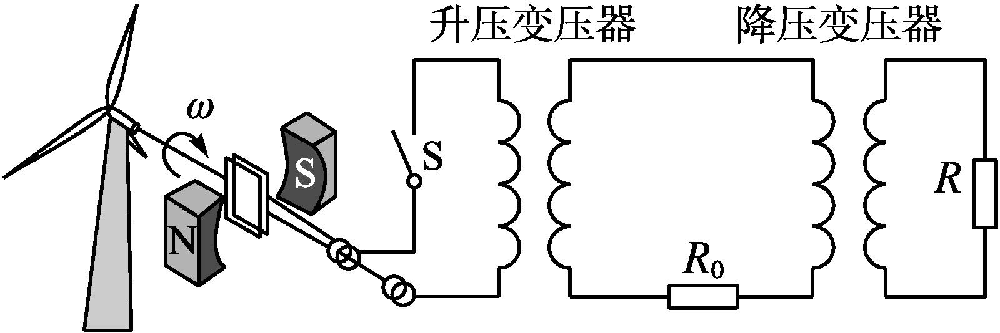

A.风速增加,若转子角速度增加一倍,则*R*0上消耗的功率为4*P*

B.输电线路距离增加,若*R*0阻值增加一倍,则*R*0消耗的功率为4*P*

C.若升压变压器的副线圈匝数增加一倍,则*R*0上消耗的功率为8*P*

D.若在用户端再并联一个完全相同的电阻*R*,则*R*0上消耗的功率为6*P*

解析本题考查交变电流产生和远距离输电原理,涉及等效法。转子在磁场中转动时产生的电动势的有效值为*E=*$\frac{NBS\omega}{\sqrt{2}}$,当转子角速度增加一倍时,升压变压器原副线圈两端电压都增加一倍,输电线上的电流变为*I*2*'=*2*I*2,故*R*0上消耗的电功率变为原来的4倍,故A正确。升压变压器副线圈匝数增加一倍,副线圈两端电压增加一倍,输电线上的电流增加一倍,故*R*0上消耗的电功率变为原来的4倍,故C错误。设降压变压器的原副线圈匝数比为*k*∶1,将降压变压器和用电器整体等效成一个电阻,等效电阻为$\frac{U_{3}}{I_{3}} = \frac{kU_{4}}{\frac{1}{k}I_{4}}$*=k*2*R*,等效电路图如图所示,则输电线上的电流为*I*2=$\frac{U_{2}}{R_{0} + k^{2}R}$,*R*0消耗的功率*P=*${I_{2}}^{2}$*R*0;若*R*0阻值增加一倍,输电线路上的电流*I*2*″=*$\frac{U_{2}}{2R_{0} + k^{2}R}$,*R*0消耗的功率*P*1*=I*2*″*2·2*R*0≠4*P*,故B错误。若在用户端再并联一个完全相同的电阻*R*,用户端电阻减为原来的一半,输电线上的电流为*I*2*‴=*$\frac{U_{2}}{R_{0} + k^{2}\frac{R}{2}} = \frac{2U_{2}}{2R_{0} + k^{2}R}$,*R*0消耗的功率*P*2*=I*2*‴*2*R*0≠6*P*,故D错误。

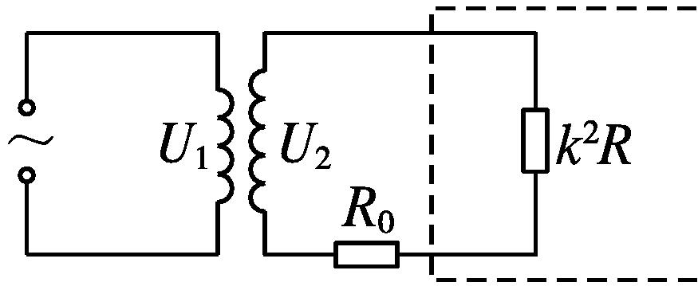

二、选择题:本题共4小题,每小题5分,共20分。在每小题给出的四个选项中,有多项符合题目要求。全部选对的得5分,选对但不全的得3分,有选错的得0分。

**7.**2024年5月3日,“嫦娥六号”探测器顺利进入地月转移轨道,正式开启月球之旅。相较于“嫦娥四号”和“嫦娥五号”,本次的主要任务是登陆月球背面进行月壤采集并通过上升器将月壤转移至绕月运行的返回器,返回器再通过返回轨道返回地球。设返回器绕月运行的轨道为圆轨道,半径近似为月球半径。已知月球表面重力加速度约为地球表面重力加速度的$\frac{1}{6}$,月球半径约为地球半径的$\frac{1}{4}$。关于返回器在该绕月轨道上的运动,下列说法正确的是(　BD　)

A.其相对于月球的速度大于地球第一宇宙速度

B.其相对于月球的速度小于地球第一宇宙速度

C.其绕月飞行周期约为地球上近地圆轨道卫星周期的$\sqrt{\frac{2}{3}}$

D.其绕月飞行周期约为地球上近地圆轨道卫星周期的$\sqrt{\frac{3}{2}}$倍

解析本题考查万有引力定律、宇宙速度的理解。返回器绕月运行的轨道半径近似为月球半径,则有*G*$\frac{m_{\text{月}}m}{{r_{\text{月}}}^{2}}$*=m*$\frac{{v_{\text{月}}}^{2}}{r_{\text{月}}}$,在月球表面,由万有引力和重力的关系有*G*$\frac{m_{\text{月}}m'}{{r_{\text{月}}}^{2}}$*=m'g*月,解得*v*月=$\sqrt{g_{\text{月}}r_{\text{月}}}$;同理可得地球第一宇宙速度即近地卫星的环绕速度*v*地=$\sqrt{g_{\text{地}}r_{\text{地}}}$,代入题中数据可得*v*月=$\frac{\sqrt{6}}{12}$*v*地,故A错误,B正确;根据*T=*$\frac{2\pi r}{v}$,得*T*月=$\sqrt{\frac{3}{2}}$*T*地,故C错误,D正确。

**8.**某电磁缓冲装置如图所示,两足够长的平行金属导轨置于同一水平面内,导轨左端与一阻值为*R*的定值电阻相连,导轨*BC*段与*B*1*C*1段粗糙,其余部分光滑,*AA*1右侧处于竖直向下的匀强磁场中,一质量为*m*的金属杆垂直导轨放置。现让金属杆以初速度*v*0沿导轨向右经过*AA*1进入磁场,最终恰好停在*CC*1处。已知金属杆接入导轨之间的阻值为*R*,与粗糙导轨间的动摩擦因数为*μ,AB=BC=d*。导轨电阻不计,重力加速度为*g*,下列说法正确的是(　CD　)

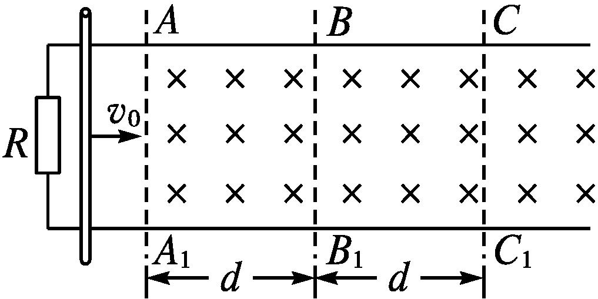

A.金属杆经过*BB*1的速度为$\frac{v_{0}}{2}$

B.在整个过程中,定值电阻*R*产生的热量为$\frac{1}{2}m{v_{0}}^{2} - \frac{1}{2}$*μmgd*

C.金属杆经过*AA*1*B*1*B*与*BB*1*C*1*C*区域,金属杆所受安培力的冲量相同

D.若将金属杆的初速度加倍,则金属杆在磁场中运动的距离大于原来的2倍

解析本题考查电磁感应的能量、动量问题,涉及微元法。设平行金属导轨间距为*L*,金属杆切割磁感线有*E=BLv*,而*I=*$\frac{E}{2R}$;根据动量定理,金属杆在*AA*1*B*1*B*区域运动的过程中有*-BIL*Δ*t=m*Δ*v*,即可得*-BLq=mvB-mv*0,而*q=*$\frac{\Delta\varphi}{2R} = \frac{BLd}{2R}$,所以*vB=v*0-$\frac{B^{2}L^{2}d}{2mR}$;设金属杆在*BB*1*C*1*C*区域运动的时间为*t*0,同理可得,金属杆在*BB*1*C*1*C*区域运动的过程中有-$\frac{B^{2}L^{2}d}{2R}$*-μmgt*0*=-mvB*,解得*vB=*$\frac{B^{2}L^{2}d}{2mR}$*+μgt*0,联立可得*vB=*$\frac{v_{0}}{2} + \frac{\mu gt_{0}}{2} > \frac{v_{0}}{2}$,则金属杆经过*BB*1的速度大于$\frac{v_{0}}{2}$,故A错误。在整个过程中,根据能量守恒定律有$\frac{1}{2}m{v_{0}}^{2}$*=μmgd+Q*,则在整个过程中,定值电阻*R*产生的热量为*QR=*$\frac{1}{2}$*Q=*$\frac{1}{4}m{v_{0}}^{2} - \frac{1}{2}$*μmgd*,故B错误。金属杆经过*AA*1*B*1*B*与*BB*1*C*1*C*区域,金属杆所受安培力的冲量为-∑*BIL*Δ*t=-*∑$\frac{B^{2}L^{2}}{2R}$*vt*Δ*t=-*$\frac{B^{2}L^{2}x}{2R}$,金属杆经过*AA*1*B*1*B*与*BB*1*C*1*C*区域滑行距离均为*d*,则金属杆所受安培力的冲量相同,故C正确。根据A选项可知,金属杆以初速度*v*0在磁场中运动有-$\frac{B^{2}L^{2} \times 2d}{2R}$*-μmgt*0*=-mv*0;设金属杆的初速度加倍后,金属杆通过*BB*1*C*1*C*区域的时间为*t*1,金属杆在磁场中运动的距离为*x*,则有-$\frac{B^{2}L^{2}x}{2R}$*-μmgt*1=0-2*mv*0,联立解得*x=*$\frac{2R}{B^{2}L^{2}}$(2*mv*0*-μmgt*1)=$\frac{2mv_{0}-\mu mgt_{1}}{mv_{0}-\mu mgt_{0}}$×2*d*,由于*t*1*\<t*0,所以$\frac{2mv_{0}-\mu mgt_{1}}{mv_{0}-\mu mgt_{0}}$*\>*2,则*x\>*4*d*,即金属杆在磁场中运动的距离大于原来的2倍,故D正确。

**9.**1834年,洛埃利用平面镜得到杨氏双缝干涉的结果(称洛埃镜实验),平面镜沿*OA*放置,靠近并垂直于光屏。某同学重复此实验时,平面镜意外倾斜了某微小角度*θ*,如图所示。*S*为单色点光源。下列说法正确的是(　BC　)

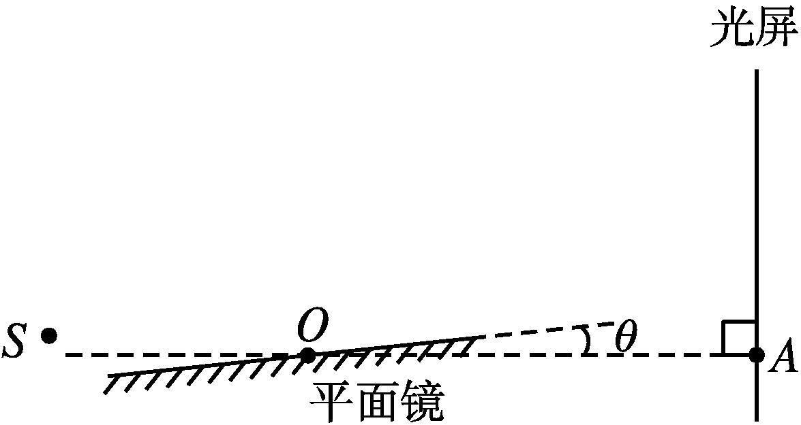

A.沿*AO*向左略微平移平面镜,干涉条纹不移动

B.沿*OA*向右略微平移平面镜,干涉条纹间距减小

C.若*θ=*0°,沿*OA*向右略微平移平面镜,干涉条纹间距不变

D.若*θ=*0°,沿*AO*向左略微平移平面镜,干涉条纹向*A*处移动

解析本题考查双缝干涉的理解。当*θ=*0°时,画出光路图,如图甲所示,*S*发出的光与通过平面镜反射的光(可以等效成虚像*S'*发出的光)是同一列光分成的,满足相干光条件,且该干涉可看成双缝干涉,设*S*与*S'*的距离为*d,S*到光屏的距离为*l*,代入双缝干涉条纹间距公式可得Δ*x=*$\frac{l\lambda}{d}$,则沿*OA*向右略微平移平面镜,对*l*和*d*均没有影响,干涉条纹间距不变,故C正确;若沿*AO*向左略微平移平面镜,由图甲可以看出,干涉条纹向远离*A*处移动,故D错误。当*θ*≠0°时,作出光路图如图乙所示,沿*OA*向右略微平移平面镜,即图乙中从①位置到②位置,由图乙可看出双缝的间距增大,则干涉条纹间距减小,故B正确;沿*AO*向左略微平移平面镜,即图乙中从②位置到①位置,由图乙可看出干涉条纹向上移动,故A错误。

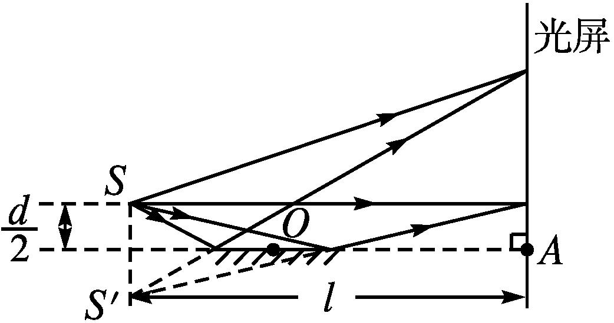

甲

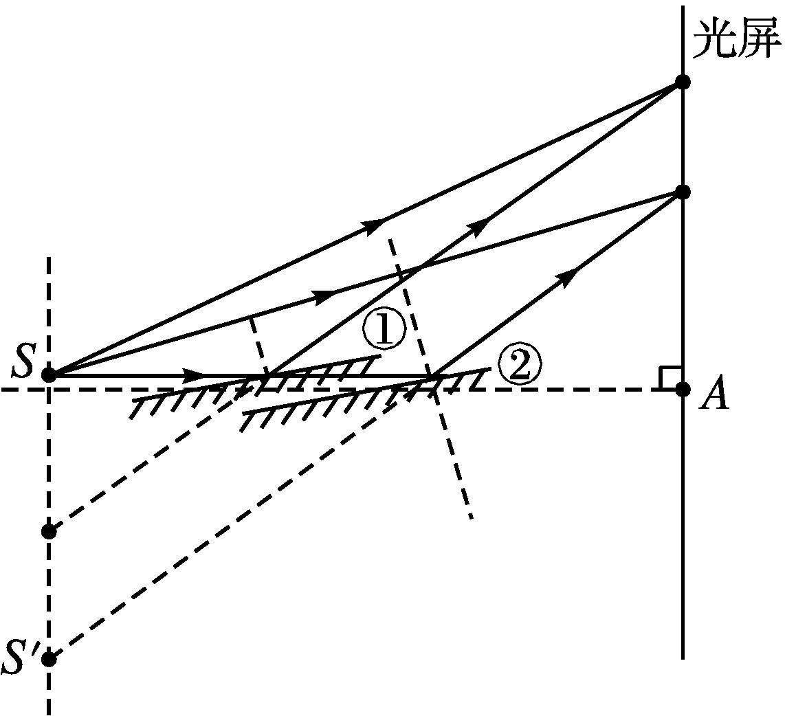

乙

**10.**如图所示,在光滑水平面内建立直角坐标系*xOy*。*A*、*B*两小球同时从*O*点出发,*A*球速度大小为*v*1、方向沿*x*轴正方向,*B*球速度大小为*v*2=2
m/s、方向与*x*轴正方向夹角为*θ*。坐标系第一象限中有一个挡板*L*,与*x*轴夹角为*α*。*B*球与挡板*L*发生碰撞,碰后*B*球速度大小变为1
m/s,碰撞前后*B*球的速度方向与挡板*L*法线的夹角相同,且分别位于法线两侧。不计碰撞时间和空气阻力,若*A*、*B*两小球能相遇,下列说法正确的是(　AC　)

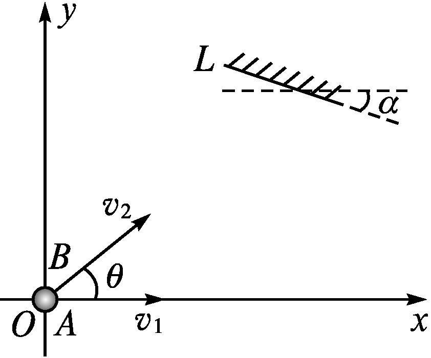

A.若*θ=*15°,则*v*1的最大值为$\sqrt{2}$ m/s,且*α=*15°

B.若*θ=*15°,则*v*1的最大值为$\frac{2}{3}\sqrt{3}$
m/s,且*α=*0°

C.若*θ=*30°,则*v*1的最大值为$\frac{2}{3}\sqrt{3}$
m/s,且*α=*0°

D.若*θ=*30°,则*v*1的最大值为$\sqrt{2}$ m/s,且*α=*15°

解析两小球均做匀速直线运动,因为*A*、*B*两小球能相遇,可绘出运动轨迹图如图所示,根据正弦定理有$\frac{v_{2}t_{1}}{\sin(2\alpha + \theta)} = \frac{v_{2}'t_{2}}{\sin\theta} = \frac{(t_{1} + t_{2})v_{1}}{\sin\text{[}180\text{°-(}2\alpha + 2\theta\text{)]}}$,若*θ=*15°,代入数据*v*2=2
m/s,*v*2*'=*1
m/s解得,当*α=*15°时,*v*1取得最大值为$\sqrt{2}$
m/s,故A正确,B错误;若*θ=*30°,代入数据*v*2=2
m/s,*v*2*'=*1
m/s解得,当*α=*0°时,*v*1取得最大值为$\frac{2}{3}\sqrt{3}$
m/s,故C正确,D错误。

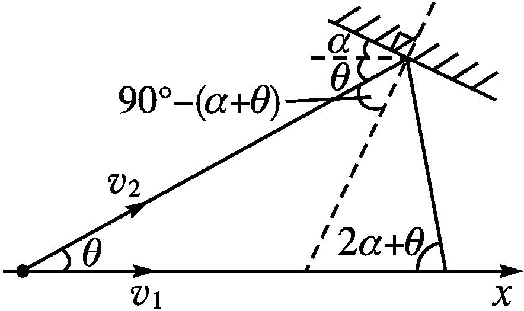

三、非选择题:本题共5小题,共56分。

**11.**某实验小组要探究一金属丝的阻值随气压变化的规律,搭建了如图甲所示的装置。电阻测量原理如图乙所示,*E*是电源,V为电压表,A为电流表。

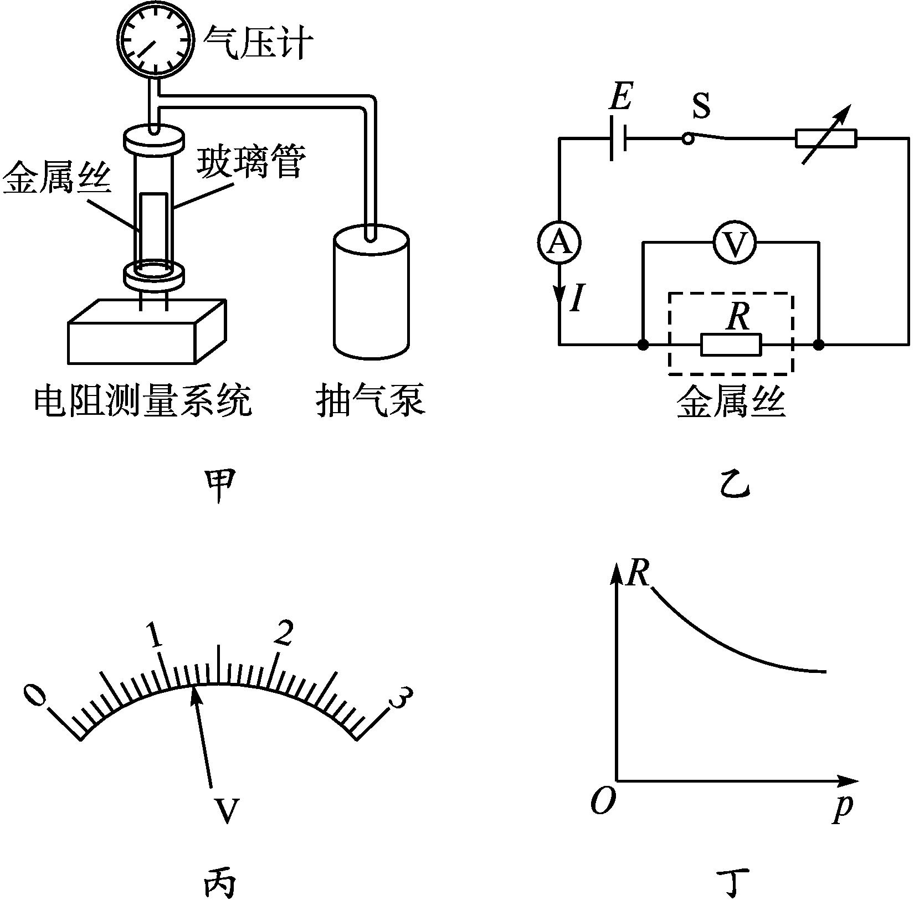

(1)保持玻璃管内压强为标准大气压,电流表示数为100 mA,电压表量程为0~3
V,表盘如图丙所示,示数为<u>　　</u>
V,此时金属丝阻值的测量值*R*为*<u>　　</u>* Ω(保留3位有效数字); 

(2)打开抽气泵,降低玻璃管内气压*p*,保持电流*I*不变,读出电压表示数*U*,计算出对应的金属丝阻值;

(3)根据测量数据绘制*R-p*关系图线,如图丁所示;

(4)如果玻璃管内气压是标准大气压的$\frac{1}{2}$,保持电流为100
mA,电压表指针应该在图丙指针位置的*<u>　　</u>*(选填“左”或“右”)侧; 

(5)若电压表是非理想电压表,则金属丝电阻的测量值*<u>　　</u>*(选填“大于”“小于”或“等于”)真实值。 

答案(1)1.23　12.3　(4)右　(5)小于

解析本题考查电学创新实验。(1)电压表分度值为0.1
V,则电压表读数需估读一位,读数为1.23
V,根据欧姆定律可知,金属丝的测量值*R=*$\frac{U}{I}$=12.3 Ω。

(4)根据图丁可知气压越小电阻越大,则压强*p*减小,则电阻*R*增大,再根据*U=IR*,故电压增大,电压表的指针位置应该在题图丙中指针位置的右侧。

(5)电流表采用外接法会导致电压表分流,即*R*测=$\frac{U}{I_{\text{测}}}$,*I*测*=I*真+$\frac{U}{R_{V}}$,即*I*测偏大,故*R*测*\<R*真。

**12.**在太空,物体完全失重,用天平无法测量质量。如图所示,某同学设计了一个动力学方法测量物体质量的实验方案,主要实验仪器包括:气垫导轨、滑块、轻弹簧、标准砝码、光电计时器和待测物体,主要步骤如下:

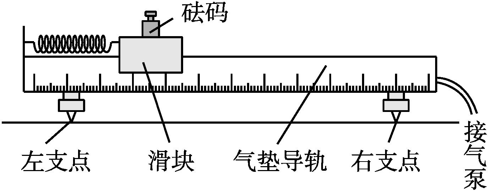

(1)调平气垫导轨,将弹簧左端连接气垫导轨左端,右端连接滑块;

(2)将滑块拉至离平衡位置20
cm处由静止释放,滑块第1次经过平衡位置处开始计时,第21次经过平衡位置时停止计时,由此测得弹簧振子的振动周期*T*;

(3)将质量为*m*的砝码固定在滑块上,重复步骤(2);

(4)依次增加砝码质量*m*,测出对应的周期*T*,实验数据如下表所示,在图中绘制*T*2-*m*关系图线;

| *m/*kg  | *T/*s   | *T*2*/*s2 |
|---------|---------|---------------------------------|
| 0.000 | 0.632 | 0.399                         |
| 0.050 | 0.775 | 0.601                         |
| 0.100 | 0.893 | 0.797                         |
| 0.150 | 1.001 | 1.002                         |
| 0.200 | 1.105 | 1.221                         |
| 0.250 | 1.175 | 1.381                         |

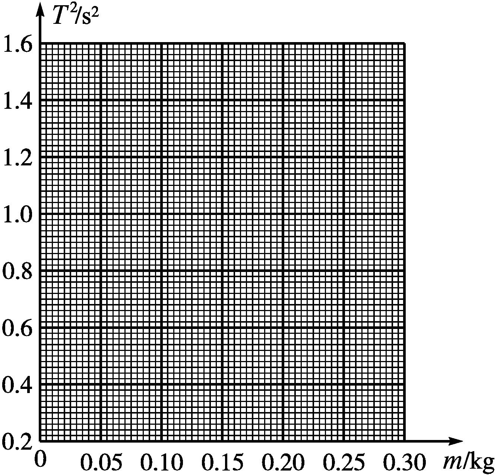

(5)由*T*2-*m*图像可知,弹簧振子振动周期的二次方与砝码质量的关系是*<u>　　</u>*(选填“线性的”或“非线性的”); 

(6)取下砝码后,将待测物体固定在滑块上,测量周期并得到*T*2=0.880
s2,则待测物体质量是*<u>　　</u>* kg(保留3位有效数字); 

(7)若换一个质量较小的滑块重做上述实验,所得*T*2-*m*图线与原图线相比将沿纵轴*<u>　　</u>*(选填“正方向”“负方向”或“不”)移动。 

答案

(4)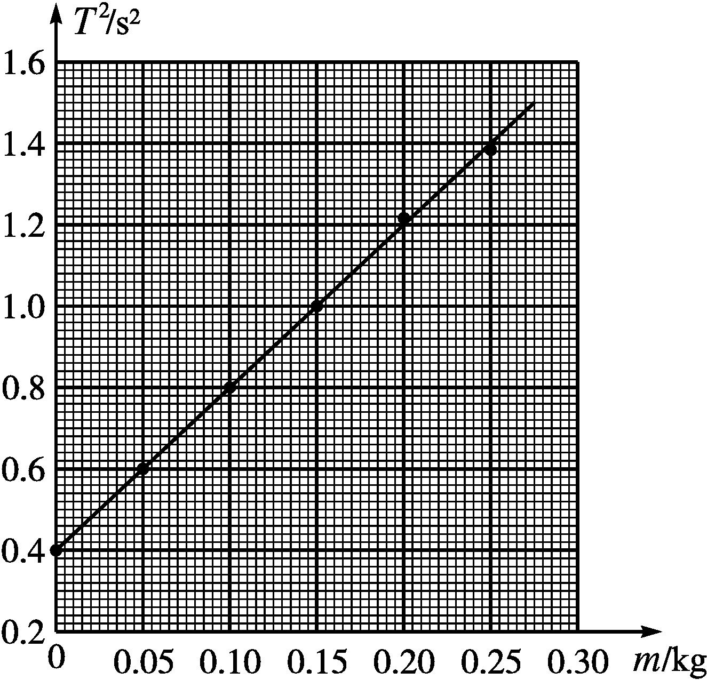

(5)线性的　(6)0.120　(7)负方向

解析本题利用弹簧振子考查力学创新实验。

(5)图线是一条倾斜的直线,说明弹簧振子振动周期的二次方与砝码质量为线性关系。

(6)在图线上找到*T*2=0.880
s2的点,对应横坐标为0.120 kg。

(7)换一个质量较小的滑块做实验,滑块和砝码总质量较原来的偏小,要得到相同的周期,应放质量更大的砝码,对应纵坐标点应右移,则所得图线与原图线相比下移,即沿纵轴负方向移动。

**13.**一个充有空气的薄壁气球,气球内气体压强为*p*、体积为*V*。气球内空气可视为理想气体。

(1)若将气球内气体等温膨胀至大气压强*p*0,求此时气体的体积*V*0(用*p*0、*p*和*V*表示);

(2)小赞同学想测量该气球内气体体积*V*的大小,但身边仅有一个电子天平。将气球置于电子天平上,示数为*m=*8.66×10-3
kg(此时须考虑空气浮力对该示数的影响)。小赞同学查阅资料发现,此时气球内气体压强*p*和体积*V*还满足:(*p-p*0)(*V-VB*0)*=C*,其中*p*0=1.0×105
Pa为大气压强,*VB*0=0.5×10-3
m3为气球无张力时的最大容积,*C=*18
J为常数。已知该气球自身质量为*m*0=8.40×10-3
kg,外界空气密度为*ρ*0=1.3
kg/m3,求气球内气体体积*V*的大小。

答案(1)$\frac{pV}{p_{0}}$　(2)5×10-3 m3

解析本题考查气体实验定律。

(1)根据玻意耳定律有*pV=p*0*V*0

解得*V*0=$\frac{pV}{p_{0}}$。

(2)设气球内气体质量为*m*气,则*m*气*=ρV*

根据阿基米德原理,气球受到的浮力为*ρ*0*gV*

对气球进行受力分析如图所示

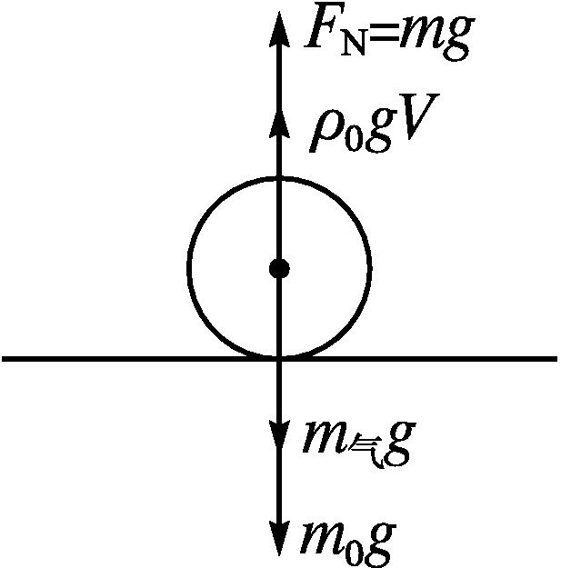

根据气球的受力分析有*mg+ρ*0*gV=m*气*g+m*0*g*

第(1)问中,气体等温变化时,气体质量不变,有*m*气*=ρV=ρ*0*V*0

又因为*pV=p*0*V*0可得$\frac{p}{\rho} = \frac{p_{0}}{\rho_{0}}$

结合题中*p*和*V*满足的关系为(*p-p*0)(*V-VB*0)*=C*

解得*V=*5×10-3 m3。

**14.**如图所示,有一内半径为2*r*、长为*L*的圆筒,左右端面圆心*O'*、*O*处各开有一小孔。以*O*为坐标原点,取*O'O*方向为*x*轴正方向建立*Oxyz*坐标系。在筒内*x*≤0区域有一匀强磁场,磁感应强度大小为*B*,方向沿*x*轴正方向;筒外*x*≥0区域有一匀强电场,电场强度大小为*E*,方向沿*y*轴正方向。一电子枪在*O'*处向圆筒内多个方向发射电子,电子初速度方向均在*xOy*平面内,且在*x*轴正方向的分速度大小均为*v*0。已知电子的质量为*m*、电荷量为*e*,设电子始终未与筒壁碰撞,不计电子之间的相互作用及电子的重力。

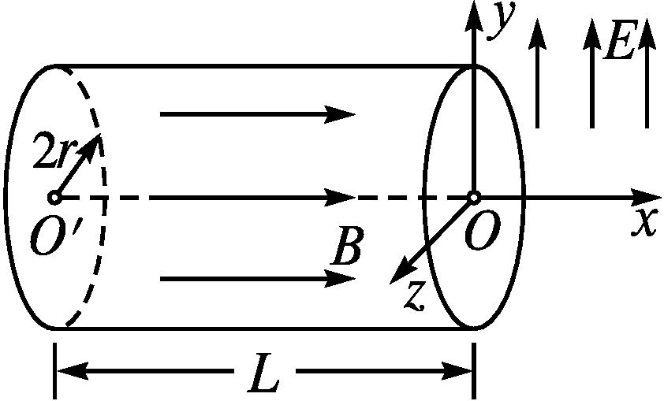

(1)若所有电子均能经过*O*进入电场,求磁感应强度*B*的最小值;

(2)取(1)问中最小的磁感应强度*B*,若进入磁场中电子的速度方向与*x*轴正方向最大夹角为*θ*,求tan
*θ*的绝对值;

(3)取(1)问中最小的磁感应强度*B*,求电子在电场中运动时*y*轴正方向的最大位移。

答案(1)$\frac{2\pi mv_{0}}{eL}$　(2)$\frac{2\pi r}{L}$　(3)$\frac{2\pi^{2}r^{2}{v_{0}}^{2}m}{EeL^{2}}$

解析(1)电子在匀强磁场中运动时,将其分解为沿*x*轴的匀速直线运动和在*yOz*平面内的匀速圆周运动,设电子入射时沿*y*轴的分速度大小为*vy*,由电子在*x*轴方向做匀速直线运动得*L=v*0*t*

在*yOz*平面内,设电子做匀速圆周运动的半径为*R*,周期为*T*,由牛顿第二定律得*Bevy=m*$\frac{{v_{y}}^{2}}{R}$

可得*R=*$\frac{mv_{y}}{Be}$且*T=*$\frac{2\pi R}{v_{y}} = \frac{2\pi m}{Be}$

由题意可知所有电子均能经过*O*进入电场,则有*t=nT(n=*1,2,3,…)

联立得*B=*$\frac{2\pi nmv_{0}}{eL}$

当*n=*1时,*B*有最小值,可得*B*min=$\frac{2\pi mv_{0}}{eL}$。

(2)将电子的速度分解,如图所示

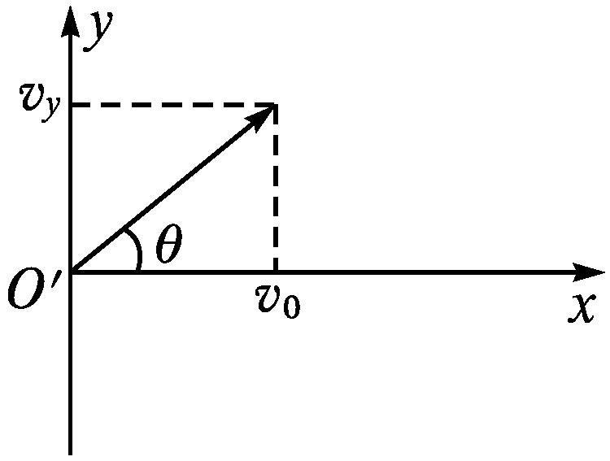

有tan *θ=*$\frac{v_{y}}{v_{0}}$

当tan *θ*有最大值时,*vy*最大,*R*最大,此时*R=r*

又*B=*$\frac{2\pi mv_{0}}{eL}$,*R=*$\frac{mv_{y}}{Be}$

联立可得*vy*m=$\frac{2\pi v_{0}r}{L}$,tan
*θ=*$\frac{2\pi r}{L}$。

(3)当*vy*最大时,电子在电场中运动时沿*y*轴正方向有最大位移*y*m,根据匀变速直线运动规律有*y*m=$\frac{{v_{ym}}^{2}}{2a}$

由牛顿第二定律知*a=*$\frac{Ee}{m}$

又*vy*m=$\frac{2\pi v_{0}r}{L}$

联立得*y*m=$\frac{2\pi^{2}r^{2}{v_{0}}^{2}m}{EeL^{2}}$。

**15.**如图所示,半径为*R*的圆环水平放置并固定,圆环内有质量为*mA*和*mB*的小球*A*和*B(mA\>mB*)。初始时小球*A*以初速度*v*0沿圆环切线方向运动,与静止的小球*B*发生碰撞。不计小球与圆环之间的摩擦,两小球始终在圆环内运动。

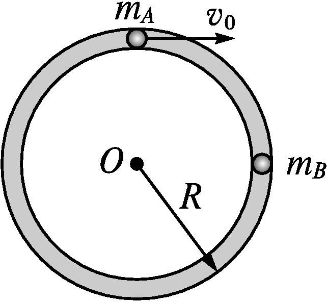

(1)若小球*A*与*B*碰撞后结合在一起,求碰撞后小球组合体的速度大小及做圆周运动所需向心力的大小;

(2)若小球*A*与*B*之间为弹性碰撞,且所有的碰撞位置刚好位于等边三角形的三个顶点,求小球的质量比$\frac{m_{A}}{m_{B}}$;

(3)若小球*A*与*B*之间为非弹性碰撞,每次碰撞后的相对速度大小为碰撞前的相对速度大小的*e*倍(0*\<e\<*1),求第1次碰撞到第2*n+*1次碰撞之间小球*B*通过的路程。

答案(1)$\frac{m_{A}v_{0}}{m_{A} + m_{B}}　\frac{{m_{A}}^{2}{v_{0}}^{2}}{(m_{A} + m_{B})R}$

(2)2或5

(3)$\frac{2\pi Rm_{A}}{m_{A} + m_{B}} \cdot \frac{e^{2n}-1}{e^{2n}(e-1)}$

解析本题考查多次碰撞的综合问题。

(1)设碰撞后两小球的速度大小为*v*,根据动量守恒定律有*mAv*0=(*mA+mB)v*

可得*v=*$\frac{m_{A}v_{0}}{m_{A} + m_{B}}$

碰撞后根据牛顿第二定律有

*F=(mA+mB*)$\frac{v^{2}}{R}$

可得*F=*$\frac{{m_{A}}^{2}{v_{0}}^{2}}{(m_{A} + m_{B})R}$。

(2)若两小球发生弹性碰撞,设碰后速度分别为*vA*、*vB*,则碰后动量守恒和能量守恒有

*mAv*0*=mAvA+mBvB*

$\frac{1}{2}$*mA*${v_{0}}^{2} = \frac{1}{2}$*mA*${v_{A}}^{2} + \frac{1}{2}$*mB*${v_{B}}^{2}$

联立解得*vA=*$\frac{m_{A}-m_{B}}{m_{A} + m_{B}}$*v*0,*vB=*$\frac{2m_{A}v_{0}}{m_{A} + m_{B}}$

因为所有的碰撞位置刚好位于等边三角形的三个顶点,如图所示

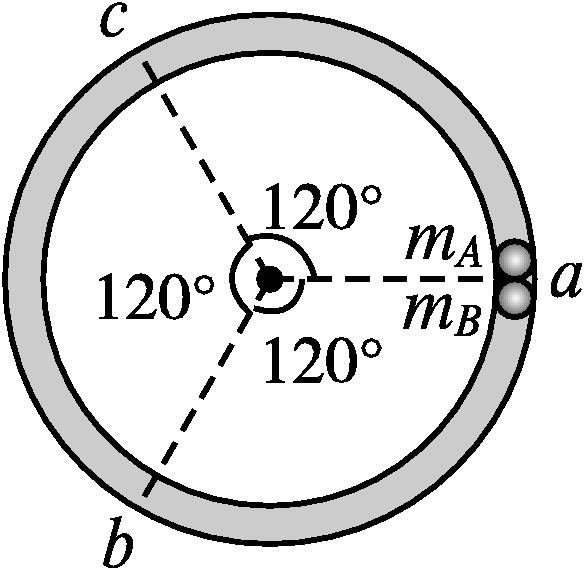

①若第二次碰撞发生在图中的*b*点,则从第一次碰撞到第二次碰撞之间,*A*、*B*通过的路程之比为$\frac{1 + 3k_{1}}{4 + 3k_{1}}$(*k*1=0,1,2,3,…)

则有

$\frac{v_{A1}}{v_{B1}} = \frac{x_{A1}}{x_{B1}} = \frac{1 + 3k_{1}}{4 + 3k_{1}}$(*k*1=0,1,2,3,…)

联立解得$\frac{m_{A1}}{m_{B1}} = \frac{4 + 3k_{1}}{2-3k_{1}}$(*k*1=0,1,2,3,…)

由于两质量均为正数,故*k*1=0,即$\frac{m_{A1}}{m_{B1}}$=2

对第二次碰撞,设*A*、*B*碰撞后的速度大小分别为*vA*1*'*、*vB*1*'*,则同样有

*mA*1*vA*1*+mB*1*vB*1*=mA*1*vA*1*'+mB*1*vB*1*'*

$\frac{1}{2}$*mA*1${v_{A1}}^{2} + \frac{1}{2}$*mB*1${v_{B1}}^{2} = \frac{1}{2}$*mA*1*vA*1*'*2+$\frac{1}{2}$*mB*1*vB*1*'*2

联立解得*vA*1*'=v*0,*vB*1*'=*0,故第三次碰撞发生在*b*点、第四次碰撞发生在*c*点,以此类推,满足题意

②若第二次碰撞发生在图中的*c*点,则从第一次碰撞到第二次碰撞之间,*A*、*B*通过的路程之比为$\frac{2 + 3k_{2}}{5 + 3k_{2}}$(*k*2=0,1,2,3,…)

则有$\frac{v_{A2}}{v_{B2}} = \frac{x_{A2}}{x_{B2}} = \frac{2 + 3k_{2}}{5 + 3k_{2}}$(*k*2=0,1,2,3,…)

联立可得$\frac{m_{A2}}{m_{B2}} = \frac{5 + 3k_{2}}{1-3k_{2}}$(*k*2=0,1,2,3,…)

因为两质量均为正数,故*k*2=0,即$\frac{m_{A2}}{m_{B2}}$=5

根据①的分析可证*vA*2*'=v*0,*vB*2*'=*0,故第三次碰撞发生在*b*点、第四次碰撞发生在*c*点,以此类推,满足题意

综上可知$\frac{m_{A}}{m_{B}}$=2或5。

(3)第一次碰前相对速度大小为*v*0,第一次碰后的相对速度大小为*v*1相*=ev*0,第一次碰后与第二次相碰前*B*比*A*多运动一圈,即*B*相对*A*运动一圈,有

*t*1=$\frac{2\pi R}{v_{1\text{相}}}$

第一次碰撞动量守恒有*mAv*0*=mAvA'+mBvB'*

且*v*1相*=vB'-vA'=ev*0

联立解得*vB'=*$\frac{m_{A}}{m_{A} + m_{B}}$(*v*0*+v*1相)

*B*运动的路程

*s*1*=vB't*1=$\frac{2\pi Rm_{A}}{m_{A} + m_{B}}\left( \frac{v_{0}}{v_{1\text{相}}} + 1 \right) = \frac{2\pi Rm_{A}}{m_{A} + m_{B}}\left( \frac{1}{e} + 1 \right)$

第二次碰撞的相对速度大小为*v*2相*=ev*1相*=e*2*v*0

*t*2=$\frac{2\pi R}{v_{2\text{相}}}$

第二次碰撞有*mAv*0*=mAvA″+mBvB″*

且*v*2相*=vA″-vB″=e*2*v*0

联立可得*vB″=*$\frac{m_{A}}{m_{A} + m_{B}}$(*v*0*-v*2相)

所以*B*运动的路程*s*2*=vB″t*2=$\frac{2\pi Rm_{A}}{m_{A} + m_{B}}\left( \frac{v_{0}}{v_{2\text{相}}}-1 \right) = \frac{2\pi Rm_{A}}{m_{A} + m_{B}}\left( \frac{1}{e^{2}}-1 \right)$

一共碰了2*n*次,有

*s=s*1*+s*2*+s*3+…*+s*2*n*=$\frac{2\pi Rm_{A}}{m_{A} + m_{B}}\left( \frac{1}{e} + \frac{1}{e^{2}} + \frac{1}{e^{3}} + \text{…} + \frac{1}{e^{2n}} \right) = \frac{2\pi Rm_{A}}{m_{A} + m_{B}} \cdot \frac{e^{2n}-1}{e^{2n}(e-1)}$。
