# 2025 年湖南卷 · 物理

> **卷别**：湖南自主命题　|　**含解析**：是　|　**来源**：物理备课大师（wl.eywedu.com）Word 版含解析
> **说明**：由官方 Word 版转换，公式为 LaTeX，图片见同目录 `images/`。

---

一、选择题:本题共6小题,每小题4分,共24分。在每小题给出的四个选项中,只有一项是符合题目要求的。

**1.** 关于原子核衰变,下列说法正确的是(　)

A.原子核衰变后生成新核并释放能量,新核总质量等于原核质量

B.大量某放射性元素的原子核有半数发生衰变所需时间,为该元素的半衰期

C.放射性元素的半衰期随环境温度升高而变长

D.采用化学方法可以有效改变放射性元素的半衰期

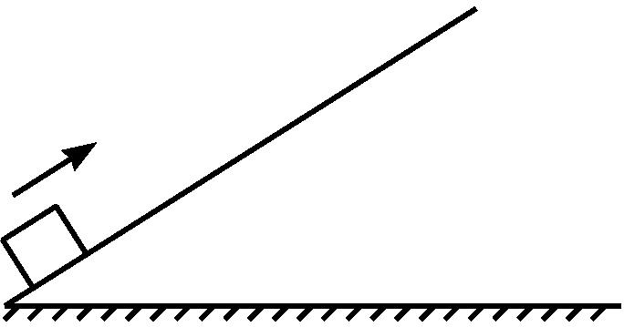

**2.** 如图所示,物块以某一初速度滑上足够长的固定光滑斜面,物块的水平位移、竖直位移、水平速度、竖直速度分别用*x*、*y*、*vx*、*vy*表示。物块向上运动过程中,下列图像可能正确的是(　)

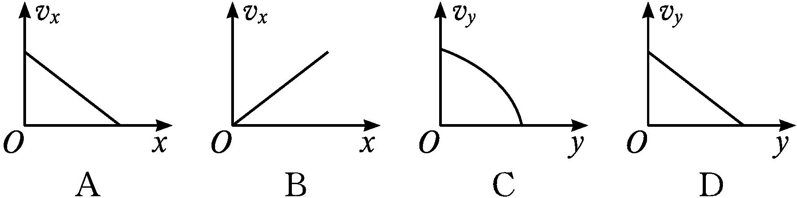

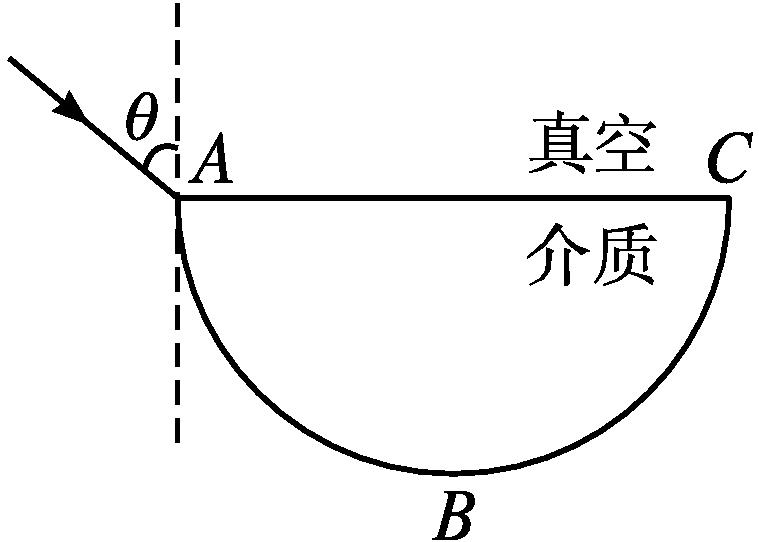

**3.** 如图所示,*ABC*为半圆柱体透明介质的横截面,*AC*为直径,*B*为$\overset{⏜}{ABC}$的中点。真空中一束单色光从*AC*边射入介质,入射点为*A*点,折射光直接由*B*点出射。不考虑光的多次反射,下列说法正确的是(　)

A.入射角*θ*小于45°

B.该介质折射率大于$\sqrt{2}$

C.增大入射角,该单色光在$\overset{⏜}{BC}$上可能发生全反射

D.减小入射角,该单色光在$\overset{⏜}{AB}$上可能发生全反射

**4.** 我国研制的“天问二号”探测器,任务是对伴地小行星及彗星交会等进行多目标探测。某同学提出探究方案,通过释放卫星绕小行星进行圆周运动,可测得小行星半径*R*和质量*M*。为探测某自转周期为*T*0的小行星,卫星先在其同步轨道上运行,测得距离小行星表面高度为*h*,接下来变轨到小行星表面附近绕其做匀速圆周运动,测得周期为*T*1。已知引力常量为*G*,不考虑其他天体对卫星的引力,可根据以上物理量得到*R=*$\frac{a^{\frac{2}{3}}}{b^{\frac{2}{3}}-a^{\frac{2}{3}}}$*h,M=*$\frac{4\pi^{2}R^{3}}{Gc^{2}}$。下列选项正确的是(　)

A.*a*为*T*1,*b*为*T*0,*c*为*T*1

B.*a*为*T*1,*b*为*T*0,*c*为*T*0

C.*a*为*T*0,*b*为*T*1,*c*为*T*1

D.*a*为*T*0,*b*为*T*1,*c*为*T*0

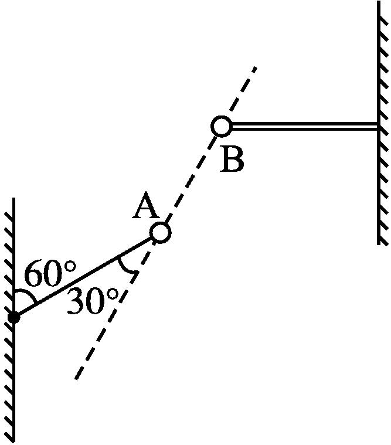

**5.** 如图所示,两带电小球的质量均为*m*,小球A用一端固定在墙上的绝缘轻绳连接,小球B用固定的绝缘轻杆连接。小球A静止时,轻绳与竖直方向的夹角为60°,两球连线与轻绳的夹角为30°,整个系统在同一竖直平面内,重力加速度大小为*g*。下列说法正确的是(　)

A.小球A静止时,轻绳上拉力为2*mg*

B.小球A静止时,小球A与小球B间的库仑力为2*mg*

C.若将轻绳剪断,则剪断瞬间小球A加速度大小为*g*

D.若将轻绳剪断,则剪断瞬间轻杆对小球B的作用力变小

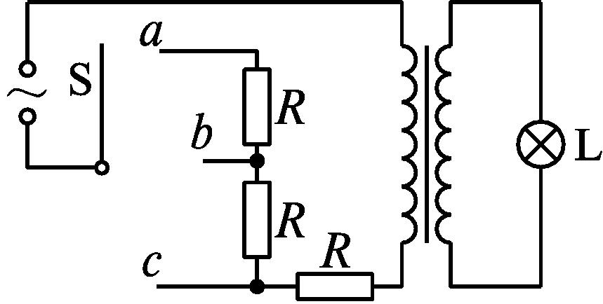

**6.** 如图所示,某小组设计了灯泡亮度可调的电路,*a*、*b*、*c*为固定的三个触点,理想变压器原、副线圈匝数比为*k*,灯泡L和三个电阻的阻值均恒为*R*,交流电源输出电压的有效值恒为*U*。开关S与不同触点相连,下列说法正确的是(　)

A.S与*a*相连,灯泡的电功率最大

B.S与*a*相连,灯泡两端的电压为$\frac{kU}{k^{2} + 3}$

C.S与*b*相连,流过灯泡的电流为$\frac{U}{(k^{2} + 2)R}$

D.S与*c*相连,灯泡的电功率为$\frac{U^{2}}{(k^{2} + 1)R}$

二、选择题:本题共4小题,每小题5分,共20分。在每小题给出的四个选项中,有多项符合题目要求。全部选对的得5分,选对但不全的得3分,有选错的得0分。

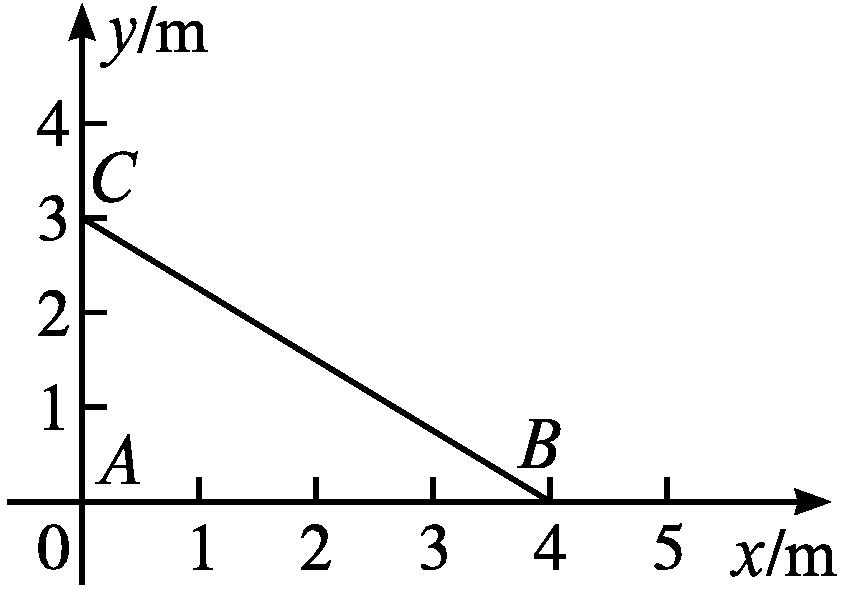

**7.** 如图所示,*A*(0,0)、*B*(4,0)、*C*(0,3)在*xOy*平面内,两波源分别置于*A*、*B*两点。*t=*0时,两波源从平衡位置起振,起振方向相同且垂直于*xOy*平面,频率均为2.5
Hz。两波源持续产生振幅相同的简谐横波,波分别沿*AC*、*BC*方向传播,波速均为10
m/s。下列说法正确的是(　)

A.两横波的波长均为4 m

B.*t=*0.4 s时,*C*处质点加速度为0

C.*t=*0.4 s时,*C*处质点速度不为0

D.*t=*0.6 s时,*C*处质点速度为0

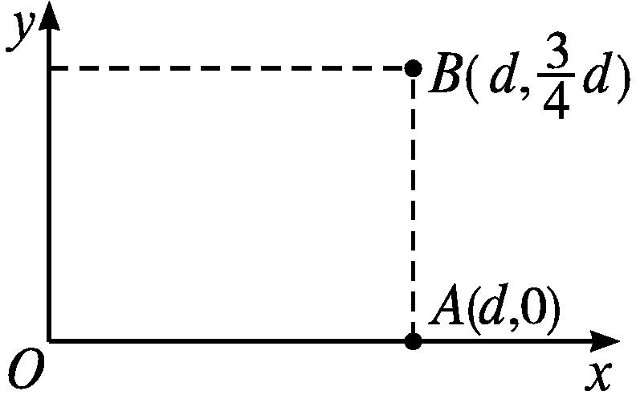

**8.** 一匀强电场的方向平行于*xOy*平面,平面内*A*点和*B*点的位置如图所示。电荷量为*+q*、*-q*
和+2*q*的三个试探电荷先后分别置于*O*点、*A*点和*B*点时,电势能均为*E*p(*E*p*\>*0)。下列说法正确的是(　)

A.*OA* 中点的电势为零

B.电场的方向与*x*轴正方向成60°角

C.电场强度的大小为$\frac{\sqrt{2}E_{p}}{qd}$

D.电场强度的大小为$\frac{2\sqrt{2}E_{p}}{qd}$

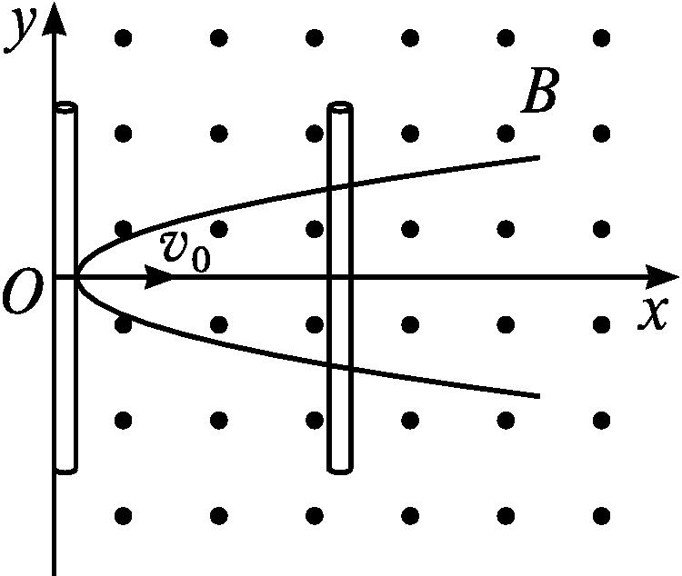

**9.** 如图所示,关于*x*轴对称的光滑导轨固定在水平面内,导轨形状为抛物线,顶点位于*O*点。一足够长的金属杆初始位置与*y*轴重合,金属杆的质量为*m*,单位长度的电阻为*r*0。整个空间存在竖直向上的匀强磁场,磁感应强度为*B*。现给金属杆一沿*x*轴正方向的初速度*v*0,金属杆运动过程中始终与*y*轴平行,且与电阻不计的导轨接触良好。下列说法正确的是(　)

A.金属杆沿*x*轴正方向运动过程中,金属杆中电流沿*y*轴负方向

B.金属杆可以在沿*x*轴正方向的恒力作用下做匀速直线运动

C.金属杆停止运动时,与导轨围成的面积为$\frac{mv_{0}r_{0}}{B^{2}}$

D.若金属杆的初速度减半,则金属杆停止运动时经过的距离小于原来的一半

**10.** 如图所示,某爆炸能量测量装置由装载台和滑轨等构成,*C*是可以在滑轨上运动的标准测量件,其规格可以根据测量需求进行调整。滑轨安装在高度为*h*的水平面上。测量时,将弹药放入装载台圆筒内,两端用物块*A*和*B*封装,装载台与滑轨等高。引爆后,假设弹药释放的能量完全转化为*A*和*B*的动能。极短时间内*B*嵌入*C*中形成组合体*D,D*与滑轨间的动摩擦因数为*μ*。*D*在滑轨上运动*s*1距离后抛出,落地点距抛出点水平距离为*s*2,根据*s*2可计算出弹药释放的能量。某次测量中,*A*、*B*、*C*质量分别为3*m*、*m*、5*m,s*1=$\frac{h}{\mu}$,整个过程发生在同一竖直平面内,不计空气阻力,重力加速度大小为*g*。则(　)

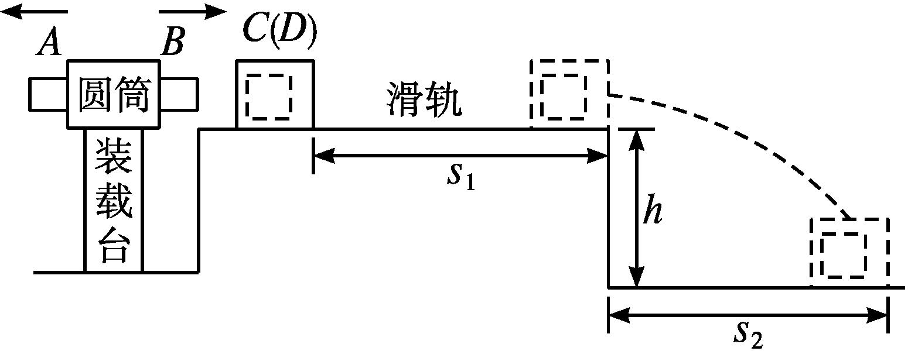

A.*D*的初动能与爆炸后瞬间*A*的动能相等

B.*D*的初动能与其落地时的动能相等

C.弹药释放的能量为36*mgh*$\left( 1 + \frac{{s_{2}}^{2}}{4h^{2}} \right)$

D.弹药释放的能量为48*mgh*$\left( 1 + \frac{{s_{2}}^{2}}{4h^{2}} \right)$

三、非选择题:本题共5小题,共56分。

**11.** (7分)某同学通过观察小球在黏性液体中的运动,探究其动力学规律,步骤如下:

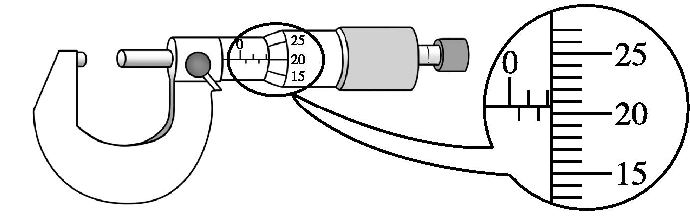

图1

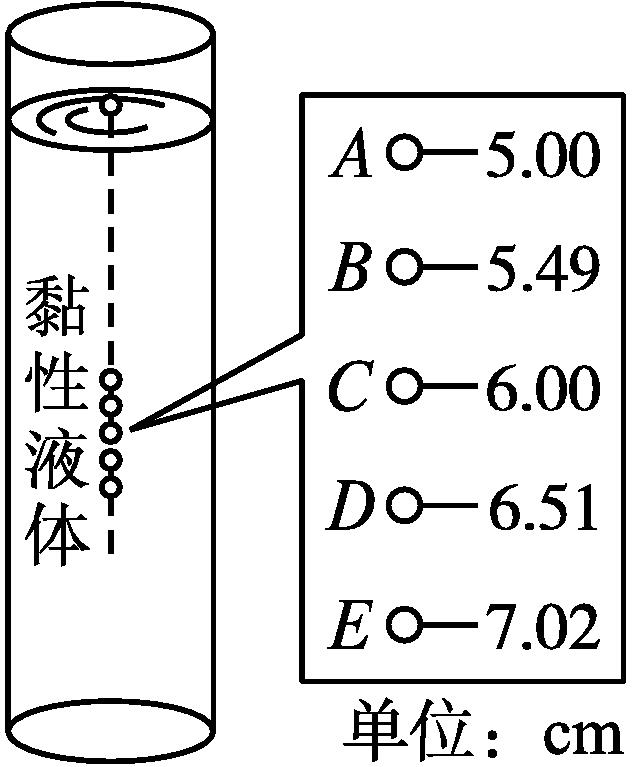

图2

(1)用螺旋测微器测量小球直径*D*如图1所示,*D=<u>　　</u>* mm。 

(2)在液面处由静止释放小球,同时使用频闪摄影仪记录小球下落过程中不同时刻的位置,频闪摄影仪每隔0.5
s闪光一次。装置及所拍照片示意图如图2所示(图中的数字是小球到液面的测量距离,单位是cm)。

(3)根据照片分析,小球在*A*、*E*两点间近似做匀速运动,速度大小*v=<u>　　</u>*
m/s(保留2位有效数字)。 

(4)小球在液体中运动时受到液体的黏滞阻力*f=kDv(k*为与液体有关的常量),已知小球密度为*ρ*,液体密度为*ρ*0,重力加速度大小为*g*,则*k*的表达式为*k=<u>　　　</u>*(用题中给出的物理量表示)。 

(5)为了进一步探究动力学规律,换成直径更小的同种材质小球,进行上述实验,匀速运动时的速度将*<u>　　</u>*(选填“增大”“减小”或“不变”)。 

**12.** (9分)车辆运输中若存在超载现象,将带来安全隐患。由普通水泥和导电材料混合制成的导电水泥,可以用于监测道路超载问题。某小组对此进行探究。

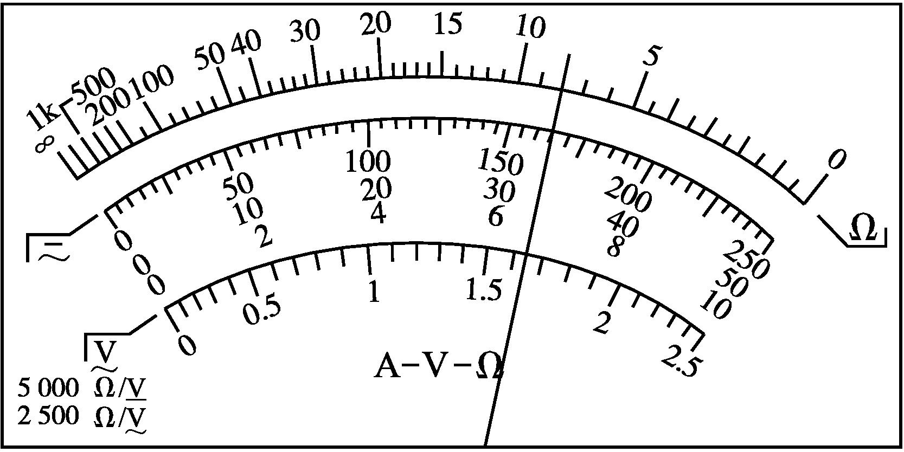

图1

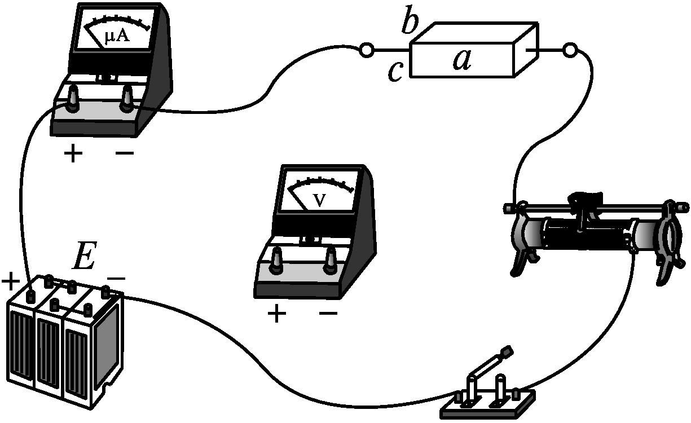

图2

(1)选择一块均匀的长方体导电水泥块样品,用多用电表粗测其电阻。将多用电表开关旋转到“×1
k”挡,正确操作后,指针位置如图1所示,则读数为*<u>　　</u>* Ω。 

(2)为进一步提高实验精度,使用伏安法测量水泥块电阻,电源*E*电动势6
V,内阻可忽略,电压表量程0*~*6 V,内阻约10 kΩ,电流表量程0*~*600
μA,内阻约100
Ω。实验中要求滑动变阻器采用分压接法,在图2中完成余下导线的连接。

(3)如图2所示,测量水泥块的长为*a*,宽为*b*,高为*c*。用伏安法测得水泥块电阻为*R*,则电阻率*ρ=<u>　　　</u>*(用*R*、*a*、*b*、*c*表示)。 

(4)测得不同压力*F*下水泥块的电阻*R*,算出对应的电阻率*ρ*,作出*ρ-F*图像如图3所示。

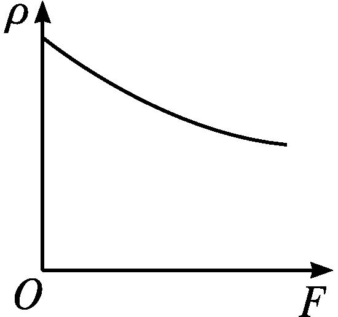

图3

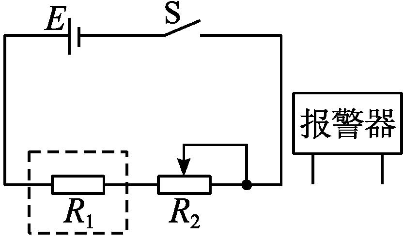

图4

(5)基于以上结论,设计压力报警系统,电路如图4所示。报警器在两端电压大于或等于3
V时启动,*R*1为水泥块,*R*2为滑动变阻器,当*R*2的滑片处于某位置,*R*1上压力大于或等于*F*0时,报警器启动。报警器应并联在*<u>　　</u>*(选填“*R*1”或“*R*2”)两端。 

(6)若电源*E*使用时间过长,电动势变小,*R*1上压力大于或等于*F*1时,报警器启动,则*F*1*<u>　　</u>*(选填“大于”“小于”或“等于”)*F*0。 

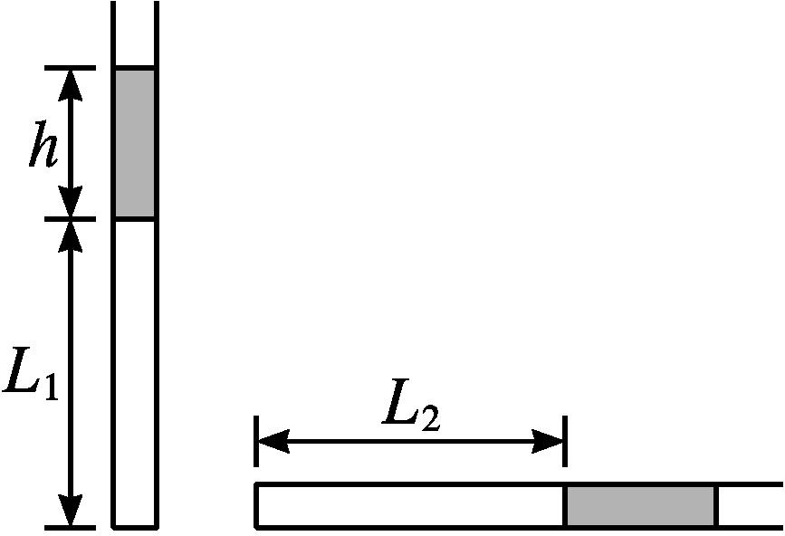

**13.** (10分)用热力学方法可测量重力加速度。如图所示,粗细均匀的细管开口向上竖直放置。管内用液柱封闭了一段长度为*L*1的空气柱。液柱长为*h*,密度为*ρ*。缓慢旋转细管至水平,封闭空气柱长度为*L*2,大气压强为*p*0。

(1)若整个过程中温度不变,求重力加速度*g*的大小。

(2)考虑到实验测量中存在各类误差,需要在不同实验参数下进行多次测量,如不同的液柱长度、空气柱长度、温度等。某次实验测量数据如下,液柱长*h=*0.200
0 m,细管开口向上竖直放置时空气柱温度*T*1=305.7
K。水平放置时调控空气柱温度,当空气柱温度*T*2=300.0
K时,空气柱长度与竖直放置时相同。已知*ρ=*1.0×103
kg/m3,*p*0=1.0×105
Pa。根据该组实验数据,求重力加速度*g*的值。

**14.** (14分)如图所示,直流电源的电动势为*E*0,内阻为*r*0,滑动变阻器*R*的最大阻值为2*r*0,平行板电容器两极板水平放置,板间距离为*d*,板长为$\sqrt{3}$*d*,平行板电容器的右侧存在方向垂直于纸面向里的匀强磁场。闭合开关S,当滑片处于滑动变阻器中点时,质量为*m*的带正电粒子以初速度*v*0水平向右从电容器左侧中点*a*进入电容器,恰好从电容器下极板右侧边缘*b*点进入磁场,随后又从电容器上极板右侧边缘*c*点进入电容器,忽略粒子重力和空气阻力。

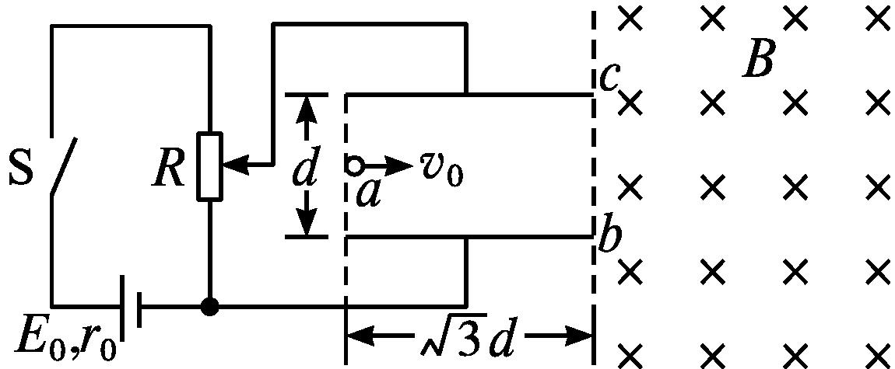

(1)求粒子所带电荷量*q*。

(2)求磁感应强度*B*的大小。

(3)若粒子离开*b*点时,在平行板电容器的右侧再加一个方向水平向右的匀强电场,电场强度大小为$\frac{4\sqrt{3}E_{0}}{3d}$,求粒子相对于电容器右侧的最远水平距离*x*m。

**15.** (16分)某地为发展旅游经济,因地制宜利用山体举办了机器人杂技表演。表演中,需要将质量为*m*的机器人抛至悬崖上的*A*点,图为山体截面与表演装置示意图。*a*、*b*为同一水平面上两条光滑平行轨道,轨道中有质量为*M*的滑杆。滑杆用长度为*L*的轻绳与机器人相连。初始时刻,轻绳绷紧且与轨道平行,机器人从*B*点以初速度*v*竖直向下运动,*B*点位于轨道平面上,且在*A*点正下方,*AB=*1.2*L*。滑杆始终与轨道垂直,机器人可视为质点且始终在同一竖直平面内运动,不计空气阻力,轻绳不可伸长,sin
37°=0.6,重力加速度大小为*g*。

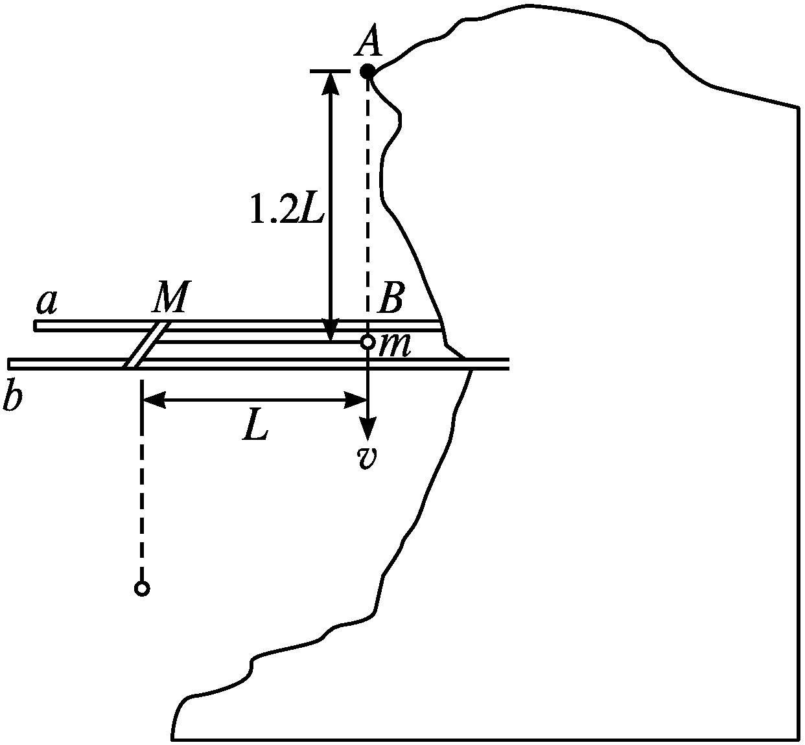

(1)若滑杆固定,*v=*$\sqrt{gL}$,当机器人运动到滑杆正下方时,求轻绳拉力的大小;

(2)若滑杆固定,当机器人运动到滑杆左上方且轻绳与水平方向夹角为37°时,机器人松开轻绳后被抛至*A*点,求*v*的大小;

(3)若滑杆能沿轨道自由滑动,*M=km*,且*k*≥1,当机器人运动到滑杆左上方且轻绳与水平方向夹角为37°时,机器人松开轻绳后被抛至*A*点,求*v*与*k*的关系式及*v*的最小值。

**2025**年物理(湖南卷)

**1.** B　原子核衰变时释放能量,根据质能方程,总质量会减少,新核总质量小于原核质量,故A错误;半衰期定义为大量放射性原子核半数发生衰变所需的时间,题干中对数量的描述也是“大量”,符合定义,故B正确;半衰期由原子核内部结构决定,与温度无关,故C错误;半衰期只由核内部自身的因素决定,与原子所处的化学状态和外部条件没有关系,故D错误。

**2.** C　由题意可知,物块沿斜面向上做匀减速直线运动,设初速度为*v*0,加速度大小为*a*,斜面倾角为*θ*,水平方向上物块做匀减速直线运动,初速度为*v*0*x**=v*0cos
*θ*,加速度大小为*ax=a*cos
*θ*,则有${v_{x}}^{2} - {v_{0x}}^{2}$=-2*axx*,整理可得*vx=*$\sqrt{(v_{0}\cos\theta)^{2}-2a\cos\theta\cdot x}$,可知,*vx-x*图像应为类似抛物线的一部分,故A、B错误;物块在竖直方向上做匀减速直线运动,速度为*v*0*y**=v*0sin
*θ*,加速度大小为*ay=a*sin
*θ*,则有${v_{y}}^{2} - {v_{0y}}^{2}$=-2*ayy*,整理可得*vy=*$\sqrt{(v_{0}\sin\theta)^{2}-2a\sin\theta\cdot y}$,可知,*vy-y*图像应为类似抛物线的一部分,故C正确,D错误。

【一题多解】物块沿光滑斜面上滑时,其水平方向和竖直方向的分运动均为匀变速直线运动,在匀变速直线运动中速度的二次方与位移成线性关系,故*vx-x*图像、*vy-y*图像一定为曲线,通过排除法选C。

**3.** D　根据题意,画出光路图,如图甲所示,*O*为该介质横截面的圆心,由几何关系可知,折射角为45°,由折射定律有*n=*$\frac{\sin\theta}{sin45^\circ } = \sqrt{2}$sin
*θ\>*1,且sin *θ\<*1,则有*n\<*$\sqrt{2}$,sin
*θ\>*$\frac{\sqrt{2}}{2}$,即*θ\>*45°,故A、B错误;令sin
*C=*$\frac{1}{n}$,根据折射光直接由*B*点出射可知sin
*C\>*$\frac{\sqrt{2}}{2}$,即全反射临界角*C\>*45°,增大入射角,光路图如图乙所示,由几何关系可知,光在$\overset{⏜}{BC}$上的入射角小于45°,则该单色光在$\overset{⏜}{BC}$上不可能发生全反射,故C错误;减小入射角,光路图如图丙所示,由几何关系可知,光在$\overset{⏜}{AB}$上的入射角大于45°,可能大于临界角,则该单色光在$\overset{⏜}{AB}$上可能发生全反射,故D正确。

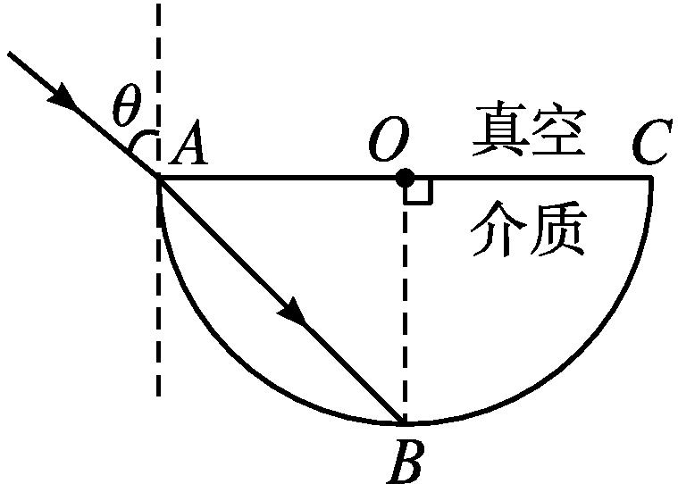

甲

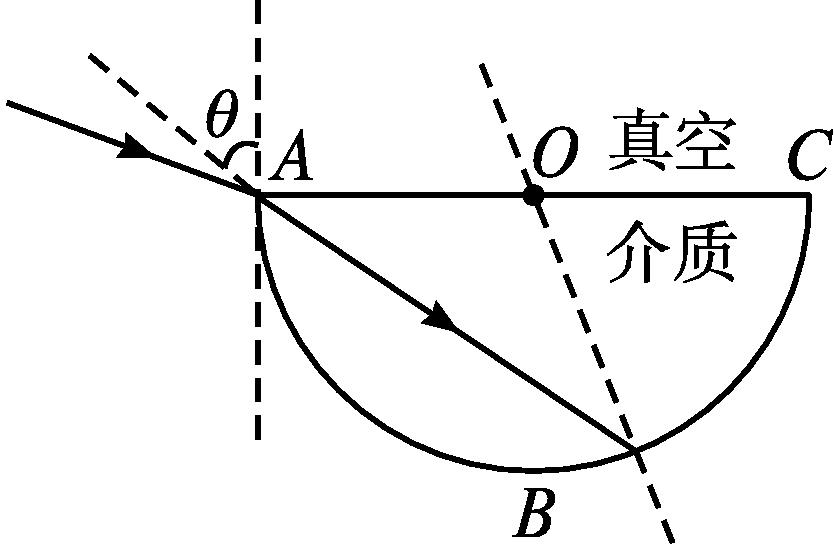

乙

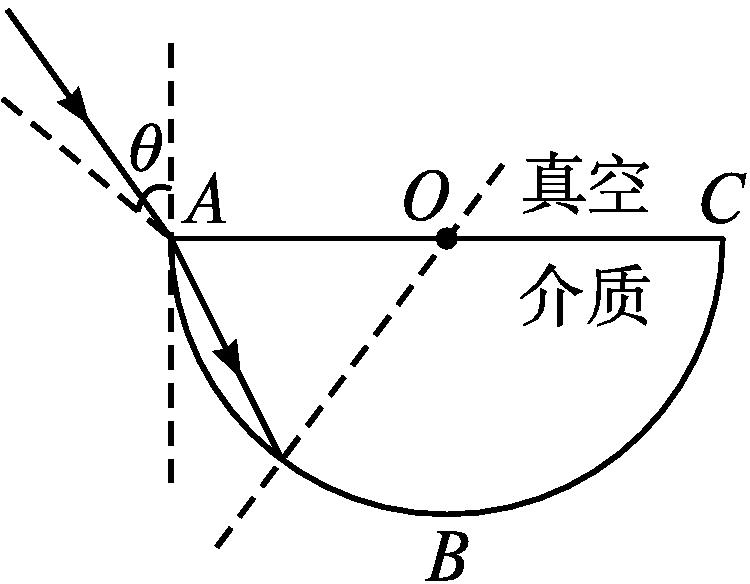

丙

**4.** A　根据题意,卫星在小行星同步轨道和表面附近轨道运行时轨道半径分别为*R+h*、*R*,设卫星的质量为*m*,由开普勒第三定律可知$\frac{(R + h)^{3}}{{T_{0}}^{2}} = \frac{R^{3}}{{T_{1}}^{2}}$,解得*R=*$\frac{{T_{1}}^{\frac{2}{3}}}{{T_{0}}^{\frac{2}{3}}-{T_{1}}^{\frac{2}{3}}}$*h*,卫星绕小行星表面附近做匀速圆周运动,由万有引力提供向心力可知$\frac{GMm}{R^{2}}$*=m*$\frac{4\pi^{2}}{{T_{1}}^{2}}$*R*,解得*M=*$\frac{4\pi^{2}R^{3}}{G{T_{1}}^{2}}$,对应结果可得*a*为*T*1,*b*为*T*0,*c*为*T*1,故A正确。

**5.** C　小球A静止时,对小球A受力分析,如图所示,由平行四边形定则及几何关系可知,轻绳上拉力为*F*T*=mg*,小球A与小球B间的库仑力*F*库=2*mg*cos
30°=$\sqrt{3}$*mg*,故A、B错误;若将轻绳剪断,则剪断瞬间小球A受到轻绳的拉力消失,其他两力保持不变,根据力的平衡可知,此时小球A所受的合力大小为*mg*,则加速度大小为*g*,故C正确;若将轻绳剪断,则剪断瞬间小球B受到的库仑力、重力不变,小球B仍然处在静止状态,则轻杆对小球B的作用力不变,故D错误。

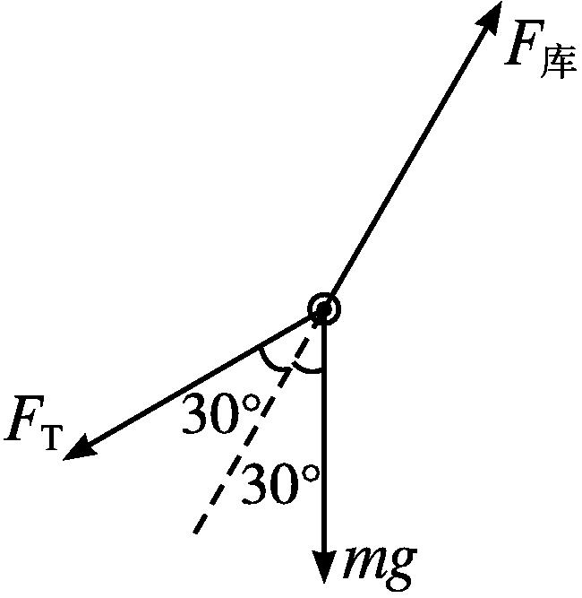

**6.** B　设变压器原、副线圈的电压分别为*U*1、*U*2,电流分别为*I*1、*I*2,电压关系$\frac{U_{1}}{U_{2}}$*=k*,电流关系$\frac{I_{1}}{I_{2}} = \frac{1}{k}$,在原线圈中*U*1*=U-I*1*R*原,在副线圈中*U*2*=I*2*R*,故灯泡两端电压*U*2=$\frac{U_{1}}{k} = \frac{U-I_{1}R_{\text{原}}}{k} = \frac{U}{k} - \frac{I_{2}R_{\text{原}}}{k^{2}} = \frac{U}{k} - \frac{U_{2}R_{\text{原}}}{k^{2}R}$,整理后有$\frac{k^{2}R + R_{\text{原}}}{k^{2}R}$*U*2=$\frac{U}{k}$,即灯泡两端电压*U*2=$\frac{kRU}{k^{2}R + R_{\text{原}}}$,故流过灯泡的电流为*I*2=$\frac{U_{2}}{R} = \frac{kU}{k^{2}R + R_{\text{原}}}$,灯泡的电功率*P=U*2*I*2=$\frac{k^{2}U^{2}R}{{(k^{2}R + R_{\text{原}})}^{2}}$,由于不知道*k*的具体值,故无法判断原线圈所在回路的阻值*R*原为何值时功率最大,故A错误;当开关S与*a*相连时,*R*原=3*R*,故灯泡两端电压*U*2=$\frac{kU}{k^{2} + 3}$,故B正确;当开关S与*b*相连时,*R*原=2*R*,故流过灯泡的电流为*I*2=$\frac{kU}{(k^{2} + 2)R}$,故C错误;当开关S与*c*相连时,*R*原*=R*,故灯泡的电功率*P=*$\frac{k^{2}U^{2}}{{(k^{2} + 1)}^{2}R}$,故D错误。

【一题多解】设理想变压器原、副线圈的匝数分别为*n*1、*n*2,原、副线圈电压分别为*U*1、*U*2,副线圈负载电阻为*R*,可以将变压器与负载看为一个整体,等效为一个新的电阻,*R*等=$\frac{U_{1}}{I_{1}} = \frac{\frac{n_{1}}{n_{2}}U_{2}}{\frac{n_{2}}{n_{1}}I_{2}} = \left( \frac{n_{1}}{n_{2}} \right)^{2}$*R=k*2*R*,其中*k=*$\frac{n_{1}}{n_{2}}$(原、副线圈匝数比),等效后电路如图所示,当开关S与*a*相连时,*R*原=3*R*,等效电阻两端电压*U*1=$\frac{R_{\text{等}}}{R_{\text{等}} + 3R}$*U=*$\frac{k^{2}}{k^{2} + 3}$*U*,故灯泡两端电压*U*2=$\frac{U_{1}}{k} = \frac{kU}{k^{2} + 3}$,故B正确;当开关S与*b*相连时,*R*原=2*R*,流过等效电阻的电流*I*1=$\frac{U}{R_{\text{等}} + 2R} = \frac{U}{(k^{2} + 2)R}$,故流过灯泡的电流为*I*2*=kI*1=$\frac{kU}{(k^{2} + 2)R}$,C错误;当开关S与*c*相连时,*R*原*=R*,灯泡的电功率与等效电阻的电功率相同,流过等效电阻的电流*I*1=$\frac{U}{R_{\text{等}} + R}$,故功率*P=*${I_{1}}^{2}$*R*等=$\frac{k^{2}U^{2}}{{(k^{2} + 1)}^{2}R}$,故D错误;由闭合电路欧姆定律知识可知,当外电路电阻与内阻相等时功率最大,即*R*原和*R*等最接近时功率最大,由于*k*未知,故无法判断开关S与哪个触点接触时*R*原和*R*等最接近,即无法判断何时灯泡功率最大,故A错误。

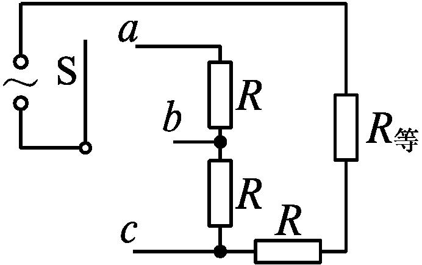

**7.** AD　两横波的波长均为*λ=*$\frac{v}{f}$=4
m,故A正确;来自*A*处、*B*处的两列波传到*C*处所需时间分别为*t*1=$\frac{3}{10}$
s=0.3 s,*t*2=$\frac{\sqrt{3^{2} + 4^{2}}}{10}$
s=0.5 s,*T=*$\frac{1}{f}$=0.4 s,故*t=*0.4
s时,*A*处波已传到*C*处且*C*处质点已经振动了$\frac{1}{4}$*T*,故*C*处质点处于正向或负向最大位移处,加速度最大,速度为0,故B、C错误;分析可知*t=*0.6
s时两列波都已传播到*C*处,*C*处质点到两波源的距离差为Δ*x=*5 m-3 m=2
m=$\frac{1}{2}$*λ*,故*C*处为振动减弱点,由于两列波振幅相同,故*C*处位移始终为0,速度为0,故D正确。

**8.** AD　根据题意可知*O*点、*A*点和*B*点的电势分别为*φO=*$\frac{E_{p}}{q}$、*φA=-*$\frac{E_{p}}{q}$、*φB=*$\frac{E_{p}}{2q}$,则*OA*中点的电势为*φM=*$\frac{\varphi_{O} + \varphi_{A}}{2}$=0,故A正确;如图所示,设*N*点为*AB*的三等分点,同理可知*N*点电势为0,连接*MN*,则*MN*为一条等势线,过*A*点作*MN*的垂线,可知电场线沿该垂线方向指向右下方,由几何关系可知,∠*NMA=*45°,故电场的方向与*x*轴正方向成45°角,故B错误;电场强度的大小为*E=*$\frac{0-\left( -\frac{E_{p}}{q} \right)}{\frac{1}{2}d\cdot cos45^\circ } = \frac{2\sqrt{2}E_{p}}{qd}$,故C错误,D正确。

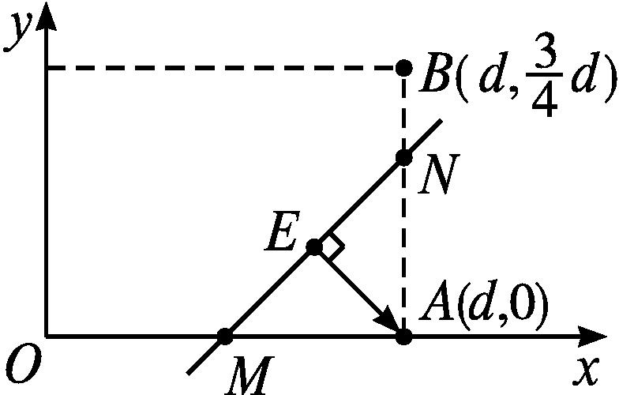

**9.** AC　根据右手定则可知金属杆沿*x*轴正方向运动过程中,金属杆中电流沿*y*轴负方向,故A正确;若金属杆可以在沿*x*轴正方向的力*F*作用下做匀速直线运动,则有*F=F*安*=BIL,I=*$\frac{BLv_{0}}{R} = \frac{BLv_{0}}{Lr_{0}} = \frac{Bv_{0}}{r_{0}}$,可得*F=*$\frac{B^{2}Lv_{0}}{r_{0}}$,由于金属杆运动过程中接入导轨中的长度*L*在变化,故*F*为变力,故B错误;取一微小时间Δ*t*,设此时金属杆接入导轨中的长度为*L'*,根据动量定理有*-BI'L'*Δ*t=-BL'q'=m*Δ*v*,同时有*q=*$\frac{\frac{\Delta\Phi}{\Delta t}}{L'r_{0}}$·Δ*t=*$\frac{\Delta\Phi}{L'r_{0}} = \frac{B\cdot \Delta S}{L'r_{0}}$,联立得-$\frac{B^{2}\Delta S}{r_{0}}$*=m*Δ*v*,对从开始到金属杆停止运动时整个过程累积可得-$\frac{B^{2}S}{r_{0}}$=0*-mv*0,解得此时金属杆与导轨围成的面积*S=*$\frac{mv_{0}r_{0}}{B^{2}}$,故C正确;若金属杆的初速度减半,由上述分析可知当金属杆停止运动时金属杆与导轨围成的面积*S'=*$\frac{1}{2}$*S*,根据抛物线的图像规律可知此时金属杆停止运动时经过的距离大于原来的一半,故D错误。

**10.** BD　爆炸后,*A*、*B*组成的系统动量守恒,有3*mv*1*=mv*2,*B*与*C*碰撞过程动量守恒,有*mv*2=6*mv*,联立解得*v=*0.5*v*1,爆炸后瞬间*A*的动能*E*k*A*=$\frac{1}{2}$·3*m*·${v_{1}}^{2}$,*D*的初动能*E*k*D*=$\frac{1}{2}$·6*m*·${(0.5v_{1})}^{2}$,两者不相等,故A错误;*D*水平滑动过程中摩擦力做功为*W*f*=-μ*·6*mg*·*s*1*=-μ*·6*mg*·$\frac{h}{\mu}$=-6*mgh,D*做平抛运动过程中重力做的功为*W*G=6*mgh*,故*D*从开始运动到落地瞬间合外力做功为0,根据动能定理可知*D*的初动能与其落地时的动能相等,故B正确;*D*物块平抛过程有*h=*$\frac{1}{2}$*gt*2,*s*2*=v*0*t*,联立解得*v*0*=s*2$\sqrt{\frac{g}{2h}}$,*D*水平滑动过程中根据动能定理有-6*mgh=*$\frac{1}{2}$·6*m*${v_{0}}^{2} - \frac{1}{2}$·6*mv*2,化简得*v*2=$\frac{{s_{2}}^{2}g}{2h}$+2*gh*,弹药释放的能量完全转化为*A*和*B*的动能,则爆炸过程的能量为*E=*$\frac{1}{2}$·3*m*${v_{1}}^{2} + \frac{1}{2}$·*m*${v_{2}}^{2}$=24*mv*2=24*m*$\left( \frac{{s_{2}}^{2}g}{2h} + 2gh \right)$=48*mgh*$\left( 1 + \frac{{s_{2}}^{2}}{4h^{2}} \right)$,故C错误,D正确。

**11.** 答案 (1)2.206(2.205*~*2.207均可)　(3)0.010

(4)$\frac{(\rho-\rho_{0})g\pi D^{2}}{6v}$　(5)减小

解析 (1)根据图1可知小球直径*D=*2 mm+20.6×0.01 mm=2.206 mm。

(3)由图2可知*A*、*E*两点间的距离为*x=*(7.02-5.00)×10-2
m=2.02×10-2
m,小球从*A*运动到*E*的时间为*t=*4*t*0=4×0.5 s=2
s,所以速度为*v=*$\frac{x}{t} = \frac{2.02 \times 10^{-2}\text{ }m}{2s}$≈0.010
m/s。

(4)小球匀速运动,根据受力平衡有*ρgV=ρ*0*gV+f*,由体积公式可知,小球的体积*V=*$\frac{4}{3}$π*R*3=$\frac{4}{3}\pi\left( \frac{D}{2} \right)^{3}$,整理可得*k=*$\frac{(\rho-\rho_{0})gV}{Dv} = \frac{(\rho-\rho_{0})g\pi D^{2}}{6v}$。

(5)根据(4)可知匀速运动的速度与小球直径的二次方成正比,所以换成直径更小的同种材质小球,匀速运动时的速度将减小。

**12.** 答案 (1)8
000　(2)见解析图　(3)$\frac{Rbc}{a}$　(5)*R*2　(6)大于

解析 (1)由题可知多用电表开关旋转到“×1 k”挡,故根据题图1可得读数为8 000
Ω。

(2)由上述知长方体导电水泥块样品的电阻*Rx\>*$\sqrt{R_{A}R_{V}}$,故采用电流表内接法;实验中要求滑动变阻器采用分压接法,故连接实物图如图所示。

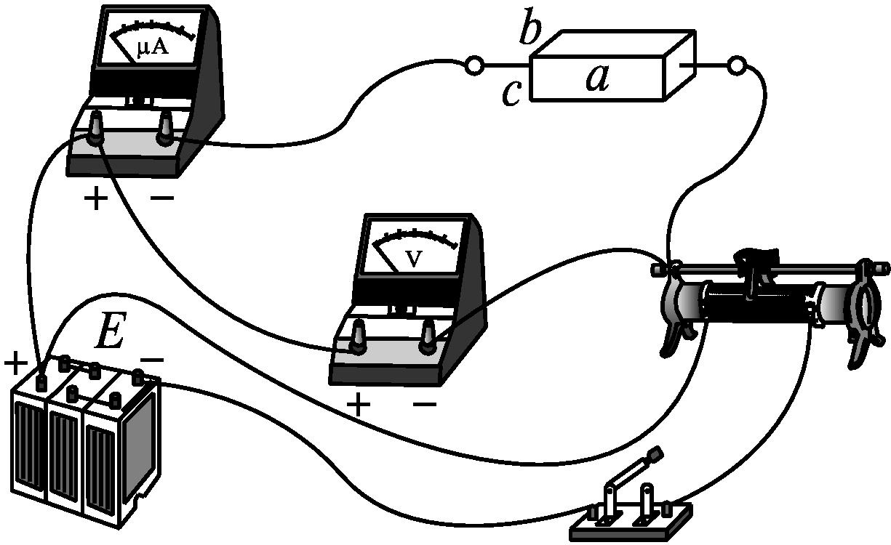

(3)电阻定律*R=*$\frac{\rho L}{S}$,化简得*ρ=*$\frac{RS}{L}$,根据题图2可知,测量的水泥块长度为*a*,横截面积为*bc*,代入解得*ρ=*$\frac{Rbc}{a}$。

(5)根据题图3可知压力越大电阻率越小,即电阻越小;回路中电流增大,滑动变阻器*R*2电压增大,水泥块*R*1电压减小,而报警器在两端电压大于或等于3
V时启动,故应将报警器并联在*R*2两端。

(6)电源电动势*E*减小,要使报警器启动,即*R*2两端电压仍为3
V,根据串联分压有*U*2=$\frac{R_{2}}{R_{1} + R_{2}}$*E=*$\frac{1}{\frac{R_{1}}{R_{2}} + 1}$*E*,可知*E*减小需要*R*1更小,又因为*F*越大*R*1越小,可知*F*1大于*F*0。

**13.** 答案
(1)$\frac{p_{0}(L_{2}-L_{1})}{L_{1}\rho h}$　(2)9.5
m/s2

解析 (1)竖直放置时空气柱的压强为*p*1*=p*0*+ρgh*

水平放置时空气柱的压强*p*2*=p*0

由题可知,空气柱发生等温变化,根据玻意耳定律,有*p*1*L*1*S=p*2*L*2*S*

解得*g=*$\frac{p_{0}(L_{2}-L_{1})}{L_{1}\rho h}$。

(2)由题可知,空气柱发生等容变化,根据查理定律,有$\frac{p_{1}}{T_{1}} = \frac{p_{2}}{T_{2}}$

代入数据可得*g=*9.5 m/s2。

**14.** 答案
(1)$\frac{m{v_{0}}^{2}}{E_{0}}$　(2)$\frac{2E_{0}}{dv_{0}}$　(3)$\frac{(2 + \sqrt{3})d}{2}$

解析
(1)粒子在电容器中做类平抛运动,其中粒子在水平方向做匀速直线运动,有$\sqrt{3}$*d=v*0*t*

在竖直方向做匀变速直线运动,有$\frac{d}{2} = \frac{0 + v_{y}}{2}$*t,vy=at=*$\frac{qU}{md}$*t*

由闭合回路欧姆定律可得*U=*$\frac{r_{0}}{r_{0} + 2r_{0}}$*E*0

联立解得*vy=*$\frac{\sqrt{3}}{3}$*v*0,*q=*$\frac{m{v_{0}}^{2}}{E_{0}}$。

(2)粒子进入磁场时的速度与竖直方向夹角的正弦值为tan
*θ=*$\frac{v_{x}}{v_{y}}$=60°,*v=*$\frac{v_{0}}{sin60^\circ } = \frac{2\sqrt{3}}{3}$*v*0

粒子在进入磁场后做匀速圆周运动,即

*qvB=m*$\frac{v^{2}}{R}$

其中由几何关系可得*R=*$\frac{\frac{d}{2}}{cos30^\circ } = \frac{\sqrt{3}d}{3}$

联立解得*B=*$\frac{2E_{0}}{dv_{0}}$。

(3)对粒子取一个竖直向上的速度使得该速度对应产生的洛伦兹力与水平向右的静电力平衡,则有*qvy*1*B=qE*

解得*vy*1=$\frac{2\sqrt{3}}{3}$*v*0

此时粒子做圆周运动的合速度在竖直方向的分速度大小为*vy*2*=vy*1*'+vy=*$\sqrt{3}$*v*0

*vy*1*'=vy*1

此时合速度与竖直方向夹角的正切值为tan
*α=*$\frac{v_{0}}{\sqrt{3}v_{0}}$

合速度大小为*v'=*$\sqrt{{(\sqrt{3}v_{0})}^{2} + {v_{0}}^{2}}$

粒子做圆周运动的半径*r=*$\frac{mv'}{Bq}$

故最远距离为*x*m*=r+r*cos
*α=*$\frac{(2 + \sqrt{3})d}{2}$。

**15.** 答案 (1)4*mg　*(2)$\sqrt{\frac{37gL}{10}}$

(3)*v=*$\sqrt{\frac{9kgL}{10(k + 1)} + \frac{14}{5}gL}　\sqrt{\frac{13}{4}gL}$

解析
(1)对机器人由*B*点运动到最低点的过程,由动能定理可得$\frac{1}{2}m{v_{0}}^{2} - \frac{1}{2}$*mv*2*=mgL*

对于机器人在最低点的运动状态,由向心力公式可得*F-mg=m*$\frac{{v_{0}}^{2}}{L}$

联立可得*F=*4*mg*。

(2)轻绳运动到左上方与水平方向夹角为37°时,由能量守恒定律可得

$\frac{1}{2}$*mv*2*=mgL*sin
37°+$\frac{1}{2}$*mv*2*'*2

水平方向位移*x=L*cos 37°*+L=v*2*'*sin 37°·*t*

竖直方向(取向上为正)位移*y=*1.2*L-L*sin 37°*=v*2*'*cos
37°·*t-*$\frac{1}{2}$*gt*2

联立可得*v=*$\sqrt{\frac{37gL}{10}}$。

(3)当机器人运动到滑杆左上方且与水平方向夹角为37°时记此时机器人所在的点为*C*点,在水平方向对机器人运动到*C*点的过程,由动量守恒定律可得*mx*1*=Mx*2

对该过程中机器人和杆的运动情况分析可得

*x*1*+x*2*=L+L*cos 37°

解得*x*1=$\frac{1.8kL}{1 + k}$,*x*2=$\frac{1.8L}{1 + k}$,*x*1方向向左,*x*2方向向右

令*C*点到*A*点的水平方向上的距离为*xCA*,对运动情况进行分析,可得*xCA=L*cos
37°+(*L-x*2)=$\frac{1.8kL}{1 + k}$

同理,令*C*点到*A*点的竖直方向上的距离为*yCA*,则*yCA=*1.2*L-L*·sin
37°=0.6*L*

设此时机器人在水平方向的速度为*vx*,在竖直方向的速度为*vy*,杆的速度为*vM*,根据动量守恒定律可得*mvx=MvM*,即*vx=kvM*

对于机器人由*B*点运动到*C*点的过程,由动能定理可得

$\frac{1}{2}$*mv*2=$\frac{1}{2}$*m*(${v_{x}}^{2} + {v_{y}}^{2}$)+$\frac{1}{2}$*km*$\left( \frac{v_{x}}{k} \right)^{2}$*+mgL*·sin
37°

对该式化简可得*v*2=$\frac{k + 1}{k}{v_{x}}^{2} + {v_{y}}^{2}$+1.2*gL*

分析机器人由*C*点运动到*A*点的过程,可得

*vx*·*t=*$\frac{1.8kL}{1 + k}$(水平方向)

*vy*·*t-*$\frac{1}{2}$*gt*2=0.6*L*(竖直方向)

当以杆为参考系时,小球依然在做圆周运动,此时小球相对于杆的水平速度*vx'=vx+vM*,由此可得*vy=*$\frac{v_{x}'}{tan37^\circ }$

解得*vy=*$\frac{4}{3} \cdot \frac{k + 1}{k}$·*vx*

联立*vy*与机器人从*C*点到*A*点竖直方向运动公式,可得

$\frac{4}{3} \cdot \frac{k + 1}{k} \cdot \frac{1.8kL}{1 + k} - \frac{1}{2}$*gt*2=0.6*L*

联立解得*t=*$\sqrt{\frac{3.6L}{g}}$

将*t*代入刚刚机器人由*C*点到*A*点竖直方向运动的公式,可得

*vy*·$\sqrt{\frac{3.6L}{g}} - \frac{1}{2}$*g*·$\frac{3.6}{g}$=0.6*L*

解得*vy=*$\sqrt{1.6gL}$

因为*vy=*$\frac{4}{3} \cdot \frac{k + 1}{k}$·*vx*,可得*vx=*$\frac{3k}{4(k + 1)}$*vy*,即*vx=*$\frac{3k}{4(k + 1)} \cdot \sqrt{1.6gL}$

将*vx*、*vy*代入前面动能定理公式在化简后得到的公式,可得

*v*2=$\frac{k + 1}{k} \cdot \frac{9k^{2}}{16(k + 1)^{2}}$·1.6*gL+*1.6*gL+*1.2*gL*

解得*v=*$\sqrt{\frac{9kgL}{10(k + 1)} + \frac{14}{5}gL}$(*k*≥1)

当*k=*1时,*v*值最小,为*v*min=$\sqrt{\frac{13gL}{4}}$。
