# 2026 年湖南卷 · 物理

> **卷别**：湖南自主命题　|　**含解析**：是　|　**来源**：物理备课大师（wl.eywedu.com）Word 版含解析
> **说明**：由官方 Word 版转换，公式为 LaTeX，图片见同目录 `images/`。

---

2026年高考湖南卷物理高考真题

一、单选题

**1.** 某舰载机起飞时，在第2s内的*v*—*t*图像如图所示，该段时间内舰载机加速度的大小为(　)

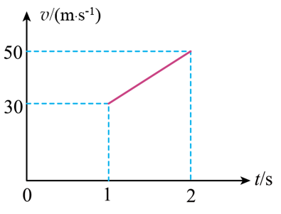

A．10m/s<sup>2</sup> B．20m/s<sup>2</sup> C．30m/s<sup>2</sup>
D．40m/s<sup>2</sup>

【答案】B

【解析】根据加速度的定义式$a = \frac{\Delta v}{\Delta t} = \frac{50 - 30}{1}\text{m/s}^{2} = 20\text{m/s}^{2}$，故选B。

**2.** 关于原子核衰变，下列说法正确的是(　)

A．原子核发生α衰变时，电荷数增大

B．原子核发生α衰变时，质量数增大

C．衰变产生的α粒子穿透能力强，可以穿透几厘米厚的铅板

D．理论研究表明，${}_{86}^{216}\text{Rn}$(氡核)可能在一次衰变过程中放出两个α粒子，则其衰变方程为${}_{86}^{216}\text{Rn} \rightarrow 2_{2}^{4}\text{He} +_{82}^{208}\text{Pb}$

【答案】D

【解析】α衰变放出的α粒子为$_{2}^{4}\text{He}$，衰变过程电荷数守恒，因此母核电荷数减少2，质量数减少4，故A、B错误；α粒子电离能力强、穿透能力极弱，一张白纸即可将其挡住，穿透能力强、可穿透几厘米厚铅板的是*γ*射线，故C错误；衰变方程满足电荷数守恒和质量数守恒：左边电荷数为86，右边2×2＋82
= 86；左边质量数为216，右边2×4＋208 = 216，守恒关系成立，故D正确。

**3.** 郭守敬望远镜是我国首个天文领域大科学装置，积累了大量的观测数据。分析观测数据表明，某行星绕一恒星做匀速圆周运动的周期为*T*，轨道半径为该恒星半径的*n*倍。不考虑其他星体的影响，引力常量为*G*，则该恒星的平均密度为(　)

A．$\frac{3\pi n^{3}}{GT}$ B．$\frac{3\pi }{GT}$
C．$\frac{3\pi n^{3}}{GT^{2}}$ D．$\frac{3\pi }{GT^{2}}$

【答案】C

【解析】设恒星半径为*R*，由题意得行星轨道半径*r = nR*

行星绕恒星做匀速圆周运动，万有引力提供向心力，有$G\frac{Mm}{r^{2}} = m\frac{4\pi^{2}}{T^{2}}r$

整理得恒星质量$M = \frac{4\pi^{2}r^{3}}{GT^{2}}$，恒星为均匀球体，体积$V = \frac{4}{3}\pi R^{3}$，平均密度$\rho = \frac{M}{V}$，将*r=nR*代入得$\rho = \frac{\frac{4\pi^{2}{(nR)}^{3}}{GT^{2}}}{\frac{4}{3}\pi R^{3}} = \frac{3\pi n^{3}}{GT^{2}}$，故选C。

**4.** 如图，均匀介质中有且仅有一个点波源产生简谐横波在*xy*平面内传播，*A*(4，3)、*B*(4，0)在*xy*平面内。某时刻，*A*处质点位于波峰，*B*处质点位于波谷。下列说法正确的是(　)

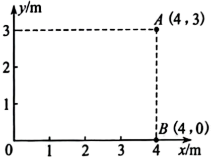

A．若波源在(0，0)处，波长可能为1m B．若波源在(0，0)处，波长可能为2m

C．若波源在(0，3)处，波长可能为3m D．若波源在(0，3)处，波长可能为4m

【答案】B

【解析】已知某时刻*A*处质点位于波峰，*B*处质点位于波谷，因此*A*、*B*两点的波程差应满足半波长的奇数倍$\Delta r = (n＋\frac{1}{2})\lambda$(*n=*0，1，2，…)

若波源在(0，0)，由坐标可推得*A*点到波源距离$r_{A} = \sqrt{4^{2}＋3^{2}}m = 5m$

*B*点到波源距离$r_{B} = 4m$

波程差$\Delta r = 1m$

代入得$1 = (n＋0.5)\lambda$

解得$\lambda = \frac{2}{2n＋1}m$

故B正确；

若波源在(0，3)，

波程差仍为$1m$，

故CD错误。

**5.** 如图，电阻$R$的阻值为$10\Omega$，电流表为理想电表，两个电池组完全相同。若将$a$、$b$端分别接入$d$、$e$端，电流表示数为$1.0\text{A}$；若将$a$、$c$端分别接入$d$、$e$端，电流表示数为$1.5\text{A}$。则单个电池组的电动势和内阻分别为(　)

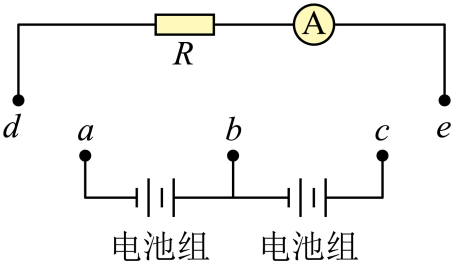

A．$15\text{V}$，$5\Omega$ B．$15\text{V}$，$10\Omega$
C．$30\text{V}$，$5\Omega$ D．$30\text{V}$，$10\Omega$

【答案】A

【解析】设单个电池组的电动势为$E$，内阻为$r$，根据闭合电路欧姆定律分两种情况列方程求解：

*a*、*b*接*d*、*e*时：只有单个电池接入电路，根据闭合电路欧姆定律：
$E = I_{1}(R + r)$

*a*、*c*接*d*、*e*时：两个电池串联，总电动势为$2E$，总内阻为$2r$，同理得：
$2E = I_{2}(R + 2r)$

联立解得：$E = 15V$，$r = 5\Omega$

故选A。

**6.** 如图，三个足够大的金属板$\text{A}$、$\text{B}$、$\text{C}$平行放置，$\text{B}$板到$\text{A}$、$\text{C}$板的距离分别为$d_{1}$、$d_{2}$，$d_{1} < d_{2}$。$a$点到$\text{A}$、$\text{B}$板的距离相等，$b$点到$\text{B}$、$\text{C}$板的距离相等。$\text{A}$、$\text{C}$板均接地，$\text{B}$板带电。关于$a$、$b$两点的电场强度$E_{a}$、$E_{b}$和电势$\varphi_{a}$、$\varphi_{b}$，下列关系正确的是(　)

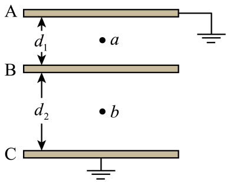

A．$E_{a} > E_{b}$ B．$E_{a} < E_{b}$
C．$\varphi_{a} > \varphi_{b}$ D．$\varphi_{a} < \varphi_{b}$

【答案】A

【解析】A、C板均接地，电势为0，B板是等势体，因此BA间、BC间的电势差相等，都等于$U = \varphi_{B}$-0=$\varphi_{B}$，平行板内部为匀强电场，电场强度满足$E = \frac{U}{d}$，已知$d_{1} < d_{2}$，故$E_{1} > E_{2}$，故A正确，B错误；

*a*点到A板的距离为$\frac{d_{1}}{2}$，电势$\varphi_{a} = E_{a} \cdot \frac{d_{1}}{2} = \frac{U}{d_{1}} \cdot \frac{d_{1}}{2} = \frac{U}{2}$

电势$\varphi_{b} = \frac{U}{2}$

因此$\varphi_{a} = \varphi_{b}$，故CD错误。

**7.** 如图，一心形玩具气球内密封一定质量的理想气体和一个充有同种气体的弹性小气球，心形气球体积始终不变。在心形气球内，小气球内部气体压强大于外部气体压强，整个系统导热良好。初始时，小气球的体积为心形气球体积的一半。当温度缓慢升高时，忽略温度变化对气球材料性质的影响，下列说法正确的是(　)


A．小气球外部气体压强不变 B．小气球内部气体分子数与外部相等

C．小气球内部气体体积不变 D．小气球内部气体体积变大

【答案】D

【解析】设心形气球总体积为$V$(恒定)，小气球体积为$V_{1}$，则外部气体体积$V_{2}$=$V_{1}$。设小气球内气体压强$p_{1}$，外部气体压强$p_{2}$，且$p_{1}$\>$p_{2}$

结合克拉伯龙方程
$pV = nRT$可知，$n_{1}$\>$n_{2}$，即小气球内部气体分子数较多，故B错误。

温度升高时，假设小气球内、外部分气体体积均不变，由查理定律：$\frac{p}{T} = \frac{\mathrm{\Delta}p}{\mathrm{\Delta}T}$，解得小气球内、外气体增加的压强$\mathrm{\Delta}p = \frac{\mathrm{\Delta}T}{T} \cdot p$，因$p_{1}$\>$p_{2}$，升高相同的温度，小气球内、外部气体的压强均增大且小气球内部气体压强增加比外部气体压强增加的多，故小气球内部气体的体积将变大，外部气体的体积将变小。故AC错误，D正确。故选D。

二、多选题

**8.** 如图，一块高功率芯片上方紧贴着一个均热板散热器。均热板是一个完全密封的扁平纯铜空腔，空腔内部注有微量的水。在正常工作过程中，水从高温芯片处吸收热量汽化，水蒸气在低温冷凝端放出热量变回液态水，并回流到底部。下列说法正确的是(　)

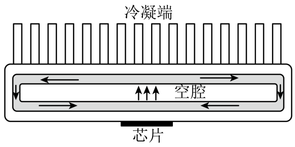

A．空腔内高温处所有水分子的运动速率都比低温处水分子的运动速率大

B．一定量的水吸收热量变成相同温度的水蒸气，内能变大

C．该均热板可以从高温物体吸热，向低温物体放热，不对外界做功

D．该均热板可以从低温物体吸热，向高温物体放热，而不产生其他影响

【答案】BC

【解析】温度是分子平均动能的统计标志，仅反映整体的平均水平，高温处仍存在速率小的水分子，低温处也存在速率大的水分子，并非所有水分子的运动速率都满足高温处大于低温处，故A错误；一定量的水变为同温度的水蒸气，温度不变则分子总动能不变。汽化过程吸收热量，且汽化后分子间距大幅增大，分子势能增加，因此总内能变大，故B正确；该过程中，均热板从高温的芯片吸热，向低温的冷凝端放热，整个过程循环进行，均热板自身状态复原，不需要对外界做功，仅依靠水传递热量，符合物理规律，故C正确；根据热力学第二定律，不可能从低温物体吸热、向高温物体放热，同时不产生其他影响，D错误。

故选BC 。

**9.** 如图，某同学将两个相同的球形氦气球用等长的轻绳系在一起，拉着绳使气球随人一起做水平匀速运动。运动过程中，球心始终在绳的延长线上且球心连线水平，两绳所构成的平面与水平面的夹角为$\theta(\theta < 90{^\circ}$)，两球间的弹力为$F$。气球受到空气阻力的大小与相对空气的速率成正比，空气始终相对于地面静止，忽略气球形状的变化。该同学沿原方向运动速度缓慢增大，下列说法正确的是(　)


A．$\theta$增大 B．$\theta$减小 C．$F$增大 D．$F$减小

【答案】BC

【解析】根据题意，设每根绳子的拉力为$F_{T}$，两根绳子之间的夹角为$2\alpha$，每个气球受到空气阻力$f = kv$，浮力为$F_{浮}$，对整体受力分析，由平衡条件，竖直方向上有$2F_{浮} = 2G + 2F_{T}\cos\alpha\sin\theta$,水平方向上有$2kv = 2F_{T}\cos\alpha\cos\theta$,整理可得$\tan\theta = \frac{F_{浮} - G}{kv}$

运动速度缓慢增大，$\tan\theta$减小，则$\theta$减小，$T$增大，故A错误，B正确；

对单个气球受力分析，由平衡条件有$T\sin\alpha = F$,由于$\alpha$不变，$T$增大，则$F$增大，故C正确，D错误。故选BC。

**10.** 某小组设计了一磁悬浮装置。如图，环形通电线圈固定在水平面上，其上方固定一半径为$R$的环形细管道，管道任意处磁场方向与竖直方向夹角为$45{^\circ}$。质量为$m$的带正电小球在环形管道中以某一速率做匀速圆周运动，此时小球与管道间无弹力，重力加速度为$g$。下列说法正确的是(　)

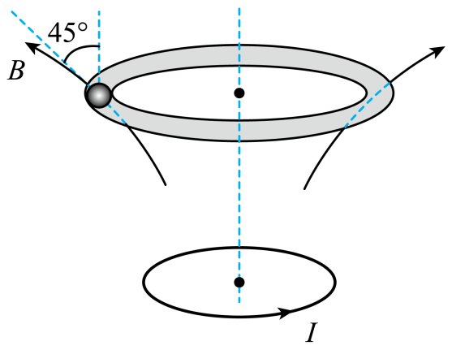

A．从管道上方俯视，小球沿顺时针方向做圆周运动

B．小球做圆周运动的周期为$\pi\sqrt{\frac{R}{g}}$

C．小球做圆周运动的半个周期内洛伦兹力的冲量大小为$m\sqrt{\left( 2 + \pi^{2} \right)gR}$

D．若小球的绕行方向不变，速率为其做匀速圆周运动速率的2倍，则小球与管道间的弹力大小为$\sqrt{5}mg$

【答案】AD

【解析】根据题意可知，小球所受洛伦兹力的水平分力提供小球做圆周运动的向心力，由左手定则可知，从管道上方俯视，小球沿顺时针方向做圆周运动，故A正确；

设磁感应强度为$B$，小球的速度为$v$，此时小球与管道间无弹力，竖直方向上有$mg = qvBcos45{^\circ}$,水平方向上有$qvBsin45{^\circ} = m\frac{v^{2}}{R}$,解得$v = \sqrt{gR}$则小球做圆周运动的周期为$T = \frac{2\pi R}{v} = 2\pi\sqrt{\frac{R}{g}}$，故B错误；根据题意，水平方向上，由动量定理有$I_{x} = \Delta p = - mv - mv = - 2m\sqrt{gR}$

竖直方向有$I_{y} = qvBcos45{^\circ} \cdot \frac{T}{2} = mg \cdot \frac{T}{2} = m\pi\sqrt{gR}$

则小球做圆周运动的半个周期内洛伦兹力的冲量大小为$I = \sqrt{I_{x}^{2} + I_{y}^{2}} = m\sqrt{\left( 4 + \pi^{2} \right)gR}$，故C错误；

若小球的绕行方向不变，速率为其做匀速圆周运动速率的2倍，竖直方向上有$mg + F_{\text{N}y} = q \cdot 2vBcos45{^\circ}$,水平方向上有$q \cdot 2vBsin45{^\circ} + F_{\text{N}x} = m\frac{(2v)^{2}}{R}$

小球与管道间的弹力大小$F_{\text{N}} = \sqrt{F_{Ny}^{2} + F_{Nx}^{2}}$,联立解得$F_{\text{N}} = \sqrt{5}mg$，故D正确。

故选AD。

三、实验题

**11.** 某同学借助视频分析软件进行“用单摆测量重力加速度”的实验，步骤如下：

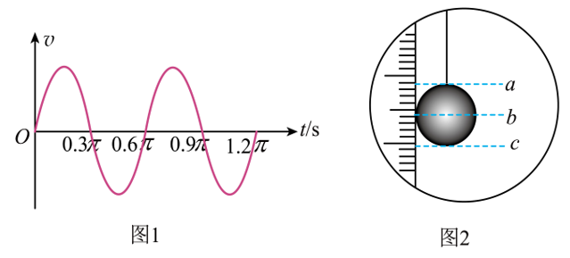

(1)准备好单摆，用支架将手机竖直放置。

(2)打开手机录像，将单摆拉离平衡位置$4{^\circ}$摆角由静止释放。

(3)将录制的视频导入软件进行分析，得到摆球的$v - t$图像，拟合后如图1所示，可知此单摆的周期$T$为\_\_\_\_\_\_$\text{s}$。

(4)如图2，用刻度尺测量单摆摆长，该同学将刻度尺竖直放置，刻度尺0刻度线与单摆悬点对齐，读出\_\_\_\_\_\_(填“$a$”“$b$”或“$c$”)位置的读数，该读数即为摆长$l$。

(5)重力加速度$g =$\_\_\_\_\_\_(用题中给出的字母“$T$”和“$l$”表示)。

(6)该同学发现所得实验结果小于当地重力加速度，可能的原因是刻度尺0刻度线\_\_\_\_\_\_(填“高于”或“低于”)悬点。

【答案】(3)$0.6\pi$(4)$b$　(5)
$\frac{4\pi^{2}l}{T^{2}}$　(6)高于

【解析】(3)图1可知，单摆的周期$T$为$0.6\pi\text{s}$。

(4)如图2，用刻度尺测量单摆摆长，该同学将刻度尺竖直放置，刻度尺0刻度线与单摆悬点对齐，应读出球心所在位置的读数，即$b$位置的读数，该读数即为摆长$l$。

(5)由单摆周期公式$T = 2\pi\sqrt{\frac{l}{g}}$可得重力加速度$g = \frac{4\pi^{2}l}{T^{2}}$

(6)若该同学发现所得实验结果小于当地重力加速度，可知摆长测量值偏小，即刻度尺0刻度线高于悬点。

**12.** 某探究小组用霍尔元件设计了一个测量微小位移的实验装置。

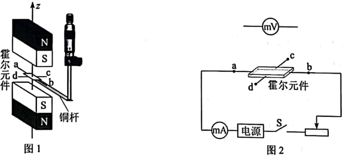

(1)将螺旋测微器通过铜杆连接霍尔元件。霍尔元件伸入两块磁感应强度相同、同极相对放置的磁体间隙中，并处于两磁体中心竖直线上。以中心竖直线为$z$轴，其示意图如图1所示；霍尔元件上的导线与外部工作电路连接，其示意图如图2所示。

(2)将电压表接在霍尔元件的\_\_\_\_\_\_\_(填“$a$、$b$”或“$c$、$d$”)两端，闭合开关$\text{S}$，测量其霍尔电压，电压表指针如图3所示，此时电压为\_\_\_\_\_\_\_$\text{mV}$。

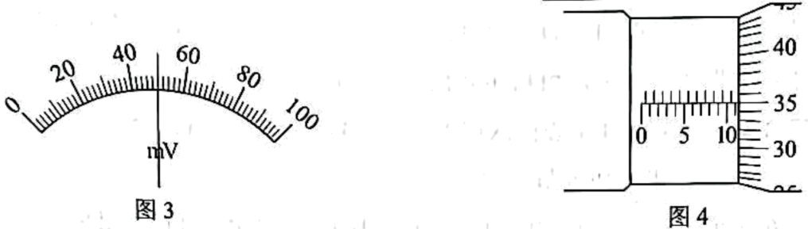

(3)旋转螺旋测微器的旋钮，使霍尔元件沿$z$轴移动至霍尔电压为0处，该处磁感应强度为0，此时的螺旋测微器读数如图4所示，该读数为\_\_\_\_\_\_\_$\text{mm}$。

(4)保持电流不变，旋转螺旋测微器的旋钮，读出霍尔元件在不同位置的霍尔电压，得到10组数据如下表所示。

|     |                     |                     |
|:----|:--------------------|:--------------------|
|     |                     
       ``` math             
       \frac{z}{\text{mm}}  
       ```                  |                     
                             ``` math             
                             \frac{U}{\text{mV}}  
                             ```                  |
| 1   | 11.670              | 9                   |
| 2   | 11.960              | 16                  |
| 3   | 12.302              | 25                  |
| 4   | 12.633              | 35                  |
| 5   | 12.952              | 42                  |
| 6   | 13.270              | 48                  |
| 7   | 13.594              | 57                  |
| 8   | 13.930              | 67                  |
| 9   | 14.246              | 74                  |
| 10  | 14.585              | 81                  |

(5)在图5中描出第4、5组测量数据的坐标点，并作出$z - U$图像。\_\_\_\_\_\_\_

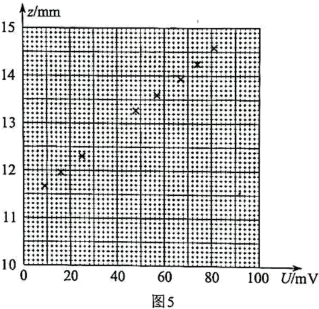

(6)用此装置测量微小位移。取下螺旋测微器，将待测物体与铜杆连接，待测物体在$z$轴方向移动，其位移与霍尔元件的位移相等。某次测量中待测物体移动前电压表示数为$20\text{mV}$，移动后电压表示数为$60\text{mV}$，根据图像，此过程中物体位移的大小为\_\_\_\_\_\_\_$\text{mm}$(保留2位小数)。

【答案】(2)$c$、$d$　50　$(3)11.350$/$11.349$/$11.351$

\(5\) 见解析　(6)$1.55$

【解析】(2)由霍尔效应原理可知，霍尔电压会出现在垂直电流和磁场方向上，结合图2可知，将电压表接在霍尔元件的$c$、$d$两端。

由图3可知，电压表的最小刻度为$2\text{mV}$，则此时电压为$50\text{mV}$。

(3)图4中螺旋测微器读数为$11\text{mm} + 35.0 \times 0.01\text{mm} = \text{11.350mm}$。

(5)根据表格中数据，在图5中描出第4、5组测量数据的坐标点，并作出$z - U$图像，如图所示

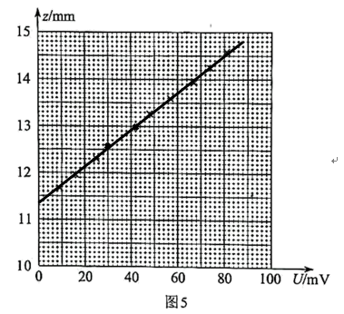

(6)根据图像可知，电压表示数为$20\text{mV}$时，有$z_{1} = 12.15\text{mm}$，移动后电压表示数为$60\text{mV}$时，有$z_{2} = 13.70\text{mm}$，则此过程中物体位移的大小为$z = z_{2} - z_{1} = 1.55\text{mm}$。

四、解答题

**13.** 车载摄像头需要有较大的拍摄角度。一摄像头由于结构限制，拍摄角度为$120{^\circ}$。如图，将摄像头嵌入均匀透明介质，介质截面为矩形。只考虑该截面内光线传播情况，通过空气与介质间界面的折射，可将实际拍摄角度扩大。

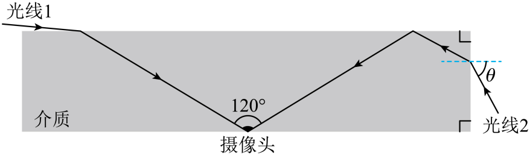

(1)若希望几乎贴着介质表面入射的光线1能够以图示路径恰好射入摄像头，即拍摄角度扩大为$180{^\circ}$，求介质的折射率；

(2)若介质折射率为1.8，从侧后方向入射的光线2能够以图示路径折射之后发生一次全反射，然后恰好射入摄像头，求光线2的入射角$\theta$的正弦值。

【答案】(1)$\frac{2\sqrt{3}}{3}$　(2)$0.9$

【解析】(1)如图所示

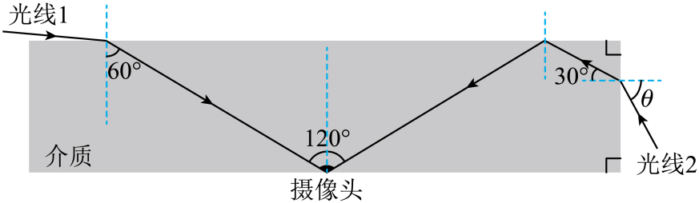

根据几何关系可知光线1的入射角为90°，折射角为$60{^\circ}$，可得$n = \frac{sin90{^\circ}}{sin60{^\circ}} = \frac{2\sqrt{3}}{3}$

(2)根据几何关系可得光线2在玻璃砖中的折射角为$\beta = 30{^\circ}$

根据折射定律$n' = \frac{\sin\theta}{\sin\beta}$

其中$n' = 1.8$

解得$\sin\theta = 0.9$

**14.** 某小组制作了一储能器，其两端电压$U$与其储存的电荷量$q$间的函数关系近似为$U = kq(k$为常量)。将该储能器接入如图所示电路，$a$、$b$、$c$为固定的三个触点。两足够长的平行金属导轨固定于水平面上，电阻不计，间距为$L$。导轨间有竖直向下的匀强磁场，磁感应强度为$B$。质量为$m$的导体棒垂直导轨放置，接入电路的阻值为$r$。电源电动势为$E$，内阻不计。定值电阻阻值为$R$。$t_{0}$时刻开关S与$a$连接，直到导体棒做匀速运动，再于$t_{1}$时刻切换开关与$b$或$c$连接。运动过程中导体棒与导轨始终垂直且接触良好，忽略摩擦。

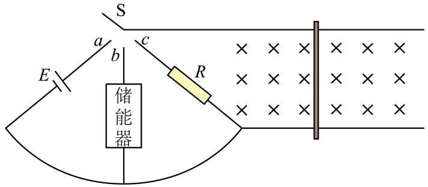

(1)求$t_{0}$时刻导体棒加速度$a_{0}$的大小；

(2)若$t_{1}$时刻开关与$b$连接，储能器接入电路前电压为0，当储能器电压为$U_{0}$时(此时电路中电流不为0)，求导体棒速度$v$的大小；

(3)若$t_{1}$时刻开关与$c$连接，求从$t_{0}$时刻起到导体棒静止的过程中，导体棒上产生的焦耳热$Q$。

【答案】(1)$a_{0} = \frac{BEL}{mr}$　(2)$v = \frac{E}{BL} - \frac{BLU_{0}}{mk}$　(3)$Q = \frac{(R + 2r)mE^{2}}{2(R + r)B^{2}L^{2}}$

【解析】(1)$t_{0}$时刻开关S与$a$连接，流过导体棒的电流$I = \frac{E}{r}$

导体棒所受的安培力$F = BIL$

根据牛顿第二定律$F = ma_{0}$

联立可得$a_{0} = \frac{BEL}{mr}$

(2)当导体棒匀速运动时，导体棒产生的电动势等于电源电动势，设此时导体棒速度为$v_{0}$，即$E = BLv_{0}$

当储能器电压为$U_{0}$时，

对导体棒根据动量定理有$- \sum BIL \cdot t = mv - mv_{0}$

又$q = \sum I \cdot t$

可得$- BLq = mv - mv_{0}$

根据题意$U = kq$

联立可得$v = \frac{E}{BL} - \frac{BLU_{0}}{mk}$

(3)从$t_{0}\sim t_{1}$过程对导体棒，根据动量定理$B\overset{-}{I}L \cdot t = mv_{0}$

又$q_{1} = \overset{-}{I} \cdot t$

可得$q_{1} = \frac{mE}{B^{2}L^{2}}$

设导体棒上产生的焦耳热$Q_{1}$，由能量守恒可得$q_{1}E = Q_{1} + \frac{1}{2}mv_{0}^{2}$

解得$Q_{1} = \frac{mE^{2}}{2B^{2}L^{2}}$

从$t_{1}$时刻到导体棒静止过程中，根据能量守恒定律可知电路中产生的焦耳热为$Q_{总} = \frac{1}{2}mv_{0}^{2}$

导体棒产生的焦耳热为$Q_{2} = \frac{r}{R + r} \cdot Q_{总}$

可得$Q_{2} = \frac{mrE^{2}}{2(R + r)B^{2}L^{2}}$

``` math
故Q = Q_{1} + Q_{2} = \frac{(R + 2r)mE^{2}}{2(R + r)B^{2}L^{2}}
```

**15.** 如图，长为$L$的轻杆竖直放置，上端固定一质量为$m$的小球，下端连接于水平地面上某固定点，杆可绕该点无摩擦转动。小球内部安装了质量不计的智能弹射装置。受轻微扰动后，小球和杆从静止开始一起运动，当两者间弹力为0时，小球脱离轻杆，重力加速度为$g$，不计空气阻力。


(1)求小球接触地面瞬间的速度$v$的大小；

(2)求小球接触地面瞬间的速度与水平面夹角$\alpha$的正切值；

(3)小球与地面碰撞前后，竖直方向分速度大小相等、方向相反，水平方向分速度相等。碰撞后瞬间，智能弹射装置工作，小球在极短时间内分裂成两部分，两部分速度方向均与小球分裂前瞬间的速度方向成$\theta$角($\theta$已知，且$0 < \theta < \alpha$)。设两部分质量之比为$k$，弹射装置释放的能量为$E$。

(i)求$E$与$k$的关系；

(ii)当$E$最小时，若分裂后两部分第一次落地时刻相同，求两部分第一次落地点的间距$d$。

【答案】(1)$v = \sqrt{2gL}$

(2)$\tan\alpha = \frac{\sqrt{23}}{2}$

(3)(i)$E = \lbrack\frac{{(1 + k)}^{2}}{4k\cos^{2}\theta} - 1\rbrack mgL$；(ii)$d = \frac{8}{9}\sqrt{69}L\tan\theta$

【详解】(1)根据机械能守恒定律有$mgL = \frac{1}{2}mv^{2}$

解得小球接触地面瞬间的速度的大小$v = \sqrt{2gL}$

(2)设小球脱离轻杆时，轻杆与竖直方向的夹角为$\beta$，如图所示

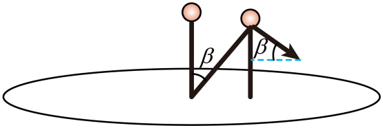

设此时小球的速度为$v_{1}$，根据机械能守恒定律$mgL(1 - \cos\beta) = \frac{1}{2}mv_{1}^{2}$

对小球，根据牛顿第二定律$mg\cos\beta = m\frac{v_{1}^{2}}{L}$

解得$\cos\beta = \frac{2}{3}$，$v_{1} = \sqrt{\frac{2gL}{3}}$

此时小球水平方向分速度$v_{x1} = v_{1}\cos\beta$

竖直方向分速度$v_{y1} = v_{1}\sin\beta$

竖直方向，根据速度位移关系$v_{y}^{2} - v_{y1}^{2} = 2g \cdot L\cos\beta$

小球接触地面瞬间的速度与水平面夹角$\alpha$的正切值$\tan\alpha = \frac{v_{y}}{v_{x1}}$

联立解得$\tan\alpha = \frac{\sqrt{23}}{2}$

(3)(i)设其中一部分的质量为$m_{0}$，则另一部分质量为$km_{0}$，如图所示

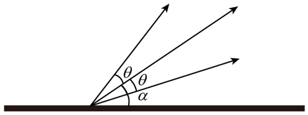

根据动量守恒定律有$km_{0}v_{2}\sin\theta = m_{0}v_{3}\sin\theta$，$km_{0}v_{2}\cos\theta + m_{0}v_{3}\cos\theta = mv$

弹射装置释放的能量$E = \frac{1}{2}km_{0}v_{2}^{2} + \frac{1}{2}m_{0}v_{3}^{2} - \frac{1}{2}mv^{2}$

联立可得$E = \lbrack\frac{{(1 + k)}^{2}}{4k\cos^{2}\theta} - 1\rbrack mgL$

(ii)根据数学知识可知，当$k = 1$时，$E$最小为$E_{\min} = mgL\tan^{2}\theta$

即有$m_{0}v_{2}\sin\theta = m_{0}v_{3}\sin\theta$，$m_{0}v_{2}\cos\theta + m_{0}v_{3}\cos\theta = mv$，$E_{\min} = \frac{1}{2}m_{0}v_{2}^{2} + \frac{1}{2}m_{0}v_{3}^{2} - \frac{1}{2}mv^{2}$

两小球同时落地，运动时间为$t = 2 \cdot \frac{v_{2}\sin\alpha}{g} = 2 \cdot \frac{v_{3}\sin\alpha}{g}$

可得$\left| v_{3} \right| = \left| v_{2} \right|$

两小球的距离$d = 2v_{2}\sin\theta \cdot t$

由$\tan\alpha = \frac{\sqrt{23}}{2}$可得$\sin\alpha = \sqrt{\frac{23}{27}}$

联立可得$d = \frac{8}{9}\sqrt{69}L\tan\theta$
